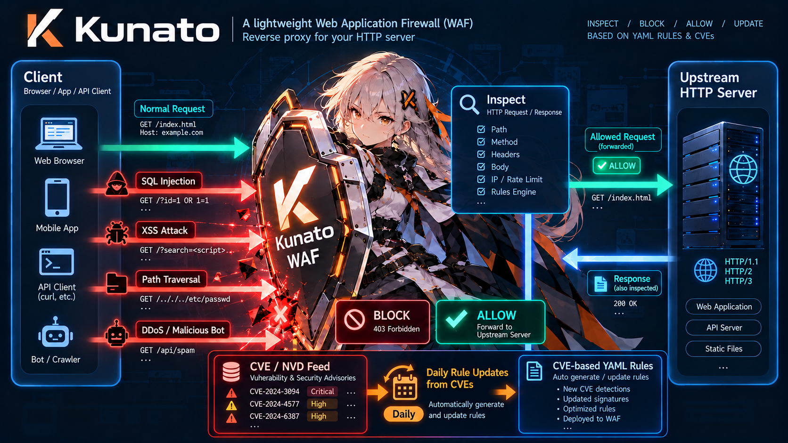

# Kunato

[](https://github.com/hiroeorz/kunato/actions/workflows/ci.yml)

[English](README.md) | **日本語**

**個人サーバーや小規模環境向けに設計された、単一バイナリで動くセルフホスト型 Rust 製 Web Application Firewall (WAF)。**


Kunato は Web アプリケーションの前段でリバースプロキシとして動作し、カテゴリ分けされた YAML ルールに基づいてリクエストとレスポンスを検査して **BLOCK**・**ALLOW**・**LOG** を適用します。さらに DoS / DDoS やブルートフォース攻撃を自動的に緩和し、毎日の CVE ルール自動更新によって最新の脅威に対応し続けます。

> **ステータス:** 初期開発段階です。設定フォーマットや公開インターフェースはまだ安定しておらず、予告なく変更される場合があります。

---

## コンセプト：なぜ Kunato なのか？

従来の WAF 環境では、有償のクラウドサービスを利用するか、Web サーバーモジュール・外部の証明書管理ツール・ログパーサー・cron ジョブといった複雑なスタックを組み合わせる必要がありました。Kunato はよりシンプルな前提に基づいて設計されています。**「個人サーバーやセルフホスト環境の保護は、1つのバイナリと1つの YAML ファイルだけで完結すべきである」**という考え方です。

| 設計の柱 | 実際のメリット |
| --- | --- |
| **1バイナリ・外部サービス不要** | リバースプロキシ、WAF ルールエンジン、Let's Encrypt (ACME) 自動 TLS 証明書、DoS / DDoS 防御、日次ルールアップデータ、運用 CLI がすべて1つの静的リンクされた Rust バイナリに収まっています。データベース、Redis、`certbot`、cron ジョブは一切不要です。 |
| **手間いらずの日常保護** | 同梱のルールセットは新たに悪用が確認された CVE のシグネチャを取り込んで1日1回自動更新されます。さらに内蔵のレート制限・接続数バジェット・振る舞い検知により、フラッド攻撃や探索（プロービング）を設定なしに初期状態から防ぎます。 |
| **読みやすい YAML とホットリロード** | ルールは明快なカテゴリ（`sql-injection`、`xss`、`response-leaks` など）ごとに整理され、`ALLOW`・`BLOCK`・`LOG` アクションを持ちます。設定の変更はプロセス再起動やコネクション切断なしに実行中に即座に反映されます。 |
| **フェイルセーフ設計** | すべてのバッファと IP ごとの状態には上限が設けられ、正規表現はロード時に ReDoS ガード付きで一度だけコンパイルされます。不正な設定のリロードやルール更新の失敗時には、直前の正常な設定を安全に維持し続けます。 |



## 特徴 (Features)

### リバースプロキシ・TLS・プロトコル
- **リバースプロキシ** — ブラウザやアプリと HTTP サーバーの間に立ち、すべてのリクエストを検査しながらトラフィックを転送します。
- **Host 許可リスト (`allowed_hosts`)** — Host ヘッダまたは `:authority` が欠落・不正な場合や `allowed_hosts` に含まれていない場合、ルール評価の前に `400`/`421` で拒否します。インストーラは `--acme-domain` からリストを自動生成します。他のホスト名や IP は `--allowed-host` で追加できます。
- **HTTP/2、HTTP/3、HTTP/1.1 対応** — TLS 上の HTTP/2 (ALPN) および平文の h2c (prior knowledge)、さらにオプションで QUIC 上の HTTP/3 を受け付け、自動的に HTTP/1.1 へフォールバックします。アップストリームへのリクエストは HTTP/1.1 で送信されます。
- **自動 TLS 証明書 (Let's Encrypt)** — ACME プロトコル（HTTPS ポート上の TLS-ALPN-01）を介して Let's Encrypt 証明書を直接取得・更新します。`certbot` などの外部ツール、cron ジョブ、デプロイフックは不要です。`tls.acme` にドメインを列挙するだけで、発行・更新・無停止ローテーション・再起動間のローカルキャッシュまで Kunato がすべて処理します。
- **WebSocket プロキシ** — HTTP/1.1 の Upgrade ハンドシェイクをアップストリームへ転送し、双方向のトンネルを確立します。ハンドシェイクはルールエンジンと保護バジェットを通過し、アイドル状態のトンネルは自動的に閉じられます。
- **信頼されたプロキシ (Trusted Proxy) 対応** — 明示的に信頼したプロキシ IP/CIDR (`client_ip`) からクライアント IP を解決し、CDN やロードバランサ配下でもルール評価・リクエスト制限・振る舞い検知による BAN を正確に行います。[デプロイメントチェックリスト](docs/behavioral-readiness.md)を参照してください。

### 脅威検知・ディープインスペクション
- **カテゴリ別ルールセット** — ルールは名前付きカテゴリ（例：`sql-injection`、`xss`）にグループ化されます。各カテゴリでデフォルトのアクションを定義し、個別のルールで上書きできます。
- **日次 CVE ルール自動更新** — オプションのアップデータが、最新の悪用 CVE シグネチャを含むマネージドルールセットを1日1回自動更新します。条件付きリクエスト、SHA256 検証、完全なバリデーションを経てアトミックに切り替えられます。
- **エンコード済みボディの検査** — gzip、deflate、brotli、zstd で圧縮されたボディを展開してマッチングを行い、さらにリクエストボディは Content-Type に応じて（`application/x-www-form-urlencoded` や JSON エスケープを）デコードして検査します。転送される元のトラフィック自体は一切改変されません。
- **アップロードコンテンツ検査** — `multipart/form-data` のファイルパートについて、申告された MIME タイプ・ファイル拡張子・先頭バイト（マジックバイト）を照合します。画像、PDF、Office 文書、メディア、フォントを装ったパートはそのフォーマットのシグネチャで始まっていなければならず、`.jpg` や `.pdf` にリネームされたソースコード、安全なファイル形式を装った実行ファイル・スクリプト・マークアップ、PHP ショートタグ、実行可能パスへの生データの書き込みを拒否します。`strict` モードでは汎用バイナリ申告も検査対象になります。
- **レスポンス検査** — レスポンスフェーズ (`phase: response`) のカテゴリにより、アップストリームのレスポンスのステータス・ヘッダ・ボディ（サイズ上限まで）を検査し、ブロック・ログ記録・通過を制御できます。上限を超える巨大なレスポンスの残りの部分はそのままストリーミングされます。
- **レスポンスヘッダの書き換え** — アップストリームのレスポンスおよび Kunato 自身が返すブロック／エラーレスポンスの両方から、`Server` や `X-Powered-By` などの識別ヘッダを削除または置換します。

### DoS / DDoS 防御・振る舞い検知
- **DoS / DDoS 検知と自動緩和** — 異常なリクエストパターンを検知し、悪質な送信元を自動的にスロットリングまたはブロック（BAN）します。
- **振る舞いによる不正利用検知 (Behavioral Abuse Detection)** — アップストリームのレスポンスを送信元ごとの時間窓で集計し、反復的な `404` パス探索（列挙攻撃）や認証失敗のバーストを検知します。またグローバルな時間窓で分散型の認証失敗を記録します。サンプル設定ではパス列挙をブロックし、認証シグナルは観察（LOG）モードとしていますが、シグナルごとに `BLOCK` へ設定可能です。

### 運用性・高信頼性
- **YAML ルールとホットリロード** — ルールは YAML で記述します。ルールファイルの変更は実行中に検知され、プロセスの再起動やコネクションの切断なしに即座にリロードされます。
- **高い耐障害性 (Fault Tolerance)** — 設定ミスがあっても直前の正常な設定（Last Known Good）で稼働を続け、障害を分離し、リロード中もトラフィックを止めません。
- **ガイド付きインストーラ** — Linux サーバー上で `curl | sudo sh` の1コマンドを実行するだけで、静的バイナリ、systemd サービス、設定ファイル、初期ルールセットのインストールが完了します。
- **シンプルなデプロイ** — 1つのバイナリと1つの YAML 設定ファイルだけで動作します。データベースも外部サービスも複雑なセットアップも不要です。
- **Rust 実装** — ランタイム依存のない単一の静的バイナリにより、メモリ安全性と予測可能なパフォーマンスを提供します。

## 仕組み (How It Works)

```text
                 inspect & apply rules
Client ──────►  ┌───────────────────┐  ──────►  Upstream HTTP server
(browser/app)   │  Kunato (WAF)     │
                │  reverse proxy    │  ◄──────  (response)
                └───────────────────┘
```

1. リクエストが Kunato に到着します。
2. `allowed_hosts` が設定されている場合、最初に Host / `:authority` が検査されます。欠落・形式不正・未登録のホスト名は `400`/`421` で拒否されます。
3. 設定ファイルに記述された順序でカテゴリが評価され、各カテゴリ内のルールも記述順に評価されます。
4. すべての条件に一致した最初のルールについて、その有効アクションが適用されます：
   - `ALLOW` — リクエストをアップストリームへ転送し、それ以降のルール評価を終了します。
   - `BLOCK` — リクエストを即座に拒否します（デフォルト：`403 Forbidden`）。
   - `LOG` — 一致をログに記録し、後続のルール評価を続行します。
5. どのルールにも一致しなかった場合、リクエストはアップストリームへ転送されます（パススルー）。
6. アップストリームからのレスポンスに対しても、レスポンスフェーズのカテゴリが同様に実行されます。`BLOCK` はアップストリームのレスポンスを設定されたレスポンスに置き換え、`ALLOW` はレスポンス評価を終了してレスポンスをそのまま通過させます。

## はじめに (Getting Started)

### 1. Linux サーバーへのインストール

Kunato は Linux 向けの単一静的バイナリとして配布されています。systemd を備えたサーバーでは、以下の1コマンドでバイナリ・サービス・設定ファイル・初期ルールセットをインストールし、自動取得した Let's Encrypt 証明書による TLS 終端を開始できます：

```sh
curl -fsSL https://raw.githubusercontent.com/hiroeorz/kunato/main/scripts/install.sh \
  | sudo sh -s -- \
      --upstream http://127.0.0.1:8080 \
      --acme-domain example.com \
      --acme-contact admin@example.com \
      --yes
```

`--upstream` には保護対象の Web サーバーを、`--acme-domain` と `--acme-contact` にはこのサーバーに名前解決される DNS 名と Let's Encrypt の有効期限通知用メールアドレスを指定してください。自動証明書の取得にはインターネットから TCP ポート 443 へ到達できる必要があるため、ワイルドカード証明書や TLS 終端を行う CDN／プロキシ配下の環境では証明書を手動で管理してください（全オプションの一覧は [Deployment](docs/development.md#deployment) を参照）。

`--acme-domain` で指定した名前は `allowed_hosts` にも書き込まれるため、それ以外の Host ヘッダを持つリクエストは `421` で拒否されます。ヘルスチェックなどで別のホスト名や IP アドレスから Kunato にアクセスする場合は、`--allowed-host` で追加するか `/etc/kunato/kunato.yaml` を編集してください（[Host allowlist](docs/development.md#host-allowlist) を参照）。

サービスは自動的に起動します。初回起動時はバックグラウンドで証明書を発注するため、TLS が有効になるまで数秒待ってください。インストールまたは `kunato upgrade` が成功するとカラーのマスコットバナーが表示されます。インストーラの `--no-banner`（または `KUNATO_NO_BANNER`）で非表示にでき、`NO_COLOR` で色なし表示になります。

### 2. ステータス・ログ・メトリクスの確認

サービスの稼働確認、トラフィックやメトリクスの検査、設定の検証はいつでも以下のコマンドで行えます：

```sh
systemctl status kunato
sudo kunato log -n 50
kunato metrics                       # :9090 からメトリクス表を表示
kunato banner                        # マスコットバナーを再表示
sudo kunato validate
```

`kunato log` は systemd ジャーナルを読み取り、構造化フィルタを提供します：

```sh
sudo kunato log -f                                  # 新着ログをリアルタイム表示
sudo kunato log --ip 203.0.113.9 --since '1 hour ago'
sudo kunato log --attack sqli --action BLOCK
sudo kunato log --status 429 --format table         # 集約された 429 イベントを表形式で表示
sudo kunato log --attack cve-2025 --format json | jq .
```

`--attack` には `kunato log --list-attacks` で一覧表示されるカテゴリベースの攻撃クラスを指定でき、`--category` と `--rule` では正確な名前を指定できます。レート制限や BAN による拒否は送信元ごとに `suppressed` カウント付きで集約されるため（新規 BAN は即座に出力されます）、フラッド攻撃の最中でもジャーナルが埋め尽くされず `--ip` での調査が容易です。

`kunato metrics` は Prometheus の `# HELP` や `# TYPE` 行を省き、メトリクス名と値を右揃えにした罫線付きの表形式で出力します（タイムスタンプのゲージにはローカル日時も付記されます）。管理リスナーが別のループバックアドレスを使用している場合は `--listen <ADDR>` を渡してください。

### 3. 設定とルールのカスタマイズ

プロキシ設定の調整や独自ルールの追加は `/etc/kunato/kunato.yaml` を編集します。変更は自動検知され、再起動なしでホットリロードされます：

```yaml
listen: 0.0.0.0:443
upstream: http://127.0.0.1:8080

allowed_hosts:
  - example.com

tls:
  acme:
    enabled: true
    domains:
      - example.com
    contact: admin@example.com

# Local rules evaluated after overrides_file and before the managed rules_file:
categories:
  - name: local-allowlist
    action: ALLOW
    rules:
      - name: office-network
        match: { source_ip: 203.0.113.10/32 }

  - name: local-policy
    action: BLOCK
    rules:
      - name: block-legacy-admin
        match: { path: '^/old-admin(/|$)' }
      - name: log-suspicious-param
        action: LOG
        match: { regex: '(?i)(?:^|&)debug=1(?:&|$)', in: [query] }

# Managed rule set refreshed daily by rules_update:
rules_file: /var/lib/kunato/rules.yaml
```

ルールは **`overrides_file`**（設定時） → **インラインの `categories`** → **`rules_file`**（マネージドルールセット）の順に評価されます。設定スキーマとルール構文の詳細は[開発ガイド](docs/development.md)を参照してください。

### 4. アップグレードとアンインストール

インストール済みサーバー（Kunato v0.3.2 以降）のアップグレードには組み込みコマンドを使用します。対象リリースのインストーラが再実行されます：

```sh
sudo kunato upgrade                    # 最新リリースへアップグレード
sudo kunato upgrade --version v0.4.0   # 特定のリリースを指定
sudo kunato upgrade --dry-run          # 実行内容の確認のみ
```

既存の設定ファイル（`allowed_hosts` が未設定の場合も含む）はそのまま保持されます。ホスト検証を有効にするには既存ファイルにフィールドを追加してください。インストーラを直接再実行した場合も同様に、設定を保持したままバイナリとユニットを更新してサービスを再起動します。`--uninstall` を渡すとそれらを削除します。インストール後に自動更新される内容については[マネージドルールと自動更新](#マネージドルールと自動更新-managed-rules-and-automatic-updates)を、インストーラの詳細やソースからのビルドについては [Deployment](docs/development.md#deployment) を参照してください。

### 5. ローカルで試す（ソースから実行）

systemd サービスをインストールせずに手元で Kunato を試すには、同梱のサンプルアップストリームサーバーを起動し、`rules.example.yaml` を指定して Kunato を実行します：

```sh
cargo run --example upstream -- --listen 127.0.0.1:3000
cargo run -- --config rules.example.yaml
```

その後、`http://127.0.0.1:8080/` にリクエストを送信してください（ローカルからブロックルールを試す場合は、`rules.example.yaml` の `trusted-sources` から `127.0.0.1/32` を除外してください）。

### 6. リリースとルールの署名（メンテナー向け）

署名が必要なのは配布物を作るときだけです。インストール済みのバイナリは埋め込み鍵で署名を検証するため、利用者が `minisign` を入れる必要はありません。

```sh
sudo apt-get update
sudo apt-get install -y minisign
./scripts/generate-signing-keys.sh
```

表示された公開鍵を `src/trust.rs` に貼り付けたあと、`./scripts/sign-artifact.sh KEY FILE` でルールセットやリリース資産に署名します。鍵の保管・ローテーション・残る信頼境界は [Release and rules signing](docs/release-signing.md) を参照してください。

## CLI コマンド早見表 (CLI at a Glance)

| コマンド | 説明 |
| --- | --- |
| `kunato --config <PATH>` | WAF リバースプロキシサーバーを起動します（デフォルト：`/etc/kunato/kunato.yaml`）。 |
| `kunato init --upstream <URL>` | スターター設定ファイルを生成します。 |
| `kunato validate` | 設定ファイル、マネージド `rules_file`、および `overrides_file` を検証します。 |
| `kunato log [OPTIONS]` | systemd ジャーナルから Kunato のセキュリティイベントを検索・フィルタリングします。 |
| `kunato metrics` | ループバック管理リスナー (`127.0.0.1:9090`) から Prometheus メトリクスを表形式で表示します。 |
| `kunato update-rules` | 最新のマネージドルールセットのチェック・検証・適用を1回実行します。 |
| `kunato upgrade` | 設定を保持したまま、インストール済みバイナリと systemd ユニットをアップグレードします。 |
| `kunato banner` | カラーのマスコットバナーをターミナルに表示します。 |

<a id="managed-rules-and-automatic-updates"></a>
## マネージドルールと自動更新 (Managed Rules and Automatic Updates)

インストーラは `rules_update` を有効化するため、手作業なしでルールセットが常に最新に保たれます。`interval`（デフォルト `24h`、`jitter_percent` によりデフォルト ±10% ランダム化）ごとに Kunato は以下を実行します：

1. 条件付きリクエスト（`If-None-Match` / `If-Modified-Since`）を送信し、`304 Not Modified` の場合は即座に終了します。
2. ルールファイルをダウンロードし、`checksum_url` と照合して SHA256 ダイジェストを検証します。
3. ファイルをパースし、正規表現のコンパイル・ReDoS ガード・アクション解決・サイズ上限などを含めて完全にバリデーションします。
4. ファイルをアトミックに入れ替え、設定ウォッチャーがホットリロードします。

ネットワークエラー、チェックサム不一致、不正なルール、サイズ上限超過など、いかなる失敗が発生しても現在のルールがそのまま維持されます。失敗はログに記録されて `kunato_rules_update_*` メトリクスにカウントされ、より新しいビルドのバイナリを必要とするルールセットは `kunato_rules_update_incompatible_total` に別途カウントされます（[Rule set format compatibility](docs/development.md#rule-set-format-compatibility) を参照）。全フィールドのリファレンスは [Rule sources and updates](docs/development.md#rule-sources-and-updates) にあります。

更新は自動で行われるため、通常は手動確認の必要はありません。次の更新間隔を待たずに最新のルールセットを即座に適用したい場合は、以下を実行します：

```sh
sudo kunato update-rules
```

このコマンドは1回だけチェックを行って終了します（インストーラが初回ダウンロードに使用するコマンドと同じです）。

ローカルの変更が上書きされることは決してありません。例外許可 (`ALLOW`) やルールの無効化 (`disabled_rules`) は、マネージドセットより先に評価される `overrides_file`（設定時は `/etc/kunato/overrides.yaml`）に記述します。アップデータが書き込むのはマネージドルールファイルの1ファイルのみであり、それ以外のファイルには一切触れられません。

### インストールされるファイルとディレクトリ構成

```text
/
├── usr/
│   └── local/
│       └── bin/
│           └── kunato                         # バイナリ (0755 root:root)
├── etc/
│   ├── systemd/
│   │   └── system/
│   │       ├── kunato.service                 # ユニット (0644)
│   │       └── multi-user.target.wants/
│   │           └── kunato.service -> ../kunato.service
│   └── kunato/                                # 設定ディレクトリ (0750 root:kunato)
│       ├── kunato.yaml                        # メイン設定 (0640 root:kunato)
│       ├── overrides.yaml                     # 設定時のみ (0640 root:kunato)
│       └── tls/                               # --tls-cert/--tls-key 指定時のみ (0750 root:kunato)
│           ├── cert.pem                       # (0640 root:kunato)
│           └── key.pem                        # (0640 root:kunato)
└── var/
    └── lib/
        └── kunato/                            # StateDirectory (0750 kunato:kunato)
            ├── rules.yaml                     # マネージドルールセット（自動更新）
            └── rules.yaml.update-state        # アップデータ状態管理ファイル（自動更新）
```

自動更新されるもの：`/var/lib/kunato/rules.yaml` とそのサイドカーファイル `rules.yaml.update-state`（最終成功タイムスタンプ、HTTP バリデータ）。アップデータが一切触れないもの：`/etc/kunato/` 配下のすべて。サービスはインストーラが作成する `kunato` ユーザー（ホームディレクトリなし）として実行され、`/var/lib/kunato/` への書き込み権限のみを必要とします。

## 攻撃カバレッジ (Attack Coverage)

[Attack coverage](docs/attack-coverage.md) では、同梱ルールとエンジンのメカニズムによってどの攻撃クラスがカバーされているか（Covered）、部分的か（Partial）、未カバーか（Gap）を、各判定の根拠とともに追跡しています。ルールセットやエンジンが変更されるたびに更新されます。

## セキュリティラボ (Security Lab)

ローカルのセキュリティラボは、ポート公開やホストネットワークを持たない隔離された Docker コンテナ内で記録用 HTTP サーバーと Kunato を起動し、実際のスキャンに使われる固定バージョンのツール群（goTestWAF、sqlmap、Apache 2.4.49 CVE-2021-41773 フィクスチャに対する Nuclei、ffuf、ZAP、k6）および一般的なインジェクション／API・最新 CVE／AI 攻撃面ケース、生の HTTP/1.1 フレーミング、HTTP/2 プリフェイス、WebSocket ケースをサンドボックス内で実行します。
すべてのケースは最初に Kunato なしでオリジンに直接送信され、テスト自体の有効性が確認されてから Kunato 経由の保護結果が評価されます。各実行ではオリジンの受信記録、Kunato のログ、リソース計測値、回復エビデンスが保存されます。トポロジ、コントロール／エビデンスモデル、判定基準、図解については[サンドボックススイートのテストモデル](docs/security-lab-testing-model.md)を参照してください。

サンドボックススイート全体、または特定のスイートを個別に実行できます：

```sh
scripts/security-lab.sh prepare
scripts/security-lab.sh run --sandbox-suite all
scripts/security-lab.sh run --sandbox-suite common
scripts/security-lab.sh run --sandbox-suite recent
scripts/security-lab.sh run --sandbox-suite response
scripts/security-lab.sh run --sandbox-suite graphql
scripts/security-lab.sh run --sandbox-suite jwt
scripts/security-lab.sh run --sandbox-suite hardening
scripts/security-lab.sh run --sandbox-suite ssrf-xxe
scripts/security-lab.sh run --sandbox-suite credential-stuffing
scripts/security-lab.sh run --sandbox-suite global-auth
scripts/security-lab.sh run --sandbox-suite scraping
scripts/security-lab.sh run --sandbox-suite protocol
scripts/security-lab.sh run --sandbox-suite slow
scripts/security-lab.sh run --sandbox-suite load
```

## ドキュメントと開発ガイド (Documentation & Development)

ソースからの実行、ブラックボックステストスイート、デプロイメントとソースからのビルド、全設定リファレンス、DoS / DDoS 防御、コントリビューションに関する注意事項は[開発ガイド](docs/development.md)にまとめられています。

| ドキュメント | 内容 |
| --- | --- |
| [Development Guide](docs/development.md) | YAML 設定の全フィールドリファレンス、デプロイオプション、DoS / DDoS 防御、ブラックボックステスト、ソースからのビルド手順。 |
| [Design & Architecture](docs/DESIGN.md) | 並行処理モデル、リクエスト／レスポンスのライフサイクル、ボディ・フォーム・アップロード検査ポリシー、設計上の不変条件。 |
| [Attack Coverage](docs/attack-coverage.md) | 同梱ルールとエンジン機構における攻撃クラスごとの対応状況（Covered / Partial / Gap）トラッカー。 |
| [Rule Updates & Compatibility](docs/rule-updates.md) | 日次ルール更新の仕組みと、バイナリ／スキーマ間のバージョン互換性ポリシー。 |
| [Behavioral Detection](docs/behavioral-detection.md) | 送信元ごとのパス列挙および認証悪用検知の設計と設定方法。 |
| [Behavioral Readiness Checklist](docs/behavioral-readiness.md) | 信頼されたプロキシ設定および認証監視を有効化する前のデプロイチェックリスト。 |
| [Security Lab Testing Model](docs/security-lab-testing-model.md) | 隔離コンテナトポロジ、コントロール／エビデンスモデル、および検証プロセス。 |

## ライセンス (License)

Kunato is provided "as is", without warranty of any kind, express or implied,
including but not limited to the warranties of merchantability, fitness for a
particular purpose, and non-infringement. In no event shall the authors or
copyright holders be liable for any claim, damages, or other liability, whether
in an action of contract, tort, or otherwise, arising from, out of, or in
connection with the software or the use or other dealings in the software. You
use it at your own risk, and you remain responsible for keeping your applications
updated and securely configured.

Licensed under either of [Apache License, Version 2.0](LICENSE-APACHE) or
[MIT license](LICENSE-MIT) at your option.

Unless you explicitly state otherwise, any contribution intentionally submitted
for inclusion in this project by you, as defined in the Apache-2.0 license,
shall be dual licensed as above, without any additional terms or conditions.
