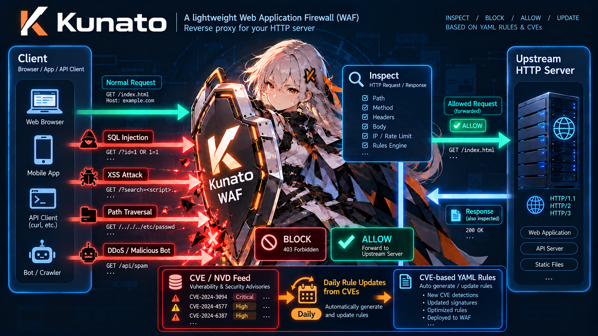

# Kunato

[](https://github.com/hiroeorz/kunato/actions/workflows/ci.yml)

Kunato is a lightweight Web Application Firewall (WAF) written in Rust, built for personal users who want an easy-to-deploy protection layer in front of their web applications.



It runs as a reverse proxy between clients (browsers, apps) and your HTTP server,
inspects incoming requests against categorized, YAML-defined rules, and applies one
of three actions: **BLOCK**, **ALLOW**, or **LOG**.

> **Status:** Early development. The configuration format and public interfaces are
> not yet stable and may change without notice.

## Features

- **Reverse proxy** — Sits between browsers/apps and your HTTP server, forwarding
  traffic while inspecting every request.
- **HTTP/2, HTTP/3, and HTTP/1.1** — Accepts HTTP/2 over TLS (ALPN) and
  cleartext h2c (prior knowledge), plus optional HTTP/3 over QUIC, falling back
  to HTTP/1.1 automatically. Upstream requests are sent over HTTP/1.1.
- **Automatic TLS certificates** — Obtains and renews Let's Encrypt
  certificates directly over the ACME protocol (TLS-ALPN-01 on the HTTPS
  port). No external tools such as certbot, no cron job, and no deploy hooks:
  list your domains under `tls.acme` and Kunato handles issuance, renewal, and
  in-place rotation, caching the certificate locally between restarts.
- **WebSocket proxying** — Forwards HTTP/1.1 upgrade handshakes to the upstream
  and tunnels the connection both ways. The handshake passes through the rule
  engine and protection budgets; idle tunnels are closed automatically.
- **Categorized rule sets** — Rules are grouped into named categories (for example
  `sql-injection` or `xss`). Each category defines a default action, and individual
  rules can override it.
- **Daily CVE-driven rule updates** — An optional updater automatically refreshes
  the managed rule set once a day with signatures for the latest exploited CVEs,
  using conditional requests, SHA256 verification, and full validation before an
  atomic swap.
- **Response header rewriting** — Removes or replaces identifying response headers
  such as `Server` and `X-Powered-By` on upstream responses and Kunato's own
  block/error responses alike.
- **Response inspection** — Response-phase categories match upstream responses on
  status, headers, and body (up to a size limit) and can block, log, or pass them
  through. The remainder of oversized responses is streamed uninspected.
- **Encoded body inspection** — Bodies compressed with gzip, deflate, brotli, or
  zstd are decompressed for matching, and request bodies are additionally decoded
  by content type (`application/x-www-form-urlencoded` and JSON escapes).
  Forwarded traffic is never modified.
- **YAML rules with hot reload** — Rules are written in YAML. Changes to the rule
  file are detected at runtime and reloaded on the fly without restarting the
  process or dropping connections.
- **High fault tolerance** — Keeps serving with the last known good configuration,
  isolates failures, and avoids disrupting traffic during reloads.
- **Guided install** — One `curl | sudo sh` command installs the static binary,
  the systemd service, the configuration, and the initial rule set on a Linux
  server.
- **DoS / DDoS detection and mitigation** — Detects abnormal request patterns and
  automatically throttles or blocks abusive sources.
- **Simple deployment** — One binary and one YAML configuration file. No database,
  no external services, no complex setup.
- **Rust implementation** — Memory safety and predictable performance in a single
  static binary with no runtime dependencies.

## How It Works

```
                 inspect & apply rules
Client ──────►  ┌───────────────────┐  ──────►  Upstream HTTP server
(browser/app)   │  Kunato (WAF)     │
                │  reverse proxy    │  ◄──────  (response)
                └───────────────────┘
```

1. A request arrives at Kunato.
2. Categories are evaluated in the order they appear in the configuration, and
   rules within each category in their order.
3. The first rule whose conditions all match is handled according to its effective
   action:
   - `ALLOW` — forwards the request and stops evaluation.
   - `BLOCK` — rejects the request immediately (default: `403 Forbidden`).
   - `LOG` — records the match and continues evaluation.
4. If no rule matches, the request is forwarded to the upstream (pass-through).
5. Response-phase categories run on the upstream response the same way. `BLOCK`
   replaces the upstream response with the configured response; `ALLOW` stops
   response evaluation and passes the response through unchanged.

## Getting Started

Kunato ships as a single static binary for Linux. On a server with systemd, one
command installs the binary, the service, the configuration, and the initial
rule set, and terminates TLS with an automatically obtained Let's Encrypt
certificate:

```sh
curl -fsSL https://raw.githubusercontent.com/hiroeorz/kunato/main/scripts/install.sh \
  | sudo sh -s -- \
      --upstream http://127.0.0.1:8080 \
      --acme-domain example.com \
      --acme-contact admin@example.com \
      --yes
```

Replace the upstream with the web server Kunato protects, and the domain and
contact with a DNS name that resolves to this server and an address for
Let's Encrypt expiry notices. Automatic certificates need TCP port 443
reachable from the internet, so wildcards and setups behind a TLS-terminating
CDN or proxy must manage certificates manually (see [Deployment](#deployment)
for the full option list).

The service starts automatically; the first start orders the certificate in
the background, so allow a few seconds before TLS works. Confirm it is
running, then edit `/etc/kunato/kunato.yaml`; changes are applied without a
restart:

```sh
systemctl status kunato
sudo journalctl -u kunato -e
curl -s http://127.0.0.1:9090/metrics | head
sudo kunato validate
```

Rerunning the installer upgrades the binary and unit while keeping the
configuration, and `--uninstall` removes them. On an installed server,
`sudo kunato upgrade` performs the same upgrade: it downloads the installer
published with the target release and runs it (`--version vX.Y.Z` pins a
release, `--dry-run` prints the URL and command without changing anything).
See
[Managed Rules and Automatic Updates](#managed-rules-and-automatic-updates) for
what is refreshed after installation, and [Deployment](#deployment) for installer
details and building from source.

## Managed Rules and Automatic Updates

The installer enables `rules_update`, so the rule set stays current without
manual work. Every `interval` (default `24h`, randomized by `jitter_percent`,
default 10%) Kunato:

1. sends a conditional request (`If-None-Match` / `If-Modified-Since`) and stops
   immediately on `304 Not Modified`;
2. downloads the rule file and verifies its SHA256 digest against `checksum_url`;
3. parses and fully validates it — regex compilation, ReDoS guards, action
   resolution, size limits — before replacing anything;
4. swaps the file in atomically, and the configuration watcher hot-reloads it.

Any failure (network, checksum mismatch, invalid rules, size limit) leaves the
current rules active; failures are logged and counted in the
`kunato_rules_update_*` metrics, and a rule set that needs a newer build is
counted separately in `kunato_rules_update_incompatible_total` (see
[Rule set format compatibility](#rule-set-format-compatibility)). `kunato
update-rules` performs a single check and exits, and is what the installer uses
for the first download. The full field reference lives in
[Rule sources and updates](#rule-sources-and-updates).

Local changes are never overwritten: exemptions and rule disables belong in
`overrides_file` (`/etc/kunato/overrides.yaml` when configured), which is
evaluated before the managed set. The updater writes exactly one file — the
managed rules file — and nothing else.

### Installed files and directories

```text
/
├── usr/
│   └── local/
│       └── bin/
│           └── kunato                         # binary (0755 root:root)
├── etc/
│   ├── systemd/
│   │   └── system/
│   │       ├── kunato.service                 # unit (0644)
│   │       └── multi-user.target.wants/
│   │           └── kunato.service -> ../kunato.service
│   └── kunato/                                # settings (0750 root:kunato)
│       ├── kunato.yaml                        # main configuration (0640 root:kunato)
│       ├── overrides.yaml                     # only when configured (0640 root:kunato)
│       └── tls/                               # only with --tls-cert/--tls-key (0750 root:kunato)
│           ├── cert.pem                       # (0640 root:kunato)
│           └── key.pem                        # (0640 root:kunato)
└── var/
    └── lib/
        └── kunato/                            # StateDirectory (0750 kunato:kunato)
            ├── rules.yaml                     # managed rule set (auto-updated)
            └── rules.yaml.update-state        # updater bookkeeping (auto-updated)
```

Auto-updated: `/var/lib/kunato/rules.yaml` and its `rules.yaml.update-state`
sidecar (last success timestamp, HTTP validators). Never touched by the updater:
everything under `/etc/kunato/`. The service runs as the `kunato` user (created
by the installer, no home directory) and only needs write access to
`/var/lib/kunato/`.

## Trying It Locally

Running from source requires Rust 1.89 or later (edition 2024). The repository
includes a small example upstream that logs every request to stdout:

```sh
cargo run --example upstream -- --listen 127.0.0.1:3000
cargo run -- --config rules.example.yaml
```

Open `http://127.0.0.1:8080/` in a browser or use `curl -v`. The response reports
the method, target, headers, and body as seen by the upstream, including the
`X-Forwarded-*` headers Kunato adds. The bundled example configuration trusts
`127.0.0.1`, so remove `127.0.0.1/32` from `trusted-sources` to exercise the block
rules locally.

## Black-Box Testing

Run the whole test with one command: it builds the binaries, starts the example
upstream and Kunato with a test configuration that does not trust the client,
replays both request lists, and prints a colored report with allow/block
pass and fail counts plus per-phase latency (min/avg/max):

```sh
./scripts/blackbox-test.sh
```

The report exits non-zero when an allowed request is not forwarded, a blocked
request reaches the upstream, or the upstream access count does not match.
`--skip-build`, `--parallelism N`, `--color auto|always|never`, and
`--workdir DIR` adjust the run; the log and test-config paths are printed at
the end.

`blackbox/` itself is a dependency-free driver that replays request lists in
parallel and prints the response status of each request:

```sh
cargo run --release --manifest-path blackbox/Cargo.toml -- \
  --blocked blackbox/requests/blocked.txt \
  --allowed blackbox/requests/allowed.txt \
  --addr 127.0.0.1:8080 \
  --parallelism 5
```

The request-list format supports HTTP/2 cleartext probes with `proto=h2c`,
including HPACK compression bombs (`hpack_bomb=N`) and oversized header blocks
(`pad_header=N`); see `--help` and the header of `blocked.txt`.

`--parallelism` defaults to 5. The two lists are split by expectation; correctness
is judged from the logs: the upstream access log should contain only the allowed
requests, and the Kunato log should show the blocked requests as blocked. Run it
against a configuration that does not trust the test client, otherwise
`trusted-sources` forwards everything. If the configuration has strict protection
limits, start Kunato with `--disable-protection` so rate limits and bans do not
interfere with the driver.

`blocked.txt` doubles as a CVE regression corpus. CVE coverage targets
vulnerabilities with a CVSS base score of 7.0 or higher, and only attacks that
can be expressed as an HTTP request are listed. Classes that need TLS-internal
state, raw connection framing, or a malicious upstream are recorded as comments
at the end of the list instead.

## Deployment

The installer used in [Getting Started](#getting-started) downloads the release
for your architecture, verifies its SHA256 checksum, installs the binary to
`/usr/local/bin/kunato` and the systemd unit, writes `/etc/kunato/kunato.yaml`,
fetches the managed rule set, validates the configuration, and enables the
service. Key options:

| Option                    | Description                                                              |
| ------------------------- | ------------------------------------------------------------------------ |
| `--version TAG`           | Install a specific release (default: the latest).                        |
| `--upstream URL`          | Upstream server the WAF forwards to; required on first install.          |
| `--listen ADDR`           | Listen address (default `0.0.0.0:443`).                                   |
| `--tls-cert`/`--tls-key`  | PEM certificate chain and key; copied to `/etc/kunato/tls/`.             |
| `--acme-domain DOMAIN`    | Obtain Let's Encrypt certificates automatically; repeatable.             |
| `--acme-contact EMAIL`    | Contact email registered with the ACME account.                          |
| `--acme-staging`          | Use the Let's Encrypt staging directory (for testing).                   |
| `--rules-url URL`         | Managed rule set URL (see Managed Rules and Automatic Updates).          |
| `--no-start`              | Install and validate without enabling or starting the service.            |
| `--allow-empty-rules`     | Start even when the initial rules download fails (blocks nothing).        |
| `--yes`                   | Never prompt; fail instead of asking.                                    |
| `--uninstall`             | Stop and remove the service and binary.                                  |
| `--purge`                 | With `--uninstall`, also remove `/etc/kunato` and `/var/lib/kunato`.      |

TLS material passed with `--tls-cert`/`--tls-key` is copied to `/etc/kunato/tls/`
so the service user can read it. Re-copy it and restart the service when the
certificate is renewed; as a certbot deploy hook
(`/etc/letsencrypt/renewal-hooks/deploy/kunato`):

```sh
#!/bin/sh
install -m 0640 -o root -g kunato /etc/letsencrypt/live/example.com/fullchain.pem /etc/kunato/tls/cert.pem
install -m 0640 -o root -g kunato /etc/letsencrypt/live/example.com/privkey.pem /etc/kunato/tls/key.pem
systemctl restart kunato
```

Instead of passing certificate files, pass one or more `--acme-domain
example.com` flags. Kunato then obtains the certificate itself and renews it
without a deploy hook or restart; see
[Automatic certificates](#automatic-certificates-lets-encrypt).

Running the installer again upgrades the binary and unit while keeping the
existing configuration.

Without network access, or to build a custom binary, build from source (Rust
1.89 or later, edition 2024):

```sh
sudo apt-get install musl-tools   # Debian/Ubuntu; provides musl-gcc
rustup target add x86_64-unknown-linux-musl
cargo build --release --target x86_64-unknown-linux-musl
```

Install the binary to `/usr/local/bin/kunato`, generate a configuration with
`kunato init --upstream <url> --acme-domain example.com --output
/etc/kunato/kunato.yaml` (or `--tls-cert <pem> --tls-key <pem>` for a manually
managed certificate), download the first rules file with `kunato
update-rules`, and enable `packaging/kunato.service`. `rules.example.yaml` is a
practical starting point with rules for SQL/NoSQL injection, XSS, path traversal,
command injection, SSRF, XXE, malicious uploads, scanners, sensitive files, and
more. `scripts/release.sh X.Y.Z` cuts a release: it bumps the `version` in
`Cargo.toml`, commits and pushes it, and tags and pushes `vX.Y.Z`. The tag
builds and uploads static musl tarballs, checksums, and the installer through
GitHub Actions; `kunato --version` identifies the installed release because
the release workflow rejects a tag that does not match the package version.

## Configuration

Kunato is configured through a single YAML file. The file defines where Kunato
listens, which upstream server it forwards to, and a list of rule **categories**.
All commands read `/etc/kunato/kunato.yaml` by default; pass `--config PATH` to
use a different file (for example `rules.example.yaml` when running from source):

- `listen` — address and port to bind.
- `upstream` — base URL of the upstream HTTP server.
- `categories` — ordered list of rule categories.
- `rules_file` — optional categories-only file refreshed by the daily rules updater.
- `overrides_file` — optional categories-only file with local exceptions,
  evaluated before every other rule source.
- `rules_update` — daily refresh of `rules_file` (see Managed rules and updates).

`listen` accepts IPv4 and IPv6 socket addresses; quote IPv6 literals in YAML
(`listen: "[::]:443"`). On Linux, `[::]` is dual-stack and also serves IPv4
clients as IPv4-mapped addresses, even if the host has no routable IPv6 address;
use `0.0.0.0` where the kernel has IPv6 disabled or `net.ipv6.bindv6only=1`.

Each category groups related rules (for example SQL injection or XSS signatures)
and defines a default action that its rules inherit. Individual rules can override
the category defaults.

Rules are written in a compact form: `name` on one line, followed by a flow-style
`match` mapping on the next. Rules that override category defaults add one line per
extra field (`action`, `enabled`, `description`, `response`), and larger match
mappings can fall back to block style. Both forms are plain YAML and can be mixed.

### Example

```yaml
listen: 0.0.0.0:8080
upstream: http://127.0.0.1:3000

categories:
  # Trusted clients: matching rules forward the request immediately and skip
  # all remaining categories.
  - name: trusted-sources
    action: ALLOW
    rules:
      - name: internal-networks
        match: { source_ip: [10.0.0.0/8, 192.168.0.0/16] }
      - name: uptime-monitor
        match: { source_ip: 203.0.113.10, path: ^/health$ }

  # SQL injection: the category default blocks matching requests.
  - name: sql-injection
    action: BLOCK
    response: { status: 403, body: Forbidden }
    rules:
      - name: union-select
        match: { regex: '(?i)\bunion\b.{0,40}\bselect\b', in: [query, body] }
      - name: comment-obfuscation
        match: { regex: '(?i)(/\*!|--\s|#\s)', in: [query, body] }
      - name: tuning-heuristics         # disabled while false positives are investigated
        enabled: false
        match: { regex: '(?i)\bor\s+1\s*=\s*1\b', in: [query, body] }
      - name: detection-only            # logs instead of blocking while tuning
        action: LOG
        match: { regex: '(?i)(sleep\s*\(|benchmark\s*\()', in: [query, body] }

  # Cross-site scripting: also blocks by default.
  - name: xss
    action: BLOCK
    rules:
      - name: script-tags
        match: { regex: '(?i)<\s*script\b', in: [query, body, headers] }
      - name: event-handlers
        match: { regex: '(?i)\bon(error|load|click|mouseover)\s*=', in: [query, body] }
      - name: javascript-uri
        match: { regex: '(?i)javascript\s*:', in: [query, body] }

  # Path traversal: blocks by default. Larger match mappings may use block style.
  - name: path-traversal
    action: BLOCK
    rules:
      - name: dot-dot-slash
        match:
          regex: ['\.\./', '(?i)%2e%2e%2f', '(?i)%2e%2e/']
          in: [path, query, body]
      - name: encoded-backslash
        match: { regex: '(?i)(%5c|\.\.\\)', in: [path] }

  # Scanners and sensitive endpoints: logged by default, but individual rules
  # override the category action and block.
  - name: scanners
    action: LOG
    rules:
      - name: scanner-user-agents
        match:
          headers:
            User-Agent: ['(?i)sqlmap', '(?i)nikto', '(?i)(nmap|masscan|zgrab)']
      - name: sensitive-files            # overrides the category default
        action: BLOCK
        match: { path: '(?i)(^|/)(\.env|\.git/|wp-admin|phpmyadmin)' }

  # Response inspection: runs on the upstream response after it arrives. The
  # default `in` target in a response category is `response_body`.
  - name: response-leaks
    phase: response
    action: LOG
    rules:
      - name: private-key-material
        action: BLOCK
        match: { regex: '-----BEGIN [A-Z ]*PRIVATE KEY-----' }
      - name: versioned-server
        match: { response_headers: { Server: '(?i)(apache|nginx)/[0-9]' } }
      - name: upstream-error
        match: { status: 5xx }
```

### Evaluation

1. Request-phase categories (`phase: request`, the default) are evaluated in the
   order they appear in the file, and rules within a category in their order. A
   category with `enabled: false` is skipped entirely.
2. The first rule whose conditions all match wins. Its effective action and
   response are resolved with rule-level values taking precedence over
   category-level defaults.
3. The effective action is applied:
   - `ALLOW` — forwards the request and stops evaluation.
   - `BLOCK` — rejects the request with the effective response (default:
     `403 Forbidden`) and stops evaluation.
   - `LOG` — records the match and continues evaluation.
4. If no rule matches, the request is forwarded (pass-through).
5. After the upstream responds, response-phase categories (`phase: response`) run
   in document order. They match the upstream response plus the request context;
   `BLOCK` replaces the response with the effective response, `ALLOW` stops
   response evaluation and passes the response through unchanged, and `LOG`
   records the match and continues.

Every rule must resolve to an effective action: a rule without its own `action`
requires the category to define one. The configuration is rejected at load time
otherwise.

### Rule sources and updates

Rules can come from three places. Sources are concatenated in this order, and
evaluation starts with the first source, so earlier sources win:

1. `overrides_file` — a categories-only YAML document for local exceptions and
   tuning.
2. categories written directly in the configuration file.
3. `rules_file` — the managed rule set refreshed by `rules_update`.

```yaml
rules_file: /var/lib/kunato/rules.yaml
overrides_file: /etc/kunato/overrides.yaml
```

```yaml
# /etc/kunato/overrides.yaml
disabled_rules: [union-select]      # drop these rule names from every other source

categories:
  # Fix a false positive before the managed rules run: ALLOW wins over later BLOCKs.
  - name: local-exceptions
    action: ALLOW
    rules:
      - name: admin-search
        match: { path: ^/admin/search$, source_ip: 192.168.0.0/16 }
```

The external files are categories-only: `categories`, plus `disabled_rules` in
the overrides file (listing it in `rules_file` is rejected, so a downloaded file
can never weaken local overrides). Relative paths are resolved against the
directory of the configuration file. Missing files fail validation; a running
instance keeps its last known good rules if a reload fails.

`rules_update` keeps `rules_file` fresh without manual downloads:

```yaml
rules_update:
  enabled: true
  url: https://raw.githubusercontent.com/hiroeorz/kunato/main/dist/rules.yaml
  checksum_url: https://raw.githubusercontent.com/hiroeorz/kunato/main/dist/rules.yaml.sha256
  interval: 24h        # default
  jitter_percent: 10   # randomize the next check by ±10% (default 10, max 50)
  max_bytes: 1048576   # download size limit (default 1 MiB)
```

The URL must use https; plain http is accepted only for loopback hosts, which is
handy for tests and local mirrors. Redirects must satisfy the same policy for
the URL they started from: an https download only follows https, and a
loopback-http download only follows https or loopback http, so a redirect can
never downgrade the transport. Redirects may also leave the configured origin
at most twice, which keeps the release channel's CDN bounce-through working
while a chain that keeps moving the download to other hosts fails the update;
every cross-host hop is logged. Every `interval` the updater sends a
conditional request (`If-None-Match`/`If-Modified-Since`), downloads any new
file, verifies its SHA256 digest against `checksum_url`, validates it with the
full rule compiler (regex and ReDoS guards included) together with the inline
and overrides sources, replaces the file
atomically, and lets the hot reload path apply it. Any failure — network,
checksum mismatch, invalid rules, size limit — leaves the current rules
untouched and is reported in the logs and metrics. The updater state (last
success, next due time, HTTP validators) is stored next to the rules file.
`kunato update-rules` performs a single check and exits; the installer uses it
for the first download.

The SHA256 digest guards against corrupted or truncated downloads; it is
fetched over the same TLS connection as the rules file, so it does not add
authenticity. Detached signatures (minisign) are planned as a hardening step.

### Rule set format compatibility

`main` publishes the newest rule set to installs of every release, so the format
of `dist/rules.yaml` is pinned to the newest release: the published rules use
only the fields, match targets, actions, and phases that the newest released
binary implements, and adding a schema construct means cutting a release rather
than shipping it with a daily rule update. A build that meets an unknown
construct rejects the whole candidate before writing anything (no partial
application) and keeps its last known good rules, so an incompatible rule set
freezes that install's updates instead of weakening it. The failure is logged
and counted in `kunato_rules_update_incompatible_total` — alert on it, or on
`kunato_rules_last_success_timestamp_seconds` going stale, because otherwise
only a log reader notices that a server's rules stopped moving.

`scripts/check-rules-compat.sh` is the gate. It builds the newest `v*` tag,
validates `dist/rules.yaml` with that binary, and fails with the construct the
release cannot read. It runs in CI and in the daily rule-update workflow, so an
incompatible publication cannot reach `main`. Reproduce it locally with
`KUNATO_RULES_BIN=/usr/local/bin/kunato scripts/check-rules-compat.sh`, or
against a specific tag with `KUNATO_RULES_BASELINE=v0.2.0`. The unit tests in
`src/config/mod.rs` cover the rest of the publication: the file matches
`rules.example.yaml` and `dist/rules.yaml.sha256` is current.
[Daily rule updates and version compatibility](rule-updates.md) describes the
whole mechanism: the two update streams, the failure mode, the guards, the
counters an operator sees, and the release procedure for a new construct.

A rule that genuinely needs a new construct therefore takes a release:

1. add the field, target, action, or phase to the engine and to `README.md`;
2. cut a release (`v*` tag): new installs get that build, the compatibility gate
   moves its baseline to it, and the construct becomes part of the released
   format;
3. installs that want those rules upgrade by rerunning the installer. Until they
   do, they keep their previous rules and carry on protecting with them.

A version marker inside the rules file cannot replace this, because builds that
predate the marker reject unknown keys outright — the release tag (and the
channel URL an install is configured with) is the only place a build can be told
which format to expect. Supporting several releases at once would need a
per-release channel such as `dist/v1/rules.yaml`; the repository deliberately
keeps one channel and expects installs to follow releases.

Releases publish the rule set they shipped as assets, so an install can follow
releases instead of `main` and never meet a construct its binary does not
implement:

```yaml
rules_update:
  # Rules of the newest release; they change when a release is cut.
  url: https://github.com/hiroeorz/kunato/releases/latest/download/rules.yaml
  checksum_url: https://github.com/hiroeorz/kunato/releases/latest/download/rules.yaml.sha256
```

Pointing the URL at a specific tag (`.../download/v0.2.0/rules.yaml`) freezes the
rules at that release instead, which trades coverage for reproducibility.

### Category fields

| Field         | Description                                                                                          |
| ------------- | ---------------------------------------------------------------------------------------------------- |
| `name`        | Unique category name.                                                                                |
| `description` | Optional free-text description.                                                                      |
| `enabled`     | Set to `false` to skip the category. Defaults to `true`.                                             |
| `phase`       | `request` (default) or `response`; selects when the category is evaluated.                            |
| `action`      | Default action (`BLOCK`, `ALLOW`, or `LOG`) for the category's rules.                                |
| `response`    | Default response for `BLOCK` rules (`status` from 200 to 599). Defaults to `403 Forbidden`.           |
| `threshold`   | Scoring mode: each matching rule adds 1 and the category action applies at the threshold.             |
| `rules`       | Ordered list of rules.                                                                               |

A category with `threshold` does not short-circuit on the first match: every
matching rule adds one point and, once the score reaches the threshold, the
category action runs (`BLOCK` or `LOG`, not `ALLOW`). Rules in a threshold
category must not set `action`, `response`, or `limit`, and the category
`action` is required. Categories without `threshold` keep first-match
semantics.

### Rule fields

| Field         | Description                                                     |
| ------------- | --------------------------------------------------------------- |
| `name`        | Rule name, unique within the category.                          |
| `description` | Optional free-text description.                                 |
| `enabled`     | Set to `false` to skip the rule. Defaults to `true`.            |
| `action`      | Overrides the category default action.                          |
| `match`       | Conditions that must all hold for the rule to apply (required). |
| `response`    | Overrides the category response for `BLOCK` rules.              |
| `limit`       | Request-phase per-source rate limit, `{ requests: N, window: 60s }`. |

A rule with `limit` is a burst guard: the first `requests` matching requests per
`window` from one source pass through as if the rule had not matched, and later
matches take the rule's effective action (which cannot be `ALLOW`). Sources are
tracked like the automatic per-IP limits (IPv6 aggregated by
`protection.aggregate_ipv6_prefix`), allowlisted sources and
`--disable-protection` are exempt, and the state is bounded by
`protection.max_tracked_ips`.

### Match fields

Match conditions are combined with logical AND; a list value means OR within that
field, and empty pattern lists (`headers: { x-required: [] }`) are rejected so a
condition can never silently disappear. At least one condition must be
specified. Regular expressions are compiled
once at load time, and an invalid pattern rejects the configuration. Path and query
values are matched raw and through up to two decode passes, so
`%253Cscript%253E`, `%3Cscript%3E`, and `<script>` all match. Queries follow
`application/x-www-form-urlencoded` conventions, so `+` is decoded to a space
(`?q=union+select` matches like `?q=union%20select`); paths are additionally
matched in normalized form (dot segments resolved, duplicate slashes merged), so
`//admin`, `/x/../admin`, and `/%2fadmin` are all seen as `/admin`. `BLOCK` and
`LOG` rules match any form, so an attack hidden in one representation is still
caught. An `ALLOW` rule disables the WAF for the request, so its trust has to be
unanimous instead: it must match every path form, every value of a repeated
`headers` or `cookies` entry, and every form of the `in` targets, and the
patterns of an `ALLOW` rule may only use `headers`, `cookies`, `response_headers`,
and `regex` values that are anchored at both ends (`^...$`); the configuration is
rejected otherwise. A forged extra copy of a header and a marker appended to the
query or the body therefore cannot shadow a later `BLOCK`. `path` is exempt so a
start-anchored prefix can exempt a whole area from the rules that follow. Header
values
are decoded with UTF-8 replacement, so a single invalid byte cannot hide a value
from a rule. Bodies are matched raw
and decoded by `Content-Type` (`application/x-www-form-urlencoded`, JSON string
escapes such as `\u0075`, and `multipart/form-data` flattened to field values and
file names), then through the same percent-decode passes; bodies whose content
type is unknown still get the percent passes. A `multipart/form-data` message
that declares several boundaries is flattened once per boundary (up to four),
because parsers disagree on which one wins (Rack takes the last); messages that
exceed that fall back to the percent passes on the raw body. Bodies are
decompressed first when
`Content-Encoding` is `gzip`, `deflate`, `br`, or `zstd`: all gzip members are
decoded, and stacked encodings are decoded in reverse order (up to three layers;
deeper or unknown encodings are inspected as received and counted in
`kunato_request_decode_skipped_total`). Multipart parsing is
bounded to 64 parts with 1 KiB names and file names; malformed multipart bodies
are inspected raw only. No other normalization (Unicode folding, HTML entity
decoding) is performed.

| Field              | Description                                                                                                             |
| ------------------ | ----------------------------------------------------------------------------------------------------------------------- |
| `path`             | Regex(es) matched against the request path.                                                                             |
| `method`           | One or more HTTP methods (for example `GET` or `[POST, PUT]`); names are case-sensitive, so write them in upper case. |
| `source_ip`        | IP address(es) or CIDR range(s) the client must come from.                                                              |
| `headers`          | Map of request header name to regex(es); header names are case-insensitive.                                             |
| `cookies`          | Map of cookie name to regex(es).                                                                                        |
| `in`               | Parts searched by `regex`: `query`, `body`, `cookies`, `headers`, `path`, or `response_body`. Defaults to `[query, body, cookies]`, or `[response_body]` in a response-phase category. |
| `regex`            | Signature regex(es) searched in the parts listed by `in`.                                                               |
| `status`           | Response-phase only: status code(s) or ranges, for example `404`, `500-599`, or `5xx`.                                  |
| `response_headers` | Response-phase only: map of response header name to regex(es); header names are case-insensitive.                       |

`method` is matched against the method sent on the wire; framework method
overrides such as Rack's `_method` parameter or `X-HTTP-Method-Override` are
not resolved before evaluation. A request whose method is a case variant of a
standard method (`get`, `pOsT`, ...) is rejected with `400` before rule
evaluation, because servers that compare methods case-sensitively can be
bypassed by variant case (OpenNMS CVE-2026-111235); custom methods that are not
case variants keep their previous behavior.

Response-phase rules may combine request conditions (`path`, `method`, `source_ip`,
`headers`, `cookies`, and `in` targets) with the response-specific ones, so a rule
can require a path and a response body signature. `status`, `response_headers`, and
the `response_body` target are rejected in request-phase categories. Response
bodies with `Content-Encoding: gzip`, `deflate`, `br`, or `zstd` are decompressed
for matching (all gzip members, stacked encodings in reverse order up to three
layers), and only the first `limits.max_response_body_bytes` are inspected (the
decoded output is bounded by the same limit). Unknown or deeper encodings are
inspected as received and counted in `kunato_response_decode_skipped_total`.
Decoding is inspection-only: the bytes forwarded to the
upstream and to the client are never modified.

### Timeouts and limits

Durations accept `ms`, `s`, `m`, and `h` suffixes (plain numbers are seconds).
Values must fit in the unit (no silent overflow) and must not exceed 365 days.
Defaults:

| Timeout             | Default | Limit                     | Default |
| ------------------- | ------- | ------------------------- | ------- |
| `header_read`       | `10s`   | `max_path_bytes`          | 8 KiB   |
| `body_read`         | `30s`   | `max_header_bytes`        | 32 KiB  |
| `upstream_connect`  | `5s`    | `max_headers`             | 100     |
| `upstream_response` | `30s`   | `max_body_bytes`          | 1 MiB   |
| `shutdown_grace`    | `10s`   | `max_response_body_bytes` | 1 MiB   |
| `websocket_idle`    | `10m`   | `max_concurrent_streams`  | 100     |

`max_path_bytes` bounds the whole request target (path plus query string), not
just the path. `max_concurrent_streams` caps concurrent request streams per
HTTP/2 connection (and per QUIC connection for HTTP/3), which also bounds how
much request-body buffering a single connection can hold at once. HTTP/2
connections are pinged after 30 seconds without activity and closed when the
ping is not acknowledged within 20 seconds, so idle clients cannot hold
connection slots forever.

```yaml
timeouts: { header_read: 10s, body_read: 30s }
limits: { max_body_bytes: 1048576 }
```

The first `max_body_bytes` of each request body are buffered for rule
inspection and content decoding; larger bodies are not rejected. The buffered
prefix is evaluated, the remainder streams to the upstream unchanged, and the
request is counted as truncated (`kunato_request_truncated_total`) and logged at
debug level. Rules therefore see at most the prefix; to reject oversized bodies
outright, add an explicit rule (for example a `content-length` header regex).
Request decoding is bounded by `max_body_bytes` and response decoding by
`max_response_body_bytes`, so decompression bombs cannot exceed the configured
buffer sizes. A decoded body cut off at the limit is counted separately
(`kunato_request_decode_truncated_total`,
`kunato_response_decode_truncated_total`) and logged at warning level.

### Response headers

`response_headers` rewrites the headers of every response Kunato sends — upstream
responses and its own block/error responses alike — after hop-by-hop headers are
filtered. Removing identifying headers is the recommended default; replacing them
with a fixed, version-less value is the alternative:

```yaml
response_headers:
  remove: [server, x-powered-by, via]
  # set:
  #   server: webserver
```

Header names are case-insensitive, `remove` runs before `set`, and a name listed in
both is replaced rather than deleted. Hop-by-hop headers, `content-length`, and
`alt-svc` are managed by the proxy and rejected in the policy. A value in `set`
must be non-empty; use `remove` to drop a header.

### Admin and metrics

An optional admin listener exposes Prometheus metrics on a loopback address:

```yaml
admin:
  enabled: true
  listen: 127.0.0.1:9090
```

`GET /metrics` returns the text exposition format. Counters cover total requests,
BLOCK rule hits, LOG matches, rate-limit and ban decisions, global load shedding,
upstream failures, configuration reloads, rules update outcomes (including
`kunato_rules_update_incompatible_total` for rule sets that need a newer build),
body truncation and decoding decisions (including bodies whose encoding could not
be decoded: `kunato_request_decode_skipped_total`,
`kunato_response_decode_skipped_total`), and ACME
certificate issuance, cache loads, and errors; gauges cover active connections,
uptime, the time of the last successful rules update, and the time of the last
deployed ACME certificate. Non-loopback addresses are rejected at validation
time, and if the port is already in use Kunato logs a warning and continues
without the admin endpoint.

### TLS

Set a certificate and private key (PEM) to terminate HTTPS directly:

```yaml
tls:
  cert_file: /etc/kunato/cert.pem
  key_file: /etc/kunato/key.pem
```

Without this block Kunato serves plain HTTP. When TLS is enabled, forwarded
requests carry `X-Forwarded-Proto: https`. TLS settings are applied at startup;
changing them requires a restart. Invalid or unreadable files fail startup.

With TLS, Kunato negotiates the protocol through ALPN and prefers `h2`;
cleartext clients may use h2c prior knowledge. HTTP/1.1 clients are always
accepted, and requests are forwarded to the upstream over HTTP/1.1. Static
certificates are read once at startup; rotate them by replacing the files and
restarting, or use `tls.acme` below.

#### Automatic certificates (Let's Encrypt)

Kunato can obtain and renew certificates automatically through the ACME
protocol (RFC 8555) without any helper process. Challenges are answered with
TLS-ALPN-01 on the same port as regular TLS traffic, so no extra port is
needed:

```yaml
tls:
  acme:
    enabled: true
    domains: [example.com, www.example.com]
    contact: admin@example.com   # optional
```

Requirements:

- every domain must resolve to this server (A/AAAA records) and TCP port 443
  must be reachable from the internet; wildcard names and setups behind a
  TLS-terminating CDN or proxy cannot be validated with TLS-ALPN-01;
- `domains` entries must be DNS names, not IP addresses (use punycode for
  international names).

Kunato registers an ACME account (using `contact` for expiry notices when
set), answers the challenge, and serves the issued chain. Certificates renew
automatically once about two thirds of their validity have elapsed — roughly
30 days before expiry for the 90-day Let's Encrypt certificates — with
exponential backoff while the ACME server is unreachable. The certificate and
account key are cached under `cache_dir` (default `/var/lib/kunato/acme`,
created with mode 0700) so restarts keep serving the cached certificate
without contacting the ACME server again.

Set `staging: true` to use the Let's Encrypt staging directory (untrusted
test certificates), or `directory: https://…` for a custom ACME directory such
as an internal CA; the two cannot be combined and `directory` must be an
`https://` URL. `contact` is optional and may be given with or without the
`mailto:` prefix.

On the first start the certificate is ordered asynchronously and TLS
handshakes fail until it has been issued (a few seconds). On later starts the
cached certificate is loaded before the listener starts accepting connections.
`tls.acme` is applied at startup like the rest of the `tls` block; changing it
requires a restart. The certificate cache lives under the service state
directory, so keep `StateDirectoryMode=0700` (set in the packaged unit) and
`cache_dir` writable by the service user.

`scripts/acme-pebble-test.sh` runs the integration tests for issuance, HTTP/3
serving, renewal, and cache reuse against a local
[Pebble](https://github.com/letsencrypt/pebble) server in Docker.

### HTTP/3

HTTP/3 over QUIC is opt-in and requires a `tls` block:

```yaml
http3:
  enabled: true
  listen: 127.0.0.1:8443   # optional; defaults to `listen`
```

When enabled, Kunato binds a UDP socket and terminates HTTP/3 with the same
certificate and key. The UDP address defaults to the TCP `listen` address, so
under normal deployments both share one port. TCP responses then carry an
`Alt-Svc: h3=":<port>"; ma=86400` header so clients can discover HTTP/3.

HTTP/3 requests pass through the same protection, limits, and rule evaluation
as TCP requests. Settings are applied at startup (like TLS); changing or
disabling them requires a restart. If the UDP socket cannot be bound, Kunato
logs a warning and keeps serving over TCP.

### WebSocket

Kunato forwards HTTP/1.1 WebSocket handshakes (`Upgrade: websocket`) to the
upstream. The handshake request is evaluated by the same protection budgets and
rules as any other request, and is blocked like one; when the upstream answers
`101 Switching Protocols`, Kunato opens a bidirectional tunnel between client
and upstream.

The tunnel itself is opaque: payload bytes are not inspected and
`max_body_bytes` does not apply. Tunnels with no traffic in either direction
are closed after `timeouts.websocket_idle` (default `10m`), and all tunnels are
closed on shutdown. WebSocket over HTTP/2 or HTTP/3 (extended CONNECT) is not
supported yet.

### Hot reload

Kunato watches the configuration file plus the configured `rules_file` and
`overrides_file` for changes. When any of them is updated:

- The new configuration is parsed and validated **before** it is applied.
- A valid configuration is swapped in atomically; in-flight requests are unaffected.
- An invalid configuration is rejected and the last known good rules remain active,
  with the error reported in the logs.

## DoS / DDoS Protection

Kunato monitors connection and request rates to detect abusive traffic. When a
source exceeds the configured thresholds, it is automatically throttled and, after
repeated violations, temporarily banned. Detection and mitigation run without
manual intervention and are independent of the YAML rule set.

```yaml
protection:
  enabled: true
  allowlist: [10.0.0.0/8, 192.168.0.0/16]
  max_connections_per_ip: 32
  max_connections: 1024
  requests_per_second: 20
  burst: 60
  global_requests_per_second: 2000
  max_tracked_ips: 100000
  aggregate_ipv6_prefix: 64
  ban:
    violations: 5
    window: 10s
    duration: 60s
    max_duration: 1h
```

The per-IP limiter uses a token bucket (`requests_per_second` refill rate, `burst`
capacity). Exceeding it returns `429 Too Many Requests` with a `Retry-After`
header; exceeding the global rate or connection budget returns `503 Service
Unavailable`. Repeated violations trigger a ban that doubles on each recurrence up
to `max_duration`. Addresses in `allowlist` bypass all protection limits.

IPv6 clients are tracked by the `aggregate_ipv6_prefix` prefix (default 64) rather
than by full address, so rotating within a prefix cannot bypass rate limits, bans,
or per-IP connection budgets. Set it to 128 to track each address separately;
IPv4-mapped addresses (`::ffff:a.b.c.d`) are always treated as IPv4.

Protection can be turned off entirely with `protection.enabled: false`, or at
runtime with `--disable-protection`. The flag also survives configuration reloads,
so it is a convenient way to run load or black-box tests without rate limits and
bans interfering.

## Fault Tolerance

- Invalid rule reloads never take down a running instance.
- A failed rules update (network, checksum, validation) always keeps the current
  rule set active.
- Upstream failures and timeouts are handled gracefully.
- Request handling paths avoid panics and unbounded resource usage.
- Graceful shutdown drains in-flight connections.

## Roadmap

- [x] Project scaffolding
- [x] Reverse proxy core
- [x] Rule engine (`BLOCK` / `ALLOW` / `LOG`)
- [x] YAML loader and hot reload
- [x] DoS / DDoS detection and mitigation
- [x] Metrics endpoint and admin listener
- [x] Example configuration, systemd unit, and static musl builds
- [x] Optional TLS termination
- [x] HTTP/2 (ALPN over TLS, h2c prior knowledge)
- [x] HTTP/3 over QUIC (opt-in, Alt-Svc advertisement)
- [x] Response-phase rules (status, response headers, response body)
- [x] curl installer and managed rule set with daily updates
- [ ] Detached signatures (minisign) for rules updates

## Contributing

This is a personal project, but issues and pull requests are welcome. Please keep
all code, comments, and documentation in English. Before opening a pull request,
run `cargo fmt`, `cargo clippy --all-targets -- -D warnings`, `cargo deny check`,
and `cargo test`.

## License

Kunato is provided "as is", without warranty of any kind, express or implied,
including but not limited to the warranties of merchantability, fitness for a
particular purpose, and non-infringement. In no event shall the authors or
copyright holders be liable for any claim, damages, or other liability, whether
in an action of contract, tort, or otherwise, arising from, out of, or in
connection with the software or the use or other dealings in the software. You
use it at your own risk, and you remain responsible for keeping your applications
updated and securely configured.

Licensed under either of [Apache License, Version 2.0](LICENSE-APACHE) or
[MIT license](LICENSE-MIT) at your option.

Unless you explicitly state otherwise, any contribution intentionally submitted
for inclusion in this project by you, as defined in the Apache-2.0 license,
shall be dual licensed as above, without any additional terms or conditions.
