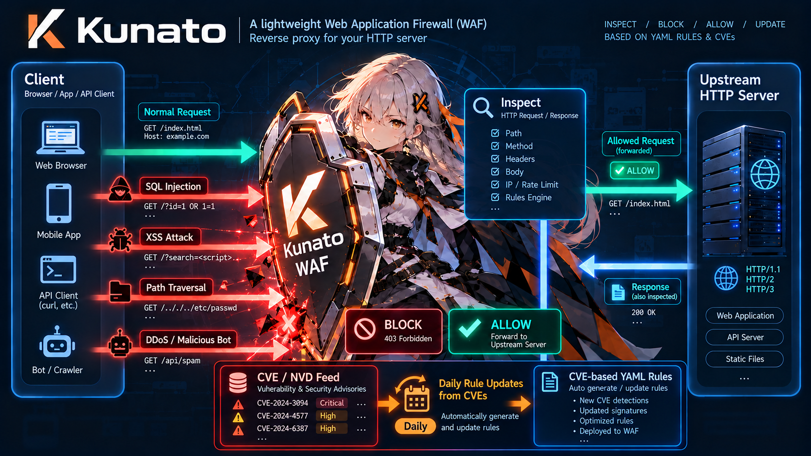

# Kunato

[](https://github.com/hiroeorz/kunato/actions/workflows/ci.yml)

**English** | [日本語](README.ja.md)

**A self-hosted, single-binary Web Application Firewall (WAF) written in Rust — built for personal servers and small deployments.**


Kunato sits in front of your web application as a reverse proxy, inspects requests and responses against categorized YAML rules (**BLOCK**, **ALLOW**, **LOG**), mitigates DoS / DDoS and brute-force traffic automatically, and stays current through daily CVE-driven rule updates.

> **Status:** Early development. The configuration format and public interfaces are
> not yet stable and may change without notice.

---

## Concept: Why Kunato?

Traditional WAF setups often require either paid cloud services or a complex stack of web server modules, external certificate managers, log parsers, and cron jobs. Kunato is designed around a simpler premise: **protecting a personal or self-hosted web server should take one binary and one YAML file.**

| Pillar | What it means in practice |
| --- | --- |
| **One Binary, Zero External Services** | Reverse proxy, WAF rule engine, automatic Let's Encrypt (ACME) TLS, DoS / DDoS protection, daily rule updater, and operator CLI ship in a single static Rust binary. No database, no Redis, no `certbot`, and no cron job. |
| **Hands-Off Daily Protection** | The bundled rule set updates automatically once a day with signatures for newly exploited CVEs, while built-in rate limiting, connection budgets, and behavioral detection handle floods and probing out of the box. |
| **Readable YAML & Hot Reload** | Rules are organized into clear categories (`sql-injection`, `xss`, `response-leaks`, etc.) with `ALLOW`, `BLOCK`, and `LOG` actions. Changes reload on the fly without restarting or dropping connections. |
| **Fail-Safe by Design** | All buffers and per-IP states are bounded, regexes are compiled once at load time with ReDoS guards, and invalid reloads or failed updates always keep the last known good configuration active. |



## Features

### Reverse Proxy, TLS & Protocols
- **Reverse proxy** — Sits between browsers/apps and your HTTP server, forwarding traffic while inspecting every request.
- **Host allowlist** — Rejects requests whose Host or `:authority` is missing, malformed, or not in `allowed_hosts` with `400`/`421` before rules run. The installer seeds the list from `--acme-domain`; add other names or IPs with `--allowed-host`.
- **HTTP/2, HTTP/3, and HTTP/1.1** — Accepts HTTP/2 over TLS (ALPN) and cleartext h2c (prior knowledge), plus optional HTTP/3 over QUIC, falling back to HTTP/1.1 automatically. Upstream requests are sent over HTTP/1.1.
- **Automatic TLS certificates** — Obtains and renews Let's Encrypt certificates directly over the ACME protocol (TLS-ALPN-01 on the HTTPS port). No external tools such as certbot, no cron job, and no deploy hooks: list your domains under `tls.acme` and Kunato handles issuance, renewal, and in-place rotation, caching the certificate locally between restarts.
- **WebSocket proxying** — Forwards HTTP/1.1 upgrade handshakes to the upstream and tunnels the connection both ways. The handshake passes through the rule engine and protection budgets; idle tunnels are closed automatically.
- **Trusted proxy support** — Explicit proxy IP/CIDR trust resolves client identities behind CDNs and load balancers for rules, request limits, and behavioral bans. See the [deployment checklist](docs/behavioral-readiness.md).

### Threat Detection & Deep Inspection
- **Categorized rule sets** — Rules are grouped into named categories (for example `sql-injection` or `xss`). Each category defines a default action, and individual rules can override it.
- **Daily CVE-driven rule updates** — An optional updater automatically refreshes the managed rule set once a day with signatures for the latest exploited CVEs, using conditional requests, SHA256 verification, and full validation before an atomic swap.
- **Encoded body inspection** — Bodies compressed with gzip, deflate, brotli, or zstd are decompressed for matching, and request bodies are additionally decoded by content type (`application/x-www-form-urlencoded` and JSON escapes). Forwarded traffic is never modified.
- **Upload content inspection** — Multipart file parts are checked against their declared type, filename extension, and leading bytes: a part that claims an image, PDF, office, media, or font type must start with that format's signature, so source code renamed to `.jpg` or `.pdf` is rejected together with executable, script, or markup content behind a safe claim, PHP short tags, and raw write bodies sent to an executable or script path. `strict` mode also covers generic binary claims.
- **Response inspection** — Response-phase categories match upstream responses on status, headers, and body (up to a size limit) and can block, log, or pass them through. The remainder of oversized responses is streamed uninspected.
- **Response header rewriting** — Removes or replaces identifying response headers such as `Server` and `X-Powered-By` on upstream responses and Kunato's own block/error responses alike.

### DoS / DDoS & Behavioral Protection
- **DoS / DDoS detection and mitigation** — Detects abnormal request patterns and automatically throttles or blocks abusive sources.
- **Behavioral abuse detection** — Per-source windows over upstream responses flag iterative `404` probing and authentication-failure bursts, and a global window records distributed authentication failures. The example configuration blocks enumeration and leaves authentication signals in observation mode; `BLOCK` remains configurable per signal.

### Operations & Reliability
- **YAML rules with hot reload** — Rules are written in YAML. Changes to the rule file are detected at runtime and reloaded on the fly without restarting the process or dropping connections.
- **High fault tolerance** — Keeps serving with the last known good configuration, isolates failures, and avoids disrupting traffic during reloads.
- **Guided install** — One `curl | sudo sh` command installs the static binary, the systemd service, the configuration, and the initial rule set on a Linux server.
- **Simple deployment** — One binary and one YAML configuration file. No database, no external services, no complex setup.
- **Rust implementation** — Memory safety and predictable performance in a single static binary with no runtime dependencies.

## How It Works

```text
                 inspect & apply rules
Client ──────►  ┌───────────────────┐  ──────►  Upstream HTTP server
(browser/app)   │  Kunato (WAF)     │
                │  reverse proxy    │  ◄──────  (response)
                └───────────────────┘
```

1. A request arrives at Kunato.
2. If `allowed_hosts` is configured, the Host / `:authority` is checked first; a missing, malformed, or unlisted name is rejected with `400`/`421`.
3. Categories are evaluated in the order they appear in the configuration, and rules within each category in their order.
4. The first rule whose conditions all match is handled according to its effective action:
   - `ALLOW` — forwards the request and stops evaluation.
   - `BLOCK` — rejects the request immediately (default: `403 Forbidden`).
   - `LOG` — records the match and continues evaluation.
5. If no rule matches, the request is forwarded to the upstream (pass-through).
6. Response-phase categories run on the upstream response the same way. `BLOCK` replaces the upstream response with the configured response; `ALLOW` stops response evaluation and passes the response through unchanged.

## Getting Started

### 1. Install on a Linux Server

Kunato ships as a single static binary for Linux. On a server with systemd, one
command installs the binary, the service, the configuration, and the initial
rule set, and terminates TLS with an automatically obtained Let's Encrypt
certificate:

```sh
curl -fsSL https://raw.githubusercontent.com/hiroeorz/kunato/main/scripts/install.sh \
  | sudo sh -s -- \
      --upstream http://127.0.0.1:8080 \
      --acme-domain example.com \
      --acme-contact admin@example.com \
      --yes
```

Replace the upstream with the web server Kunato protects, and the domain and
contact with a DNS name that resolves to this server and an address for
Let's Encrypt expiry notices. Automatic certificates need TCP port 443
reachable from the internet, so wildcards and setups behind a TLS-terminating
CDN or proxy must manage certificates manually (see
[Deployment](docs/development.md#deployment) for the full option list).

The installer verifies the release `SHA256SUMS` with its embedded minisign
public key. Install `minisign` on servers that use the `curl | sudo sh` path, or
pass `--allow-unverified` explicitly to accept checksum-only verification over
HTTPS (not recommended). `kunato upgrade` verifies the installer in-process and
does not need the CLI.

The `--acme-domain` names are also written to `allowed_hosts`, so requests with
any other Host header are rejected with `421`. If clients reach Kunato through
another name or an IP address (for example a health check), add it with
`--allowed-host` or edit `/etc/kunato/kunato.yaml` (see
[Host allowlist](docs/development.md#host-allowlist)).

The service starts automatically; the first start orders the certificate in
the background, so allow a few seconds before TLS works. A successful install
or `kunato upgrade` ends with a colored mascot banner; `--no-banner` on the
installer (or `KUNATO_NO_BANNER`) suppresses it, and `NO_COLOR` prints it
without colors.

### 2. Inspect Status, Logs, and Metrics

Confirm the service is running, inspect traffic and metrics, or validate the
configuration at any time:

```sh
systemctl status kunato
sudo kunato log -n 50
kunato metrics                       # metric table from :9090
kunato banner                        # print the mascot banner again
sudo kunato validate
```

`kunato log` reads the systemd journal and adds structured filters:

```sh
sudo kunato log -f                                  # new entries, real time
sudo kunato log --ip 203.0.113.9 --since '1 hour ago'
sudo kunato log --attack sqli --action BLOCK
sudo kunato log --status 429 --format table         # aggregated 429 events
sudo kunato log --attack cve-2025 --format json | jq .
```

`--attack` accepts the category-based classes listed by
`kunato log --list-attacks`; `--category` and `--rule` select exact names.
Rate-limit and ban rejections are aggregated per source with a `suppressed`
count (a new ban is emitted immediately), so `--ip` remains usable during a
flood without writing one journal line per rejected request.

`kunato metrics` prints one row per metric in a bordered table with the name and
value columns, leaving out the Prometheus `# HELP` and `# TYPE` lines, aligning
values to the right, and adding the local date and time to timestamp gauges;
pass `--listen <ADDR>` when the admin listener uses another loopback address.

`kunato maintenance on` stops forwarding to the upstream and answers every
request with a `503` maintenance page; `kunato maintenance off` restores normal
proxying. The page uses the bundled `maintenance_in_progress.png`, and request
bodies are not forwarded. Both commands talk to the loopback admin listener
(`127.0.0.1:9090` by default; pass `--listen <ADDR>` to change it), and the
switch resets to off when Kunato restarts.

```sh
kunato maintenance on
kunato maintenance off
```

`kunato admin-access` controls declared administrative functions (for example
`/wp-admin`, plugin installation, and file-update pages) with a default state
and time-limited overrides. Enabling `admin_access` loads built-in presets for
WordPress, Rails, Laravel, generic `/admin` panels, phpMyAdmin, Adminer,
Tomcat/JBoss consoles, Solr, Spring Actuator, Nextcloud, Ghost, and TYPO3, and
starts them `open` by default; set `default: close` to keep them unreachable
unless explicitly opened. The simplest commands apply to every client and
every function:

```sh
kunato admin-access close            # close everything for the default TTL
kunato admin-access open --ttl 10m   # open everything for ten minutes
kunato admin-access open --client 192.168.1.20 --function wordpress-admin --ttl 10m
kunato admin-access status
```

`--client` and `--function` are optional. The most recent matching command
wins, and overrides revert to the configured default when they expire. Closed
requests receive `404` and never reach the upstream; open requests still pass
through the normal WAF rules, and all overrides reset when Kunato restarts.
See [administrative access](docs/development.md#administrative-access) for the
configuration, path matching, and recovery notes.

### 3. Configure and Customize Rules

Edit `/etc/kunato/kunato.yaml` to adjust proxy settings or add your own rules;
changes are detected and hot-reloaded without a restart:

```yaml
listen: 0.0.0.0:443
upstream: http://127.0.0.1:8080

allowed_hosts:
  - example.com

tls:
  acme:
    enabled: true
    domains:
      - example.com
    contact: admin@example.com

# Local rules evaluated after overrides_file and before the managed rules_file:
categories:
  - name: local-allowlist
    action: ALLOW
    rules:
      - name: office-network
        match: { source_ip: 203.0.113.10/32 }

  - name: local-policy
    action: BLOCK
    rules:
      - name: block-legacy-admin
        match: { path: '^/old-admin(/|$)' }
      - name: log-suspicious-param
        action: LOG
        match: { regex: '(?i)(?:^|&)debug=1(?:&|$)', in: [query] }

# Managed rule set refreshed daily by rules_update:
rules_file: /var/lib/kunato/rules.yaml
```

Rules are evaluated in order: **`overrides_file`** (if configured) → **inline `categories`** → **`rules_file`** (the managed set). See the [development guide](docs/development.md) for the full configuration schema and rule syntax.

### 4. Upgrade or Uninstall

Upgrading an installed server (Kunato v0.3.2 and later) uses the built-in
command, which reruns the installer published with the target release:

```sh
sudo kunato upgrade                    # upgrade to the latest release
sudo kunato upgrade --version v0.4.0   # pin a specific release
sudo kunato upgrade --dry-run          # print what would run
```

A pinned release older than the running binary is refused unless
`--allow-downgrade` is also given, so a replayed release asset cannot silently
roll the server back.

Existing configurations are kept as-is, including an absent `allowed_hosts`;
add the field to the existing file to enable host checking. Rerunning the
installer also upgrades the binary and unit, keeps the configuration, and
restarts the service; `--uninstall` removes them. See
[Managed Rules and Automatic Updates](#managed-rules-and-automatic-updates) for
what is refreshed after installation, and
[Deployment](docs/development.md#deployment) for installer details and building
from source.

### 5. Try It Locally (From Source)

To test Kunato locally without installing the systemd service, start the
included example upstream server and run Kunato against `rules.example.yaml`:

```sh
cargo run --example upstream -- --listen 127.0.0.1:3000
cargo run -- --config rules.example.yaml
```

Then send requests to `http://127.0.0.1:8080/` (`trusted-sources` is disabled
by default in `rules.example.yaml`, so block rules apply locally).

### 6. Sign Releases and Rules (Maintainers)

Signing is only needed when publishing artifacts: the installed binary verifies
signatures with its embedded keys, so upgrades do not need the `minisign` CLI.

```sh
sudo apt-get update
sudo apt-get install -y minisign
./scripts/generate-signing-keys.sh
```

Paste the printed public keys into `src/trust.rs`, then sign the rule set or a
release asset with `./scripts/sign-artifact.sh KEY FILE`. See
[Release and rules signing](docs/release-signing.md) for key storage, rotation,
and the remaining trust limits.

## CLI at a Glance

| Command | Description |
| --- | --- |
| `kunato --config <PATH>` | Run the WAF reverse proxy server (default: `/etc/kunato/kunato.yaml`). |
| `kunato init --upstream <URL>` | Generate a starter configuration file. |
| `kunato validate` | Validate the configuration, managed `rules_file`, and `overrides_file`. |
| `kunato log [OPTIONS]` | Query and filter Kunato security events from the systemd journal. |
| `kunato metrics` | Display Prometheus metrics from the loopback admin listener (`127.0.0.1:9090`). |
| `kunato maintenance on\|off` | Serve the maintenance page without forwarding, or restore normal proxying. |
| `kunato admin-access status\|open\|close` | List or toggle time-limited access to declared administrative functions. |
| `kunato update-rules` | Check for, verify, validate, and apply the latest managed rule set once. |
| `kunato upgrade` | Upgrade the installed binary and systemd unit while preserving configuration. |
| `kunato banner` | Print the colored mascot banner to the terminal. |

## Managed Rules and Automatic Updates

The installer enables `rules_update`, so the rule set stays current without
manual work. Every `interval` (default `24h`, randomized by `jitter_percent`,
default 10%) Kunato:

1. sends a conditional request (`If-None-Match` / `If-Modified-Since`) and stops
   immediately on `304 Not Modified`;
2. downloads the rule file and verifies its SHA256 digest against `checksum_url`;
3. parses and fully validates it — regex compilation, ReDoS guards, action
   resolution, size limits — before replacing anything;
4. swaps the file in atomically, and the configuration watcher hot-reloads it.

Any failure (network, checksum mismatch, invalid rules, size limit) leaves the
current rules active; failures are logged and counted in the
`kunato_rules_update_*` metrics, and a rule set that needs a newer build is
counted separately in `kunato_rules_update_incompatible_total` (see
[Rule set format compatibility](docs/development.md#rule-set-format-compatibility)).
The full field reference lives in
[Rule sources and updates](docs/development.md#rule-sources-and-updates).

Updates run automatically, so a manual check is normally unnecessary. To apply
the latest rule set immediately instead of waiting for the next interval, run:

```sh
sudo kunato update-rules
```

This performs a single check and exits, and is the same command the installer
uses for the first download.

Local changes are never overwritten: exemptions and rule disables belong in
`overrides_file` (`/etc/kunato/overrides.yaml` when configured), which is
evaluated before the managed set. The updater writes exactly one file — the
managed rules file — and nothing else.

### Installed files and directories

```text
/
├── usr/
│   └── local/
│       └── bin/
│           └── kunato                         # binary (0755 root:root)
├── etc/
│   ├── systemd/
│   │   └── system/
│   │       ├── kunato.service                 # unit (0644)
│   │       └── multi-user.target.wants/
│   │           └── kunato.service -> ../kunato.service
│   └── kunato/                                # settings (0750 root:kunato)
│       ├── kunato.yaml                        # main configuration (0640 root:kunato)
│       ├── overrides.yaml                     # only when configured (0640 root:kunato)
│       └── tls/                               # only with --tls-cert/--tls-key (0750 root:kunato)
│           ├── cert.pem                       # (0640 root:kunato)
│           └── key.pem                        # (0640 root:kunato)
└── var/
    └── lib/
        └── kunato/                            # StateDirectory (0750 kunato:kunato)
            ├── rules.yaml                     # managed rule set (auto-updated)
            └── rules.yaml.update-state        # updater bookkeeping (auto-updated)
```

Auto-updated: `/var/lib/kunato/rules.yaml` and its `rules.yaml.update-state`
sidecar (last success timestamp, HTTP validators). Never touched by the updater:
everything under `/etc/kunato/`. The service runs as the `kunato` user (created
by the installer, no home directory) and only needs write access to
`/var/lib/kunato/`.

## Attack Coverage

[Attack coverage](docs/attack-coverage.md) tracks which attack classes the
bundled rules and engine mechanisms cover, which are partial, and which are
gaps, with the evidence behind every verdict. It is refreshed whenever the rule
set or the engine changes.

## Security Lab

The local security lab starts a real recording HTTP server and Kunato in
isolated Docker containers, with no published ports or host networking, and
exercises them in a sandbox with the same pinned tools used for real scanning:
goTestWAF, sqlmap, Nuclei against an Apache 2.4.49 CVE-2021-41773 fixture, ffuf,
ZAP, and k6, plus common-injection/API and recent CVE/AI surface cases, raw
HTTP/1.1 framing, HTTP/2 preface, and WebSocket cases.
Every case is sent directly to the origin first, without Kunato, so the test is
valid before the protected result is trusted; each run retains origin receipts,
Kunato logs, resource measurements, and recovery evidence. See
[how the lab tests sandbox suites](docs/security-lab-testing-model.md) for the
topology, control/evidence model, verdicts, and diagrams.

Run the full sandbox suite, or one focused suite at a time:

```sh
scripts/security-lab.sh prepare
scripts/security-lab.sh run --sandbox-suite all
scripts/security-lab.sh run --sandbox-suite common
scripts/security-lab.sh run --sandbox-suite recent
scripts/security-lab.sh run --sandbox-suite response
scripts/security-lab.sh run --sandbox-suite graphql
scripts/security-lab.sh run --sandbox-suite jwt
scripts/security-lab.sh run --sandbox-suite hardening
scripts/security-lab.sh run --sandbox-suite ssrf-xxe
scripts/security-lab.sh run --sandbox-suite credential-stuffing
scripts/security-lab.sh run --sandbox-suite global-auth
scripts/security-lab.sh run --sandbox-suite scraping
scripts/security-lab.sh run --sandbox-suite protocol
scripts/security-lab.sh run --sandbox-suite slow
scripts/security-lab.sh run --sandbox-suite load
```

## Documentation & Development

Running from source, the black-box test suite, deployment and building from
source, the full configuration reference, DoS / DDoS protection, and
contributing notes live in the
[development guide](docs/development.md).

| Document | Contents |
| --- | --- |
| [Development Guide](docs/development.md) | Full YAML configuration reference, deployment options, DoS / DDoS protection, black-box testing, and building from source. |
| [Design & Architecture](docs/DESIGN.md) | Concurrency model, request/response lifecycle, body/form/upload inspection policies, and design invariants. |
| [Attack Coverage](docs/attack-coverage.md) | Living tracker of covered, partial, and gap attack classes across the bundled rules and engine mechanisms. |
| [Rule Updates & Compatibility](docs/rule-updates.md) | How daily rule updates and binary/schema version compatibility work. |
| [Signing Key Backup](docs/signing-key-backup.md) | Encrypted backup, storage, restore test, and rotation rules for the signing keys. |
| [Behavioral Detection](docs/behavioral-detection.md) | Design and configuration of per-source enumeration and authentication-abuse detection. |
| [Behavioral Readiness Checklist](docs/behavioral-readiness.md) | Pre-deployment checklist for trusted proxies and authentication observation. |
| [Security Lab Testing Model](docs/security-lab-testing-model.md) | Isolated container topology, control/evidence model, and verification process. |

## License

Kunato is provided "as is", without warranty of any kind, express or implied,
including but not limited to the warranties of merchantability, fitness for a
particular purpose, and non-infringement. In no event shall the authors or
copyright holders be liable for any claim, damages, or other liability, whether
in an action of contract, tort, or otherwise, arising from, out of, or in
connection with the software or the use or other dealings in the software. You
use it at your own risk, and you remain responsible for keeping your applications
updated and securely configured.

Licensed under either of [Apache License, Version 2.0](LICENSE-APACHE) or
[MIT license](LICENSE-MIT) at your option.

Unless you explicitly state otherwise, any contribution intentionally submitted
for inclusion in this project by you, as defined in the Apache-2.0 license,
shall be dual licensed as above, without any additional terms or conditions.
