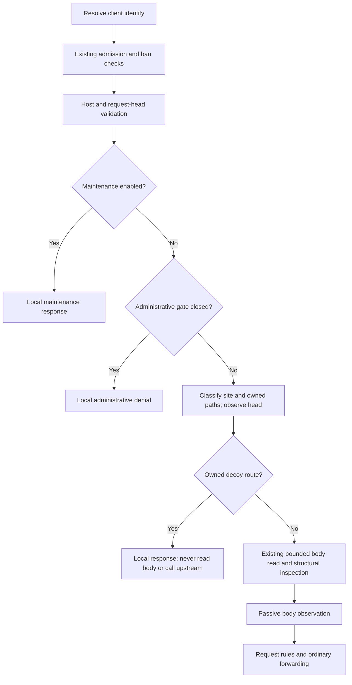

# Experimental decoy design

Date: 2026-11-10

Status: First release implemented; experimental, enabled in starter configurations,
and not yet released. The configuration requires a new binary release and is
not distributed through managed rule updates. Source bans, simulated
navigation, and adaptive-agent evaluations remain future work.

Related documents: [next-version concept](next-version-ai-defense.md#4-use-decoys-to-obtain-evidence-of-attack-progression),
[behavioral detection](behavioral-detection.md), and
[lab evidence model](security-lab-testing-model.md).

## 1. Decisions

Kunato will optionally serve small fictional configuration files containing a
credential for an HTTP endpoint that also exists entirely inside Kunato. It
will recognize the credential when it returns in another request, including
from a different source address.

| Area | First-release decision |
| --- | --- |
| Activation | Shipped and generated configs enable explicit sites; absent `decoys` means disabled |
| Lure | A fictional credential for a configured, same-site HTTP API |
| Ownership | Explicit sites and exact paths; every method on an owned path stays local |
| Evidence | Distinguish a credential presented to the fake API from a token occurrence elsewhere |
| Shipped action | `BLOCK` rejects only a qualified request to the fake API; no behavioral score |
| Schema fallback | An omitted action remains `LOG` for existing local configurations |
| Source ban | Excluded from the first release |
| Tokens | Process-local HMAC key, random nonce, authenticated expiry and site scope |
| State | No token table; fixed global state and fixed additions to tracked-source entries |
| Transports | HTTP/1.1, HTTP/2, HTTP/3, and observation of WebSocket handshake headers |
| Upstream | No connection, lookup, or request for an owned decoy path |
| Dependencies | Existing `ring`, `http`, and bounded decoding helpers; no new crate |

The useful claim is **recognition of a returned decoy credential**. This is not
proof of a person's identity, malicious intent, AI use, or delivery of the
original response to a particular person. It does not invalidate all IP
rotation: recognition works only when the credential returns through this
Kunato process before it expires.

## 2. Threat model and evidence

An untrusted client may retrieve, alter, share, encode, or replay any decoy
response. It may send valid tokens through other people's browsers, quote them
in articles, and generate enough invalid candidates to exhaust inspection.
Multiple people can share an IP or an aggregated IPv6 prefix.

HMAC establishes that the token was minted by this process for this site and
purpose. It does not authenticate the party presenting it. Consequently:

| Observation | Classification | Decoy action |
| --- | --- | --- |
| Fetch an owned configuration path | `issued` if a token-bearing response is built | Return the bounded local response |
| Valid token as the entire accepted authentication credential on the owned API | `credential` reuse | `LOG`, or reject this request with `403` under `BLOCK` |
| Valid token in a path, query, cookie, Basic credentials, body, or another endpoint's headers | `occurrence` | Log only |
| Wrong-site, altered, expired, unknown-version, or malformed token | No reuse evidence | No decoy enforcement |
| Inspection cannot finish within its budget | Incomplete observation | No token-based enforcement on ordinary application traffic |

An image request containing `?token=<valid-token>` must never produce a decoy
ban or an additional behavioral score. A scanner that checks a leaked secret
may produce credential evidence; logs must describe the observation without
labeling its source as a confirmed attacker.

AWS, database, and external Git credentials are not first-release lures. Their
normal use may bypass Kunato, and AWS SigV4 derives a signature rather than
sending the secret key itself. That restriction follows from
[AWS's signing protocol](https://docs.aws.amazon.com/IAM/latest/UserGuide/reference_sigv-create-signed-request.html).
No real cloud account, DNS callback, database, or third-party credential
validation service is involved.

## 3. Proposed configuration

The following block is the complete first-release configuration surface.
Values shown for limits are schema defaults. The shipped and generated policy
explicitly enables the three sample presets and `BLOCK`; an omitted block is
still disabled and an omitted action is still `LOG`. Site definitions have no
implicit schema default.

```yaml
decoys:
  enabled: true
  token_ttl: 30m
  on_reuse: BLOCK
  issuance:
    per_minute: 60
    burst: 10
    per_source_per_minute: 6
    per_source_burst: 2
  verification:
    per_second: 256
    burst: 256
  observation:
    body: true
  sites:
    - name: blog
      origin: https://blog.example.com
      sink: /_decoy/api/v1/storage/list
      presets: [dotenv, git-config, wordpress-backup]
      disabled_paths: []
      paths:
        - path: /.env.production
          template: dotenv
```

Configuration rules:

- Use `deny_unknown_fields` throughout. `on_reuse` accepts only `LOG` and
  `BLOCK`. `ban` and `source_ban` are unsupported fields in this release.
- An omitted block is disabled. An explicitly disabled block may omit sites;
  any supplied values must still validate. An enabled block requires 1..16
  sites. `allowed_hosts` is optional.
- Site names match `[A-Za-z0-9._-]{1,64}` and must be unique. Origins must also
  be unique after canonicalization. Runtime site matching has no wildcard or
  inferred site. `kunato init` writes one explicit site using the first ACME
  domain or allowed host; wildcard inputs use the `blog` subdomain. Without
  either input it writes `https://blog.example.com` for the owner to replace.
- An origin is an absolute `https` origin without user information, a query,
  or a fragment; its path is empty or `/`. Reuse Host parsing for ASCII DNS
  names, IPv4, bracketed IPv6, and ports. DNS names are lowercase with the
  existing trailing-dot normalization. Canonical origins omit port 443.
- Match requests by the validated Host/authority, not by `X-Forwarded-Host`,
  `Forwarded`, or a guessed TLS scheme. For site matching, an absent port and
  explicit 443 are equivalent; a nondefault port must match explicitly. The
  existing `allowed_hosts` check, when configured, still runs first and may be
  stricter. Without it, nonmatching domains keep their normal routing.
- When `allowed_hosts` is configured, validate that the origin authority or
  its explicit default HTTPS port alias is accepted by that policy. The
  owner must allow the actual authorities used by their proxy. A TLS-terminating
  CDN can use HTTP to Kunato; the configured public origin remains HTTPS.
- `token_ttl` is a whole number of seconds in 1m..24h. Issuance rates are
  1..6000/minute globally and 1..600/minute per source. Bursts are 1..100;
  source rates and bursts must not exceed their global counterparts.
- Verification rate and burst are each 1..4096. Limits cannot be zero to
  disable bounding. Use `enabled: false` to disable the feature.
- Rate fields specify token-bucket refill rates. A capacity `B` and rate `R`
  permit at most `B + R * elapsed` operations from a full bucket; they are not
  exact rolling-minute quotas.
- A site has one required sink and at least one effective trap. Accept at most
  32 traps per site and 128 across the configuration, including presets.
- Configured paths are literal, case-sensitive absolute paths of at most
  512 ASCII bytes. Permit only `/` and unreserved ASCII characters
  (`A-Z`, `a-z`, `0-9`, `-`, `.`, `_`, `~`). Reject repeated slashes and
  `.`/`..` segments. Require that path
  normalization leaves each configured path unchanged. No regex is accepted.
- Local `paths` replace a preset at the same literal path. Duplicate local
  paths are errors. `disabled_paths` removes preset paths only; an unknown
  removal or a simultaneous local replacement and removal is an error.
- The sink must not equal any trap. Site names, origins, sinks, and effective
  traps are compiled and validated before snapshot installation.

Declaring a path explicitly transfers its routing to Kunato while decoys are
active for that site. Kunato cannot check that the upstream has no legitimate
route there without violating local-only operation. Configuration inspection
must list every effective path and its template. Startup/reload warnings must
identify overlaps with administrative functions, content routes, and PHP or
GraphQL scopes. These are warnings, because a deliberate overlap can be useful;
the priority in Section 5 always applies.

### 3.1 Presets

Presets are opt-in individually; an omitted `presets` is an empty list.

| Preset | Exact paths | Template |
| --- | --- | --- |
| `dotenv` | `/.env` | `dotenv` |
| `git-config` | `/.git/config` | `git-config` |
| `wordpress-backup` | `/wp-config.php.bak`, `/wp-config.php.old` | `wp-config` |
| `spring-env` | `/actuator/env` | `spring-env` |

Do not include live `/wp-config.php`, diagnostic endpoints, arbitrary `/admin`
paths, or every ecosystem by default. The Spring preset can be hidden by a
closed `spring-actuator` administrative function. Decoys do not reopen it.

### 3.2 Switches and exemptions

Effective activation is `decoys.enabled && protection.enabled`. The CLI's
`--disable-protection` override therefore also disables decoys, including local
path ownership; requests then take the existing rules/proxy path. Emit a
control-plane warning when configured decoys are suppressed by this switch.

`protection.behavior.enabled` and `behavior.sequence.enabled` do not control
decoys. An `ALLOW` rule does not bypass owned routes or decoy API enforcement.
Sources in `protection.allowlist` are exempt from token observation and
enforcement. They receive a local `404` on owned routes, without token
issuance; they never reach the upstream through an owned path.

Disabling decoys is an explicit routing change, unlike quota exhaustion.
Operators who need those paths closed even with decoys disabled must retain
their existing rules or administrative policy.

## 4. Local templates and sink

Templates are embedded fixed strings with only two substitutions:
`{{API_URL}}` and `{{TOKEN}}`. The URL is constructed from the configured origin
and sink, never from a request header. Configuration identifiers are not read
from the filesystem, environment, upstream, or a real application's settings.

For example, `dotenv` returns:

```dotenv
APP_NAME=blog
APP_ENV=production
INTERNAL_API_URL={{API_URL}}
INTERNAL_API_TOKEN={{TOKEN}}
```

The `git-config` template has a fictional noncredential remote under
`example.invalid` and an `[internal-api]` section with `url` and `token` fields.
The `wp-config` template contains `INTERNAL_API_URL` and `INTERNAL_API_TOKEN`
definitions. `spring-env` is JSON with fictional `internal.api.url` and
`internal.api.token` values. Use `serde_json` serialization for JSON escaping.
Every template points to the same site's owned sink and uses the same token
purpose. It never embeds a working deployment credential.

The advertised authentication is `Authorization: Bearer <token>` or the entire
`X-Api-Key` value. Documentation explains this convention; no active script,
redirect, external resource, or instruction for exploiting another system is
included. These templates are deliberately small experiments, not a claim of
indistinguishable application emulation. Operational identification belongs in
logs and documentation rather than a fake-secret disclosure alarm.

### 4.1 Route behavior

| Owned route / condition | Response | Token issued? |
| --- | --- | --- |
| Trap, `GET`, quota available | `200`, rendered template | Yes |
| Trap, `HEAD`, quota available | `200`, GET-equivalent headers, no body | No |
| Trap, another method or a WebSocket upgrade | Fixed local `404` | No |
| Trap, issuance quota exhausted or tracking unavailable | Fixed local `404` | No |
| Trap, nonce generation failed | Fixed local `503` | No |
| Sink, `GET`/`HEAD`, no qualified credential | Fixed local `401` | No |
| Sink, qualified credential, `LOG` | Same local `401` and reuse event | No |
| Sink, qualified credential, `BLOCK` | Fixed local `403` and reuse event | No |
| Sink, authentication verification budget unavailable | Fixed local `503` | No |
| Sink, another method or a WebSocket upgrade | Fixed local `404` | No |
| Exempt source, either owned route | Fixed local `404` | No |

The sink's `401` includes a fixed `WWW-Authenticate: Bearer realm="internal-api"`
challenge and a small JSON error. It never authenticates a real operation or
returns a simulated success in this release. `OPTIONS` gets `404`; it does not
enable CORS. Duplicate authentication fields do not qualify for enforcement;
the sink returns `401` and records ambiguity as incomplete observation.

Each local body is at most 4096 bytes, checked against worst-case substituted
lengths at configuration compilation. HEAD lengths are computable without
minting a token because token length is fixed. HEAD consumes the same issuance
quota as GET but does not produce an `issued` event. Ignore Range and conditional
request headers; never return `206` or `304`. No owned route forwards on a
method mismatch, a rendering failure, or quota exhaustion.

### 4.2 Final response policy

Use an internal response extension to identify every decoy response, including
fallbacks. After the ordinary `response_headers.apply()` step, a shared
finalizer for HTTP/1.1, HTTP/2, and HTTP/3 must enforce:

```http
Cache-Control: no-store
X-Robots-Tag: noindex, nofollow
X-Content-Type-Options: nosniff
Referrer-Policy: no-referrer
```

It restores the template's text/plain or application/json Content-Type and
removes ETag, Last-Modified, Age, Content-Encoding, range metadata, Set-Cookie,
Location, Refresh, Link, Content-Location, and all Access-Control-* headers. It
also restores the fixed Bearer challenge on 401 responses. Content-Length/body framing remains
the transport's responsibility. A global response policy cannot weaken these
properties. Decoy responses bypass response-phase rules and upstream response
observation.

`no-store` directs conforming caches not to retain the response; it is not a
guarantee about arbitrary CDN configuration. See
[RFC 9111](https://www.rfc-editor.org/rfc/rfc9111.html#section-5.2.2.5).
Deployment validation must check final headers, bypass rules, old cached
objects, and distinct tokens for successive requests through the real CDN.
No claim is made that `noindex` prevents fetching.

## 5. Request pipeline

Preserve the existing early checks and their order:



An already banned client does not reach decoy issuance. A closed
administrative function wins over a matching decoy, including the sink.

After head validation, compute the existing decoded/normalized path forms.
A configured literal matching **any** form owns the request for every method.
If different forms select different owned routes, return a local `404` rather
than choosing a template or forwarding. Paths are case-sensitive. Query
parameters do not affect ownership. Never rewrite the upstream request while
observing tokens.

Implement one common head helper called from `server::handle_request` and
`http3::handle_request`; the latter currently has a separate early pipeline.
The internal payload-processing entry point must require or establish a
validated head outcome so direct callers cannot skip local ownership. Admission
must be charged exactly once, not again during internal dispatch.

The head outcome carries a request-local `DecoyObservation`: remaining byte and
verification budgets, up to 16 cached candidate results, incomplete reasons,
and the strongest verified evidence. Carry this same state into payload
processing; body observation does not get a new budget. Finalize one reuse log
on a local exit or before ordinary forwarding. If structural processing exits
early, finalize head evidence without searching the rejected body. Head/body
hooks must not independently log or reverify the same token.

Local responses do not drain an untrusted body. On HTTP/1.1, close the connection
after responding when an unread body is declared. On HTTP/2 and HTTP/3, cancel
only the receive side as appropriate and preserve the response and other
streams. Test pipelined bytes and half-closed streams. Do not add an unbounded
background drain or let an upgrade establish a tunnel on an owned path.
HTTP/3 abandons only request reception with `H3_NO_ERROR`, as specified for an
early complete response in [RFC 9114, Section 4.1](https://www.rfc-editor.org/rfc/rfc9114.html#section-4.1).

Body observation runs immediately before request-rule evaluation when ordinary
structural inspection succeeds. A rejected body need not be searched. It is
passive even on `content_routes`, where quoted tokens may be legitimate authored
content. Existing upload, form, PHP, GraphQL, JWT, and resource checks retain
their behavior. A new decoy hook must not turn an incomplete observation into a
structural rejection.

## 6. Token protocol

### 6.1 Encoding and authentication

Use this exact, fixed-length wire representation:

```text
kdt1.<iat16>.<exp16>.<site32>.<nonce32>.<mac64>
```

All fields are lowercase hexadecimal with exactly the indicated character
count; the entire token is 169 ASCII bytes. Interpret `iat` and `exp` as
unsigned 64-bit values and site and nonce as 16 bytes each. The MAC is the full
32-byte HMAC-SHA256 output. No truncated tag or hand-written MAC comparison is
needed.

`iat` and `exp` are seconds elapsed from a process-local monotonic start, not
Unix timestamps. Let `now` be elapsed whole seconds when validating. Mint
`iat = now`, `exp = iat + token_ttl`, using checked arithmetic. A second-resolution
token can expire less than one second before the configured duration. Reject
`iat > now`, `exp <= iat`, `exp - iat > 86400`, and `now >= exp`.

This avoids system-clock jumps and clock-skew allowances. UTC timestamps remain
in logs only. Tokens cannot survive restart or move between independent Kunato
instances, which have different keys and monotonic epochs.

Compute site identity as the first 16 bytes of SHA256 over:

```text
"kunato/decoy/site/v1\0" || u16be(name_length) || name_ascii ||
u16be(origin_length) || canonical_origin_ascii
```

Reject a site-ID collision at compilation. The immutable configuration maps
site IDs to sites. This is configuration state, not a token registry.

Generate each nonce with `ring::rand::SystemRandom`. The authenticated message is:

```text
"kunato/decoy/credential/v1\0" || u64be(iat) || u64be(exp) || site_bytes || nonce_bytes
```

All displayed `\0` bytes in these protocol definitions are literal NUL bytes.
The domain constant binds version and credential purpose. Include no IP address
in the token: recognizing a returned token across sources is the intended
observation. Nonces give probabilistic per-response uniqueness without a
counter. No template ID is required because all templates advertise the same
credential and sink for their site; the issuance log records the template.

Parse fixed lengths and scope first, then call the existing
[`ring::hmac::verify`](https://docs.rs/ring/0.17.14/ring/hmac/fn.verify.html),
which compares in constant time. A verified reuse event also requires current
site membership and an unexpired token. Unknown versions and purposes are not
accepted. There is no token-specific revocation or single-use guarantee.

### 6.2 Key and configuration lifetime

`DecoyRuntime`, shared by the proxy context, holds one 256-bit random HMAC key
and its monotonic epoch. Prepare it before enabling the first snapshot, either
at startup or on a control-plane reload. A failed key generation rejects that
startup/candidate configuration; it never publishes a partially enabled policy.
Do not initialize a key lazily from a request handler.

The key remains unchanged for the process lifetime, including disable/re-enable
and rule/configuration reloads. It is never serialized, logged, or exposed
through Debug. Compiled policies hold a shared runtime handle so a reload can
prepare and retain it before installation; key material belongs only to that
runtime, and request handlers never initialize it. Key persistence and clustered
validation are out of scope.

| Change | Effect |
| --- | --- |
| Rule-only reload | No change to key or tokens |
| Change issuance TTL | New tokens use the new TTL; existing signed expiries remain valid |
| Change templates or traps | Existing credentials for a retained site remain valid |
| Change sink | Existing credentials are recognized on the new sink; the old sink loses ownership unless separately declared |
| Rename site or change origin | Changes site ID; old tokens are no longer accepted there |
| Remove site / disable decoys | New requests no longer recognize its tokens or own its paths |
| Restore the same site / re-enable before expiry | Old tokens can be accepted again under the retained process key |
| Invalid reload | Keep the previous compiled configuration and runtime state |
| Restart | All old tokens become invalid; quotas and log budgets reset |

As elsewhere, an in-flight request retains its configuration snapshot. A
successful disable is not a cancellation barrier for an already building
response. Making TTL shorter is not immediate revocation; operators who need
all credentials invalid immediately must disable the feature and restart
before re-enabling it.

## 7. Bounded recognition

### 7.1 Qualified credential extraction

Inspect exact credentials before doing any substring search. A qualified
credential requires every condition below:

1. The request targets this site's owned sink by path-form matching, with
   method `GET` or `HEAD`, and is not a WebSocket upgrade.
2. It has exactly one accepted authentication field: either one Authorization
   field containing case-insensitive `Bearer`, one ASCII space, and the entire
   token, or one X-Api-Key field containing the entire token. Strip outer HTTP
   optional whitespace only.
3. Neither accepted field is duplicated, and both mechanisms are not supplied
   together. A field exceeding 512 bytes is unqualified. Do not search for a
   credential inside surrounding text to authorize enforcement.
4. Site, MAC, purpose, and lifetime validation succeed.
5. The source is not exempt and sufficient verification budget is available.

Cookies, browser-managed Basic authentication, query values, form posts, and
arbitrary JSON strings never qualify. No CORS headers, Set-Cookie, redirects,
or browser scripts are generated by the sink. This reduces ordinary browser
ambient-credential paths; it still does not establish the user's intent.

### 7.2 Passive observation

The optional observation path searches for valid returned tokens in this order:

1. Accepted authentication fields on other routes, then other values from those
   fields on the sink. Qualified extraction has already received first budget.
2. Raw and existing percent-decoded/normalized path and query forms.
3. Cookie fields, then other request header values in received order.
4. The inspected body prefix when `observation.body` is enabled.

Recognize bounded standard Basic credentials by Base64-decoding at most 1024
encoded bytes of one field, and search the resulting user/password pair only
as passive data. Basic credentials are encoded on the wire as specified in
[RFC 7617](https://www.rfc-editor.org/rfc/rfc7617.html).

The first release has these fixed hard caps, independent of configurable
ordinary request limits:

| Resource | Bound per request |
| --- | --- |
| Total scanned/decoded representation bytes, including qualified extraction | 32768 |
| Body bytes in each eligible raw or already-decoded prefix | 8192, also charged to the total budget |
| Distinct syntactically complete candidates / HMAC verifications | 16 total, including qualified extraction |
| Percent-decoding depth for additional passive forms | 2 |
| Additional Basic decoded output | 768 bytes, charged to the total budget |

Use the `kdt1.` filter on each eligible representation, after its bounded
decoding, not only on raw input. Count complete fixed-length candidates, dedupe
them within the request, and reserve candidate slots for qualified extraction
first. Within the scan budget, inspect every header instance rather than just
the first; ambiguous instances cannot trigger enforcement. A token may cross
body-read frames if it fits entirely inside the inspected prefix.

For uncompressed textual bodies, search the raw prefix and bounded complete
URL-encoded/JSON-string forms using the existing decoding semantics. Cap input,
output, nesting, and work; a truncated escape or incomplete structure is
uninspectable. Do not parse uploaded file bytes as arbitrary credential text;
reuse the existing multipart masking/field interpretation when available.

For compressed bodies, reuse an origin-facing decoded prefix only when the
existing inspection pipeline has already produced it. Do not add an otherwise
unnecessary decompression, change `inspect_body`, force a full body read, or
allocate the configured maximum body solely for decoys. If no decoded prefix
exists, record `encoding` as incomplete observation and omit body searching.
Unsupported charsets, deeper encodings, bytes after the prefix, and established
WebSocket frames are outside first-release observation coverage.

The 8 KiB cap is a scanning cap, not a promise that the proxy buffers only
8 KiB: its existing read path still uses `limits.max_body_bytes`. Additional
decoy buffers must be charged to the existing inspection reservation.

### 7.3 Exhaustion and ordering

Four fake prefixes cannot consume a four-verification allowance before an exact
sink credential: exact extraction is prioritized. Nevertheless, finite passive
budgets remain exhaustible. For example, a seventeenth complete candidate or a
token after 8 KiB may be missed. Do not claim comprehensive credential scanning.

Global verification is a monotonic token bucket shared by all sites and sources.
Each HMAC attempt consumes one token; a passive duplicate reuses its request-local
result. A syntax/scope rejection need not consume HMAC budget but still consumes
scan/candidate work. The bucket may be exhausted by distributed clients.

On ordinary application traffic, stop extra work, emit an incomplete-observation
counter, and continue the existing pipeline. No decoy-induced rejection is
allowed. On the owned sink, return local `503` when an otherwise syntactically
qualified credential cannot be verified due to budget exhaustion. Never assume
an incomplete scan is a clean result or evidence of abuse. Do not wait for
budget refill.

## 8. Actions and behavioral isolation

`on_reuse: LOG` has no additional enforcement effect. `BLOCK` changes only the
qualified sink response from `401` to `403`. A valid occurrence outside that
context always remains log-only, including on a real API's Authorization field.
Existing rules, rate limits, and bans can still act on those requests for their
own reasons.

No `SequenceKind::DecoyToken` is added in the first release. Current continuity
requires score, dimension, and window thresholds and has independent action
settings; feeding it decoy events could turn `on_reuse: LOG` into an indirect
ban. Keep decoy metrics/events separate. All decoy local responses are returned
as local successful dispatch results, not structural `HttpError` values that
the existing wrapper would record as `StructuralReject`. Do not pass local
`401`s, `403`s, or `404`s to upstream auth/enumeration/scraping observation.

Source-wide BAN is deferred. If later authorized as a separate feature, it must
be explicitly opt-in, limited to qualified credential evidence, and use the
existing bounded ban manager, trusted `client_ip`, source allowlist, and ban
limits. Document shared IPv4 and aggregated IPv6 collateral effects; do not
extend bans on replays from already banned sources. Token sharing and induced
requests remain possible even with these restrictions. The shipped policy
chooses request-local BLOCK; operators may select LOG for observation. There is no automatic action
against the source that originally fetched a token.

## 9. Resource and concurrency model

### 9.1 Issuance

All sites share one process-global issuance bucket. Each eligible trap GET or
HEAD must also acquire quota from a per-source bucket inside the existing
tracked-source entry. Keys use the resolved source and existing IPv6
aggregation, never an untrusted X-Forwarded-For value or just the CDN peer.

Track no new source-to-token map. A missing entry or exhausted tracking table
suppresses issuance with local `404`. It does not force insertion, evict a live
ban, change normal traffic's tracking-exhaustion behavior, or forward the trap.
Per-source quota history lasts only as long as its tracked entry; eviction can
reset it. The process-global ceiling still bounds issuance across entry churn.

Acquire global and source quotas without nesting their locks: charge the global
bucket first, release its lock, then try the source bucket. A source denial may
consume global quota without a refund. This is conservative and can suppress
lures during a flood; suppressions are counted, not treated as attacks.

Nonce generation, rendering, hashing, metrics, and tracing occur outside locks.
Signing work is bounded by issuance quota; verification has its separate quota.
Do not add delays, keep attackers waiting, create background tasks per token,
or introduce unbounded queues.

### 9.2 Retained state

Global state consists of the key, monotonic epoch, issuance/verification/log
buckets, and fixed counters. The compiled site/route table is bounded by
Section 3. Each tracked source gains only a fixed issuance bucket and an
optional last-reuse-log instant; it is evicted with the existing entry.
Request-local scratch space holds at most 16 fixed-size token results and the
bounded decoding buffers. A separate inspection reservation holds this scratch
through head/body observation and is released before rule evaluation; the
ordinary body read keeps its existing independent reservation. Path
classification uses the existing bounded head interpretations, like the
administrative gate. Scratch reservation failure skips passive observation on
ordinary traffic and returns a local fallback on owned paths, with `inspection`
limit/incomplete metrics. Mandatory body reservations may reclaim optional
scratch through a weak handle, discard candidate buffers, and retry once;
head evidence remains available, while further passive scanning stops.
Memory is O(configured routes + tracked sources),
with no growth proportional to issued tokens or token TTL.

On hot reload, retain bucket balances; clamp to reduced capacities without
granting a fresh burst. Refill using the old rate up to the policy transition,
then use the new rate. Use a control-plane generation/effective monotonic time
for lazily migrated source entries. A skipped intermediate policy update must
never grant retroactive credit: conservatively retain/clamp the balance and
resume refill from the current transition. In-flight old snapshots must not
revert bucket generations or capacities. There is no lock held across an await
and no global/source lock nesting.

## 10. Logs and metrics

Emit an `issued` event when a token-bearing response is built. This records
creation, not confirmed receipt. Both issuance and verified reuse include
`token_id = first_16_bytes(SHA256(canonical_token_ascii))`, displayed as 32
lowercase hex characters. Do not use a timestamp prefix as identity.

Issuance fields: site name, template enum, configured trap path, resolved client,
transport peer, token ID, and lifetime seconds. Reuse fields: site name, token
ID, resolved client, peer, age seconds, `credential`/`occurrence`, a fixed
location enum, chosen action, and whether observation was incomplete. Use at
most one reuse event per request, preferring credential evidence. Record all
aggregate counters even when a log is suppressed.

This pair of events permits offline correlation between retrieval and later
sources without an in-memory registry. Logs may be sampled, dropped, or lost;
absence of an issuance log is not proof that minting did not happen. No campaign
database or automatic grouping is included.

Issue and reuse logs each have a process-global limit of 60/minute with burst
10. Reuse additionally logs at most once per tracked source per 10 seconds.
Errors are limited to one line per fixed error kind per minute. Count suppressed
events. These limits deliberately trade correlation completeness for bounded
log volume.

Never include tokens, credentials, query strings, bodies, or arbitrary headers
in feature logs. Audit existing path logging as part of implementation: when
decoys are active, route all request-path log fields through a bounded redactor
that recognizes raw and up-to-twice-percent-decoded token prefixes without HMAC
verification. If a token-bearing path or redaction budget is ambiguous, log a
fixed `[redacted]` path. Redact unverified token-shaped text too. Forwarded
requests are unchanged. Configured trap paths are safe to log directly.

Proposed metrics use fixed labels only:

| Metric | Labels / meaning |
| --- | --- |
| `kunato_decoy_responses_total` | `kind=trap\|sink\|fallback`; all local decoy responses |
| `kunato_decoy_tokens_issued_total` | Tokens minted for GET responses |
| `kunato_decoy_reuse_total` | `context=credential\|occurrence`; at most one count per context per request |
| `kunato_decoy_blocked_total` | Qualified sink requests rejected by BLOCK |
| `kunato_decoy_limited_total` | `reason=global-issuance\|source-issuance\|tracking\|verification\|inspection` |
| `kunato_decoy_scan_incomplete_total` | `reason=bytes\|candidates\|body-prefix\|encoding\|verification\|ambiguous\|inspection` |
| `kunato_decoy_invalid_tokens_total` | `reason=syntax\|mac\|expired\|scope`; bounded candidate counts |
| `kunato_decoy_token_errors_total` | Nonce-generation failures |
| `kunato_decoy_logs_suppressed_total` | `event=issued\|reuse\|error` |

Do not use token IDs, IPs, site names, URIs, header names, or configuration
generations as Prometheus labels. Counters distinguish issuance, occurrence,
qualified presentation, and enforcement; a high reuse count is not an attacker
or campaign count.

## 11. Implementation boundaries

| Area | Responsibility |
| --- | --- |
| New `src/decoy/` module | Token protocol, bounded recognition, fixed templates, local responses, response marker/finalizer, log redaction |
| `src/config/mod.rs` | Proposed schema, compilation/validation, bounded site/path definitions, diagnostics |
| `src/config/watcher.rs` and startup | Prepare runtime key before first enable; atomic valid snapshot installation and quota policy transition |
| `src/protection/mod.rs` | Fixed source issuance quota with existing source keys/table lifecycle; no decoy scoring or new ban behavior |
| `src/proxy/server.rs` | Common validated head dispatch and passive body hook; preserve inspection reservations |
| `src/proxy/http3.rs` | Invoke the same head dispatch/finalizer; bounded receive cancellation |
| `src/request_view.rs` / existing decoding helpers | Reuse path and body interpretations without mutating forwarded data |
| `src/metrics.rs` and log call sites | Bounded counters, structured events, token-safe path fields |
| `tests/proxy.rs` | Real transport, routing, action, reload, and upstream-receipt assertions |
| `lab/` | Deterministic retrieval/presentation scenarios and later independent adaptive-agent experiments |

Do not move configuration parsing into request handlers, place templates in
the rule evaluator, or let protection code render HTTP responses. Owned response
dispatch must be a typed local result so it cannot fall through to upstream
forwarding. Report overlap and effective-route diagnostics through existing
startup/reload diagnostics; no new admin listener or runtime service is needed.

## 12. Verification and acceptance

Tests ship with the first implementation, not as a later feature. Inject
monotonic elapsed time and randomness into token/bucket unit tests; no sleeps
or external services are required.

### 12.1 Token and configuration tests

- Fixed protocol vectors cover serialization, site identity, MAC input and
  verification; mutate each field, separator, length, case, and version.
- Tokens from the same second have different nonces; wrong-site, wrong-key,
  future, expired, and invalid-duration tokens never qualify. Exact expiry is
  invalid. Clock changes have no effect on monotonic validation.
- Verify TTL changes preserve existing signed expiries; site rename/removal
  invalidates scope; restart invalidates old tokens. Failed key generation
  rejects a first-enable candidate without replacing active configuration.
- Reject unknown fields/actions, unbounded limits, duplicate definitions,
  invalid origins/paths, preset mistakes, and sink collisions. Expansion and
  substitution cannot exceed the body bound. Cover port/authority aliases.

### 12.2 Recognition and abuse tests

- A token issued to one synthetic source is recognized from another, with a
  common token ID in issued/reuse events. Assertion wording is correlation,
  not identity attribution.
- Query-only, cookie-only, body-only, real-API, and Basic occurrences remain
  log-only under both actions. Quoted tokens on a content route remain valid
  application content. Cross-site image/form requests never trigger a decoy
  ban or Sequence score, even when Sequence is independently set to BLOCK.
- A canonical sink Bearer or X-Api-Key credential is checked before fake
  substring candidates. Four fake prefixes followed by exact valid sink
  authentication cannot hide that credential. Duplicates/both mechanisms are
  ambiguous and do not qualify.
- Percent encoding, complete JSON escapes, Basic decoding, header instances,
  chunk/frame boundaries, and exact prefix boundaries have explicit expected
  results. Unsupported encoding and candidate 17 report incomplete observation.
- Verification exhaustion passes ordinary application traffic through its
  normal pipeline and returns local 503 on an otherwise qualified sink. No
  malformed or unverified token creates a reuse log, source ban, or score.

### 12.3 Proxy and resource tests

- Trap/sink/fallback routes produce zero mock-upstream receipts for all
  methods, upgrades, encoded aliases, quota exhaustion, table exhaustion,
  malformed authentication, and nonce-generation failure.
- Host validation, identity validation, bans, maintenance, and a closed admin
  gate win before issuance. Test the Spring overlap and exemption table.
- Ordinary non-owned traffic preserves request bytes and existing ALLOW,
  form/upload, PHP, GraphQL, JWT, strict/stream, and content-route semantics.
- HTTP/1.1, HTTP/2, and HTTP/3 agree on all local response classes. HEAD has no
  body or issuance event. A declared unread body cannot contaminate the next
  HTTP/1.1 request, stall a response, or reset another multiplexed stream.
- Response-policy attempts to remove no-store or add cacheable, HTML, CORS,
  cookie, redirect, or encoding headers cannot weaken the final response.
  Conditional/Range requests cannot receive cached-token reuse semantics.
- Concurrent requests respect global and source issuance ceilings, byte/body/
  verification caps, bounded logging, tracking limits, and no nested locks.
  Reloads do not refill bursts, reverse quota generations, or rotate the key.
- Capture tracing output for direct and twice-encoded token paths through
  success, early rejection, administrative denial, and rule-block paths;
  neither raw tokens nor their percent-encoded equivalents appear in logs.
- Local decoy statuses never inflate upstream behavioral counters or reach
  StructuralReject scoring. Nonce errors and quota denials remain local.

The initial deterministic lab case retrieves a token, presents it from a second
source, asserts LOG/BLOCK behavior, checks the correlated events, and keeps an
independent normal client healthy. The existing `agentic` suite is deterministic
and cannot establish whether an actual LLM believes the lure. Its new cases
must be described as retrieval/replay regression tests.

Run the required repository checks in order: `cargo fmt`,
`cargo clippy --all-targets -- -D warnings`, `./scripts/check-deny.sh`, and
`cargo test`. Run the existing black-box suite to check regressions, but do not
add non-CVE decoy scenarios to its CVE request lists. Use integration/lab tests
with decoys explicitly enabled for authoritative behavior assertions.

## 13. Rollout and experiments

1. Implement the complete bounded first release with explicit sites.
   Include token-safe logs, metrics, local fallback paths, and all acceptance
   tests. The experimental project's shipped and generated starter policy
   enables dotenv, git-config, and wordpress-backup with `on_reuse: BLOCK`.
   Keep the omitted-block and omitted-action schema fallbacks unchanged.
2. Observe a representative deployment, validate the actual CDN path and proxy
   identity configuration, and review token occurrences and lost-observation
   counters. BLOCK applies to the owned sink only; LOG remains available.
3. Evaluate templates and optional simulated navigation in an isolated lab.
   Navigation needs a separately domain-separated token purpose that cannot
   qualify as credential reuse. Bound page depth, total responses, and work;
   keep all pages local with dummy data.
4. Run separate adaptive-agent experiments with fixed request/time/compute
   budgets, pinned agent versions, repeated trials, and independent target
   canaries. Compare decoys enabled/disabled while retaining the same WAF
   policy. Report normal browsing/login/upload success, upstream compromise
   evidence, CPU/memory/bandwidth, issuance and presentation rates, and the
   delay among trials that actually present a token. Nonpresentation is a
   separate outcome, not an infinite time measurement.

Source-ban support and any scored Sequence integration require a separate
design/review after those observations. A fake dashboard is not necessary for
the first credential-correlation experiment.

## 14. Release and documentation obligations

This implementation changes no current attack-coverage verdict. Release obligations:

- The configuration reference and ownership/disable semantics are maintained
  in `docs/development.md`; this document specifies the protocol and tests.
- Architecture, logging/metrics references, and the next-version concept state
  the implemented first-release scope.
- `docs/attack-coverage.md` records experimental evidence and honest
  limits. Do not promote a
  general attack class to Covered based on token replay alone.
- Release a new binary for the new configuration schema. Keep the managed
  categories-only `dist/rules.yaml` format unchanged; do not distribute a
  `decoys` block through daily rule updates or change bundled rules to require
  decoys.
- Keep the claims limited to observed credential return and bounded local
  deception. Do not claim zero false positives, same-person attribution,
  comprehensive IP-rotation resistance, or effectiveness against arbitrary AI
  agents without corresponding evidence.

## 15. Verification record (2026-11-11)

The first-release implementation was checked in the working tree, without a
commit or release. No dependency, managed rule, or black-box corpus change was
needed. Existing unrelated edits were retained.

| Requirement | Evidence |
| --- | --- |
| Scoped fixed token protocol, expiry, independent key/nonce, mutations | `src/decoy/token.rs` unit tests include a fixed SHA256/HMAC vector independently generated with Python's standard library |
| Defaults, invalid schemas, canonical authorities, route bounds | `src/decoy/tests.rs` configuration tests |
| Global quota retention and no retroactive reload credit | `src/decoy/runtime.rs` bucket tests |
| Entropy failure, tracking/scratch exhaustion, body-buffer priority | `src/decoy/tests.rs` deterministic failure and inspection-reservation tests |
| Shared scan limits, textual decoding, expiry boundary, path redaction | `src/decoy/tests.rs` scanner/redactor tests |
| Cross-source reuse, LOG/BLOCK isolation, origin receipts | `tests/proxy/decoys.rs` integration tests with Sequence set to BLOCK at threshold 1 |
| HTTP/1.1/2/3, unread bodies, header finalization, multipart fields/files | `tests/proxy/decoys.rs` transport and body tests |
| Concurrency, IPv6 source aggregation, reload/disable/rename/restart | `tests/proxy/decoys.rs` lifecycle and quota tests |
| Real binary, two source identities, log correlation and credential secrecy | `lab/decoy_probe.py` and `lab/cases/decoys.json`, with hashed binary/case inputs in its JSON report |

Completed gates:

- `cargo fmt` and `cargo clippy --all-targets -- -D warnings`: passed.
- `./scripts/check-deny.sh`: advisories, bans, licenses, and sources passed;
  existing duplicate-dependency/unused-license-allowance warnings remain.
- `cargo test`: 1031 passed, 0 failed, 3 existing ignored tests. This includes
  15 decoy unit tests and 18 decoy integration tests.
- `./scripts/blackbox-test.sh --color never`: PASS; 696 allowed, 0 false
  blocks, 2231 blocked responses, 0 forwarded attacks, and one incomplete
  chunked-framing probe with no response. Origin accesses were exactly 696.
- `python3 lab/decoy_probe.py --binary target/release/kunato --output /tmp/kunato-decoy-probe-final.json`:
  all 23 cases passed across disabled, LOG, and BLOCK modes. The report's
  binary/case hashes were checked against the executed artifacts.
- Markdown fences, relative file links, and `git diff --check`: passed.

Socket-based tests were run outside the filesystem sandbox after its loopback
bind restriction was confirmed. This record covers local deterministic
behavior; production CDN validation and actual adaptive-agent evaluations
remain the deployment/experimental work described in Section 13. Source-wide
bans and simulated navigation are explicitly outside this first release.

### Starter-policy follow-up (2026-11-11)

`allowed_hosts` is now optional, with origin consistency checked only when
the policy is configured. Shipped and generated starters explicitly enable
dotenv, git-config, and wordpress-backup with `on_reuse: BLOCK`. Existing
omitted-block and omitted-action schema behavior remains unchanged.

- Configuration tests cover absent/matching/mismatched allowlists, default
  HTTPS ports, and generated DNS, IPv4, IPv6, wildcard, and ACME origins.
- The added proxy test checks local issuance/enforcement without an allowlist
  and confirms that other hosts retain normal upstream routing.
- Required checks passed: formatting, Clippy with warnings denied, dependency
  audit, and 1035 tests (0 failed, 3 existing ignored).
- The unchanged CVE corpus passed: 704 allowed, 0 false blocks, 2242 blocked
  responses, 0 forwarded attacks, and one incomplete chunked-framing probe
  with no response. Origin accesses were exactly 704.
- The loopback replay now omits `allowed_hosts` in all three modes; all 23
  cases passed against the release binary. Managed rules and their checksum
  remain unchanged and synchronized with the example's categories.
