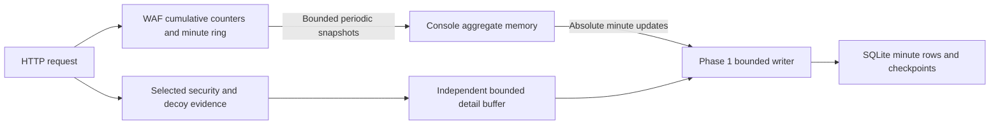

# Monitoring console: counter-based Phase 2

Date: 2026-11-16

Status: The lower-layer Phase 2 implementation is present: WAF memory
measurements, a loopback snapshot API, bounded selected events, console
collection/coalescing, and Phase 1 persistence integration.
[Phase 5](monitoring-console-phase5.md) adds the console process and web/SSE
delivery; [Phase 6](monitoring-console-phase6.md) adds remote access.
Packaging remains future work.
The subsequent [Phase 3](monitoring-console-phase3.md) implements the adopted
[UTC, reason-separated aggregation and 30-day retention policy](monitoring-console-storage.md#4-aggregation-rules).
Phase 2 itself exports the 22 primary-reason counts inside minute buckets;
separate reason rows, wider grains, and expiry belong to Phase 3. The rationale
below describes this phase's source contract.
The [update-cadence evaluation](monitoring-console-cadence.md) recommends
one-second live statistics publication based on partial existing-code/browser
measurements. Phase 2 adds real WAF/collector tests and the performance runner
described below; browser/SSE integration remains future work.

## Implemented interfaces and limits

| Component | Implementation |
| --- | --- |
| WAF measurements | `src/observations.rs`, owned by `Metrics`; fixed atomic cumulative counters and ten minute slots |
| Request context | Tokio task-local, allocation-free basic accounting across HTTP/1, HTTP/2, and HTTP/3 inspection; released at the final response-header decision, including upgrades |
| Statistics API | `GET /console/snapshot` on the existing loopback admin listener; version 2 JSON, no query parameters, no-store response |
| Source identity | Random 128-bit process generation retained across config reloads; unavailable export if generation initialization fails |
| Source clock | Startup UTC anchor plus monotonic elapsed time; wall-clock differences over two seconds are reported and mark bucket coverage incomplete |
| Minute concurrency | Non-waiting atomic pin/rotation; a missed update keeps cumulative totals and marks affected source-minute coverage incomplete |
| Export concurrency | Serialized nonblocking exports; bounded coherent-minute read attempts, followed by cached/unknown incomplete minute values under contention; cumulative live values still publish |
| Gauge history | Sampled zero-order hold between exports at most two seconds apart; retain numerator, observed duration, maximum; gaps are not filled |
| Detail transport | Selected typed rejection, LOG-match, upstream-failure, and decoy evidence in the local snapshot; journal collection is not required |
| Detail bounds | 64 records / 64 KiB at the source, at most 16 admitted records/s; ordinary records use at most 12 of those slots, reserving capacity for decoy evidence; cached export adds at most one bounded copy |
| Console collection | `src/console/collector.rs`; one-second shared polling, 750 ms fetch deadline, 256 KiB response cap, loopback socket only |
| Console memory | Two pending generations, ten uncommitted minute rows per generation, 128 events / 128 KiB per generation by default; finite configuration bounds |
| Live publication | Latest-state Tokio watch channel; a slow subscriber keeps the newest aggregate instead of an unbounded queue; no browser SSE endpoint yet |
| Persistence | Ten-second statistics coalescing, then nonblocking submission and an explicit writer flush request; delays are not stacked with the writer's ten-second metric timer |
| Detail persistence | Independent event-source checkpoints and bounded writer batches; detail loss never increments/decrements authoritative traffic statistics |
| Recovery | Dedicated bounded checkpoint-reader thread; committed generation/sequence baselines, absolute bucket upserts, durable omission/gap metadata |
| Schema | Version 2; transactional migration from application-owned version 1, preserving old rows and unknown fields as unavailable |

New rejection totals are independently incremented once per request. The
new primary-reason map uses 22 fixed terminal reasons; existing diagnostic
subsets may overlap and must not be added to infer the overall total. LOG
requests in this contract are the request/response union, counted once, with
a separate response-LOG subset. Rule matches count effective LOG/BLOCK/ALLOW
engine action records, rather than every predicate or threshold contribution.
The existing Prometheus counter meanings remain unchanged.

Client-visible statuses use 500 fixed bins for 100..599. Out-of-range responses
mark missed measurement/coverage instead of entering a fabricated status bin.
Header-decision latency for supported statuses retains count, microsecond sum,
and 15 exclusive histogram bins with inclusive
upper bounds at 1, 5, 10, 25, 50, 100, 250, 500, 1000, 2500, 5000, 10000,
30000, and 60000 milliseconds, followed by +Inf. This includes request/body
inspection, upstream waiting and any buffered response inspection; it is not
full-body delivery time or pure upstream latency. Aborted requests have their
own counter and do not invent response/status/latency samples.

Selected records intentionally have optional fields: generic denials carry
terminal reason and available client/peer; LOG matches add category/rule;
decoy evidence carries verified hashed IDs and available context. They do not
copy request bodies, headers, tokens, or arbitrary error text. No ordinary
access log is generated. Detail admission happens before metadata allocation,
with try-lock admission and finite rate/byte/count limits. Console-side detail
pressure favors decoy evidence over ordinary records. A bounded source detail
read can reuse its previous event cursor without skipping retained records.

The snapshot's opaque sequence belongs to statistics collection. Its separate
event sequence includes omitted detail candidates. The collector namespaces
statistics and event checkpoints independently. It rejects duplicate/stale
statistics updates, conflicting same-position content while retained, and
counter decreases without a generation change. The source is one ordered local
endpoint; pending old-generation data remains bounded while a new process is
observed. Oversubscribed generation/history buffers record omissions rather
than grow without limit.

Storage failure after startup stops further persistence admission and preserves
the Phase 1 failure contract. Valid subsequent snapshots still update bounded
memory/live state. Health exposes source errors, writer health, queued versus
unconfirmed batches, persistence lag, missed minute attribution, detail
omissions, and source-history gaps. A collector that cannot initialize its
database reports startup failure. Recovery after writer failure starts a new
collector from committed checkpoints; retry loops do not silently advance
progress past failed transactions.

### Development runner

The runner is a separate process and does not implement an official CLI
subcommand, service installation, browser server, or SSE endpoint:

```sh
cargo run --example console_collect -- /tmp/kunato-console-history 127.0.0.1:9090 local-waf
```

Closing a browser does not affect this process. Ctrl-C stops reception and
attempts a five-second final flush. A timed-out OS I/O operation may outlive
that deadline as documented in Phase 1; do not start another writer on the
same directory until it has exited.

### Verification

Evidence is in `src/observations.rs` unit tests, `tests/console_collector.rs`,
`tests/console_storage.rs`, `tests/proxy/observations.rs`, and the decoy console
test in `tests/proxy/decoys.rs`. These cover coherent/cached reads, immediate
and deduplicated counts, boundary/late/expired updates, cancellation, clock
gaps, gauge coverage, detail shedding, all three HTTP protocols, early Host
denial, upstream 403 versus WAF refusal, response replacement, real loopback
collection, replay/restart, database locks, bounded memory, schema migration,
periodic flush without stacked timers, and final flush.
The complete proxy suite also exposed a native-stack overflow at the existing
configured GraphQL depth of 1000 with the larger request instrumentation
context. Selection parsing now uses its existing depth/nesting/node budgets
with an explicit stack, preserving limits and behavior; the existing maximum-
depth regression test verifies the request still forwards.

The release-mode `examples/observations_bench.rs` compares eight local HTTP/1
clients with capture disabled/enabled for ordinary upstream traffic and
BLOCK-rule traffic, including one-second admin export attempts. It asserts
that all completed requests remain in the cumulative measurements. Global
protection is disabled equally for this instrumentation comparison. Retain
all raw trials and report scheduler/noise limitations; this is not an internet
attack-capacity claim. Run with:

```sh
cargo run --offline --release --example observations_bench
```

The 2026-11-16 final verification completed `cargo fmt`,
`cargo clippy --all-targets -- -D warnings`, `./scripts/check-deny.sh`, and
`cargo test` in order: 1,190 tests passed, with three existing ACME tests
ignored. The real-crate counter benchmark wrapper also ran successfully.

[Raw performance trials and source hashes](evidence/console-phase2-performance-2026-11-16.json)
record the following local results. Each number is the median of three
two-second trials; the workload has eight concurrent HTTP/1 clients and no
SQLite, browser, internet latency, or TLS in its request path.

| Workload | Capture disabled | Capture enabled | Range of paired throughput changes |
| --- | --- | --- | --- |
| Ordinary proxied requests | 97,698 requests/s | 90,526 requests/s | -7.49% to +0.73% |
| Requests rejected by a BLOCK rule | 199,749 requests/s | 197,934 requests/s | -9.58% to +2.12% |

Every enabled trial successfully exported two or three source snapshots,
with no export errors, no reported missed minute updates, and exact final
cumulative request/rejection totals. Separate medians and paired changes are
different summaries; do not interpret their differences as a precise
instrumentation cost. Short WSL2 trials vary and are diagnostic rather than
a deployment performance guarantee. The fixed bounds and source/collector
tests establish the implemented resource and accounting contracts.

The remaining sections retain the design rationale. Configured site/category/
rule time-series dimensions, upstream-only status distributions, distinct
counts, arbitrary path rankings, complete journal ingestion, and web delivery
were future work at this phase. [Phase 4](monitoring-console-phase4.md) now
adds bounded dimensions, upstream statuses, rankings, distinct estimates, and
operational state. Complete journal ingestion and web delivery remain future
work. Global counters, fixed rejection reasons, client statuses, and latency
distributions are implemented in this phase.

## Decision

Use bounded in-memory measurements in the WAF as the authoritative source of
traffic and protection statistics. Generate and store minute aggregates without
creating, transporting, parsing, or retaining an event row for every request.
Logging policy must not determine whether a request contributes to a counter.

Maintain two distinct collection paths:

1. **Statistics:** WAF counters, gauges, and supported distributions; bounded
   counter snapshots and absolute minute aggregates; console memory; batched
   SQLite bucket updates.
2. **Investigation:** selected detection/service/decoy events; bounded console
   buffers; optional retained event detail and future live delivery. These
   records explain individual observations but never increment traffic totals
   already measured by the WAF.

Do not add normal-access logging to support the console. Existing WAF security
logging remains independent; a review of its high-volume emission policy can
be performed separately without changing the statistical measurement contract.

## Baseline evidence and instrumentation scope

`src/metrics.rs` already uses `AtomicU64`. `resolve_source` in
`src/proxy/server.rs` increments `requests` once before client-IP resolution.
Thus the current HTTP-request population includes requests rejected during
identity resolution and excludes connections that never reach that HTTP stage.
Preserve this public counter's scope and check HTTP/1, HTTP/2, and HTTP/3 paths
before adding instrumentation. Admin/console collection traffic is outside
this data-plane population.

Existing counters cover request-rule blocks, requests with at least one LOG
match, response blocks, rate limits, requests rejected during a ban, overload,
several input-policy rejections, and upstream failures. Decoy counters cover
issuance, verified credential/occurrence contexts, blocked use, inspection
limits, and suppressed logs. They continue to count independently of whether
event detail was emitted or persisted.

Before Phase 2, the following were missing:

- A once-per-request rejection total spanning the selected security mechanisms.
- A process-generation identity and versioned statistics snapshot protocol.
- Retained minute buckets, including late updates and coverage information.
- Complete configured-site/category/rule breakdowns.
- General response-status distributions and latency distributions.

Do not derive these missing measurements by summing overlapping existing
counters or parsing whatever log rows happen to be retained.
Phase 2 supplies global measurements and source identity/minute export;
complete configured-dimension instrumentation remains future work.

## Request and measurement semantics

| Measurement | Required update semantics |
| --- | --- |
| Total HTTP requests | Increment once at the existing request accounting stage, including later rejects |
| WAF-rejected requests | Increment once for a local policy/resource-limit rejection, including a security response replacement; retain separate request/response-phase counters |
| Rejection mechanism | Record the actual terminal mechanism; existing subset diagnostics remain explicitly overlapping |
| LOG-detected requests | Increment once for the defined request/response scope; several matching rules do not create several requests |
| Rule matches | Count actual matches by bounded configured category/rule identity; this is a match count, not a unique-request count |
| Rate-limited requests | Count rejected requests, independently of emitted rate-limit notices |
| Banned-source requests | Count requests rejected during a ban; keep bans issued and flagged-source transitions separate |
| Upstream errors/timeouts | Count service outcomes separately from security rejections |
| Decoy contexts | Count each verified context at most once per request, independently of log emission |
| Decoy-blocked requests | Count an actual qualified security rejection, once; this is a subset of overall WAF rejection |
| Decoy issuance | Count issued credentials; issuance does not prove delivery or reuse |
| Response status | Count one defined client-visible response outcome; upstream status is a separate measurement |
| Latency | Keep count/sum and a compatible fixed histogram for one documented interval; do not retain per-request timing rows |
| Active connections | Measure as a gauge; retain weighted-average inputs and observed maxima rather than incrementing a request counter |

An upstream application 403, timeout-generated 504, maintenance page, or
ordinary decoy lure response is not automatically a security rejection.
Request-rule BLOCK and a rule-specific rate-limit subset must not increment
the overall rejection total twice. A LOG match followed by BLOCK contributes
to both LOG and rejection, so those totals are not disjoint traffic.

Credential and occurrence contexts can both apply to one request. Do not add
them to claim distinct decoy-use requests. A combined unique-use metric would
need its own once-per-request counter. Invalid, expired, wrong-site, and
unverified token candidates remain outside verified reuse counts.

Instrumentation must carry bounded once-only flags or equivalent request
context across early errors and request/response handling. Do not change the
protective verdict, evaluation order, allowlist behavior, or decoy enforcement.

## Recommended minute ownership

Retain the existing cumulative counters for compatibility and short-window
rate observations. Add a **fixed-size, in-memory minute ring in the WAF** for
historical bucket placement. The console receives already aggregated absolute
minute values and does not rebuild the main statistics from event detail.

| Alternative | Benefit | Limitation | Proposed decision |
| --- | --- | --- | --- |
| Poll cumulative counters every five seconds and assign interval differences to minutes | Smallest instrumentation change | A difference crossing a minute boundary has no exact per-minute placement; collector outages lose timing | Keep for sampled rates and consistency checks, not authoritative minute placement |
| WAF maintains cumulative counters and bounded minute buckets | Preserves source-time minute placement and can replay recent buckets after a collector interruption | Requires bounded rotation, export, and late-update logic in the WAF | Recommended historical statistics source |

A request-path update performs bounded in-memory work. There is no SQL, disk
write, log parsing, queue-capacity wait, database acknowledgement, or
request-dependent allocation to produce basic totals. Preallocate the ring and
bounded dimension tables. Do not require an atomic multi-counter transaction
on the request path. Rotation/export must not make request handling wait for
the collector or hold an unbounded lock. Benchmark atomic contention before
considering a fixed number of shards; sharding is an implementation option,
not a reason to introduce unbounded per-thread state.

### Minute attribution and late outcomes

- Store UTC-aligned `[start, start + 60 seconds)` buckets.
- Assign request-level totals, rejections, LOG-request flags, and request
  outcomes to the request's accounting/start minute. A bounded request context
  carries that minute so a late decision does not silently move to a different
  denominator population.
- Attribute independent operational events, such as a ban being issued, to
  their occurrence minute. They are not rejection-rate numerators.
- Count a response outcome at the defined decision/response-header point;
  HTTP streaming and WebSocket lifetime must not keep accounting contexts
  alive until the connection closes. Full-body delivery success is a different
  metric and is not implied by a header outcome.
- The current minute and ended minutes with outstanding decisions are
  provisional. Later snapshots can revise retained buckets.
- A minute boundary alone does not finalize a bucket. Finalization requires
  its supported measurement updates to be complete and a stable export.
- Do not wait indefinitely or retain buckets indefinitely for a delayed
  request. If an update outlives the fixed ring, keep the cumulative counter
  correct, report the missing minute attribution, and expose incomplete
  coverage. Do not recreate an expired ring slot or charge it to the current
  minute.
- Clock discontinuities require an explicit clock epoch/gap policy. Never
  overwrite a different minute merely because a modulo slot or wall-clock
  label matches. Implement and test the rotation protocol before claiming
  exact minute values.

This provides measured minute counts when instrumentation/coverage is complete.
It does not claim that a provisional atomic snapshot is a simultaneous view
of every counter. Suppress unsupported/transient ratios rather than fabricate
a consistent-looking result. Missing and unknown values remain distinct from
measured zero.

## Collection, memory, and persistence



Selected initial values (operational tuning remains subject to measurements):

| Item | Proposal |
| --- | --- |
| Source minute retention | 10 minute slots, including the current minute |
| Statistics collection and real-time aggregate publication | Every 1 second; shared bounded collection, coalesced changes, immediate publication from that tick |
| Historical metrics view refresh | About every 5 seconds while visible; does not control background collection |
| Metric persistence | Coalesce in memory and submit approximately every 10 seconds, plus bounded pressure/final flush triggers |
| Storage grain | One absolute row per source generation, site/scope, and UTC minute; revise that row while retained |
| Event detail | Selected investigation records only; independent item/byte/rate budgets and shorter retention |
| Scope dimensions | Fixed global counters first; explicitly capped configured sites/categories/rules when instrumented |

The original five-second collection proposal is superseded by the one-second
recommendation from the [cadence evaluation](monitoring-console-cadence.md).
WAF counters still update per request. Browser publication and database
submission have independent budgets; one-second publication does not require
one-second commits or a message for each request.

Ten slots are a memory-recovery horizon, not ten minutes of durability.
For example, a ring including the current partial minute retains nine older
minute slots. Collector recovery must verify the actual retained range, not
promise a full ten-minute outage can always be reconstructed.

Export a bounded versioned envelope with WAF instance/generation, source
sample sequence, observation times, cumulative counters, bucket start/revision,
measurement coverage, and known missed-attribution information. PID and uptime
alone are insufficient restart identities. Existing Prometheus `/metrics`
does not currently supply this historical contract; define the bounded local
snapshot API or equivalent before implementation. Preserve the existing
loopback admin boundary; this proposal does not expose it remotely.

Source counters must be cumulative snapshots or absolute minute values,
never destructive reads that reset shared counters. Reading from two consumers
must not drain measurements or double-count requests. A valid config reload
keeps the process generation and global totals; dimension identity changes
need an explicit mapping/version rule.

The console coalesces repeated snapshots by source/generation/minute/revision.
Receiving revisions with 10, 18, and 24 requests for the same minute results in
24, not 52. Live updates do not wait for SQLite, and successful queue admission
does not mean persistence is committed. Reject stale/duplicate revisions;
retain unsaved work within fixed bounds when admission is temporarily full.

Use the Phase 1 atomic data/checkpoint transaction. Advance durable collection
progress only when all data covered by that progress is committed. Bound
snapshot packets, rows per transaction, encoded bytes, and pending sources;
if an export needs chunks, its resume protocol must distinguish committed
chunks from a fully processed snapshot. Do not mark the entire snapshot saved
after only its first chunk. Recovery reads committed state and upserts
absolute buckets, preserving the Phase 1 idempotence guarantees.

Counter snapshots and journal detail have separate progress identities.
Replaying journal entries must never increase the authoritative minute counts.
Detailed-event loss, log suppression, and statistical measurement loss have
separate health indicators.

## Failure and completeness behavior

| Situation | Required behavior |
| --- | --- |
| Detail logs are suppressed, dropped, or expire | Independently measured traffic/protection counters remain valid; investigation completeness decreases |
| Console briefly disconnects | Recover retained source-minute revisions, deduplicate, and revise saved rows |
| Source-minute history is overwritten | Mark the uncovered time range; a cumulative difference may recover a range total but cannot recover minute placement |
| WAF restarts | Use a new generation; do not subtract its counters from the old process; unsaved old-process memory may be lost |
| SQLite becomes slow/full | Continue WAF counters; bound console buffering, report persistence lag/failure, and apply the Phase 1 writer's stop/recovery contract |
| A minute update is missed under resource/rotation pressure | Preserve independently maintained cumulative totals and report incomplete minute coverage |
| Collector or WAF restarts abruptly | Recover only committed/exportable history; do not invent unobserved timing or claim a fixed maximum loss |

Hour/day views sum counts from non-overlapping minute inputs or supported
rollups. Rates divide compatible aggregated numerators/denominators; latency
averages merge sum/count; quantiles require compatible histograms. Unique IPs,
paths, and credential IDs are not additive scalar counters. Their optional
statistics need bounded distinct-count or ranking structures with disclosed
approximation/overflow semantics. Do not allocate an unrestricted per-IP,
per-path, or per-token map to implement this proposal.

## Phase 2 scope and verification contract

The revised implementation scope is:

1. Specify the supported counter population and once-per-request updates;
   implement missing basic total/rejection measurements.
2. Implement and benchmark bounded WAF minute measurement, generation identity,
   rotation, late updates, and export without storage waits on request paths.
3. Implement console snapshot reception, memory coalescing, coverage tracking,
   periodic submission, commit acknowledgement, and restart recovery through
   the Phase 1 library.
4. Keep selected security/decoy detail buffering separate from statistical
   accounting; a complete journal/live pipeline can be developed independently.
5. Verify the following before describing the layer as complete.

| Verification | Evidence required |
| --- | --- |
| No dependency on request logs | Totals increase correctly with detail logging disabled or suppressed |
| Exactly-once request accounting | HTTP/1, HTTP/2, HTTP/3, early errors, several LOG matches, and terminal security decisions have the documented counts |
| Honest scope | Upstream 403/timeout, maintenance, request BLOCK, response BLOCK, and decoy responses stay distinct |
| Correct minute placement | Boundary races and late outcomes preserve arrival cohorts; stale ring slots are not updated |
| Bounded resources | Fixed memory/dimension/packet limits and visible missed-attribution/overflow behavior under attack |
| Stable collection | Duplicate/out-of-order snapshots, multiple readers, reloads, restarts, clock changes, and ring-overwrite gaps are handled explicitly |
| Safe persistence | Revisions coalesce without addition; transaction failure/partial chunks do not advance completed-snapshot progress |
| Independent failure | Locked/full storage and an unavailable console do not delay protection/forwarding |
| Performance | Compare request throughput/latency and memory with instrumentation enabled/disabled under normal and attack load |

The Phase 1 `MetricBucket` already represents absolute minute values and
`Checkpoint` already supports atomic progress. Additional export provenance,
metric fields, distributions, or coverage states need a reviewed versioned
contract change; this proposal does not silently extend the implemented
schema or claim that all existing UI metrics can already be populated.
