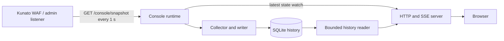

# Monitoring console: Phase 5 local web delivery

Date: 2026-11-16

Status: Implemented. `src/console/runtime.rs` starts the collector and the
server; `src/console/server/` provides routing, authentication, TLS, and the
JSON/SSE encoders; `ui/console-web/` is embedded with `include_str!`. The
integration tests in `tests/console_server.rs` cover routing, Host and
forwarding-marker rejection, history, SSE, authentication, the source
allowlist, TLS with a combined bundle, and runtime collection. Remote access and
TLS controls are described in [Phase 6](monitoring-console-phase6.md); packaging
remains future work.

## 1. Scope

| Layer | Phase 5 contract |
| --- | --- |
| Process | Optional `kunato console --config <PATH>` service, separate from WAF forwarding |
| Configuration | `console` section in the existing YAML file; no second configuration file |
| Collection | Existing collector polled from the configured loopback snapshot source |
| Delivery | Read-only HTTP/1.1 API and SSE on the configured listener |
| Storage | Existing SQLite history under `console.storage_dir` |
| UI | Embedded static assets showing measured data, not fictional data |
| Access | Loopback listener; source allowlist, authentication, and TLS are Phase 6 |

Not in Phase 5: rule editing, maintenance toggles, source bans, administrative
access changes, remote listeners without Phase 6 controls, historical event
detail queries, CSV export, comparison periods, and journal ingestion.

The console never changes a protective verdict. If it stops, the WAF keeps
forwarding and the loopback snapshot endpoint keeps serving.

## 2. Process model



The console process owns the database. It opens the storage directory, starts
the collector, binds the listener, and then serves until SIGINT/SIGTERM. Closing
or reloading the browser does not stop collection. Restarting the console does
not restart the WAF.

Startup order:

1. Load and compile the configuration, requiring `console.enabled: true`.
2. Validate the console section (section 3).
3. Start the collector and open the database (creates private paths).
4. Bind the console listener and load or create the credential material.
5. Spawn the collection loop and the HTTP server.
6. On shutdown, stop accepting connections, stop collection, attempt a bounded
   final flush, and return.

A listener bind failure stops the process without leaving a writer behind. A
storage failure after startup stops persistence admission and keeps the console
serving health and last-known live state, matching the Phase 1 failure contract.

## 3. Configuration

```yaml
console:
  enabled: true
  listen: 127.0.0.1:9091
  source: 127.0.0.1:9090
  instance: local-waf
  storage_dir: /var/lib/kunato/console
  max_bytes: 1073741824
  event_retention: 168h
  allowed_clients: []
  allowed_hosts: []
  auth:
    enabled: false
    token_file: /var/lib/kunato/console/console-token
  tls:
    cert_file: /var/lib/kunato/acme/cert.pem
    key_file: /etc/kunato/console-key.pem
```

| Field | Default | Contract |
| --- | --- | --- |
| `enabled` | `false` | Off does not start anything and does not validate remote requirements |
| `listen` | `127.0.0.1:9091` | Console listener; port 0 is allowed for development and tests |
| `source` | `admin.listen` when the admin listener is enabled | Must be a loopback address with a nonzero port |
| `instance` | `local-waf` | History scope name, 1..120 bytes of `[A-Za-z0-9._:/-]`; changing it starts a new history scope |
| `storage_dir` | `/var/lib/kunato/console` | Private SQLite directory; created 0700 on Unix |
| `max_bytes` | 1 GiB | Database plus rollback journal budget, 512 KiB..1 TiB |
| `event_retention` | `168h` (7 days) | Selected detail retention, 1 ms..30 days |
| `allowed_clients` | empty | Phase 6 allowlist; empty means loopback peers only |
| `allowed_hosts` | empty | Phase 6 Host validation; required for a non-loopback listener |
| `auth` | disabled | Phase 6 authentication; required for a non-loopback listener |
| `tls` | absent | Phase 6 TLS; required for a non-loopback listener |

Compile-time validation:

- An explicit `source` must be loopback with a nonzero port; an inherited
  `admin.listen` is validated by the admin listener itself, and the collector's
  `HttpSource` still rejects an unusable address at startup.
- `console.enabled: true` with `admin.enabled: false` loads with a warning; the
  console then logs the reason and exits successfully instead of failing.
- `allowed_clients` entries must parse as IPv4/IPv6 CIDRs; at most 256 entries.
- `allowed_hosts` uses the console's own host list, not the WAF request
  `allowed_hosts`; invalid entries fail loading.
- A non-loopback `listen` requires `auth.enabled`, `tls`, a non-empty
  `allowed_clients`, and `allowed_hosts`.
- `tls.cert_file` is required when `tls` is present. `key_file` is optional
  because the ACME cache `cert.pem` is a combined key-and-chain bundle.
- Disabled consoles still reject malformed values so a typo is found before
  enablement.

The example is illustrative for Phase 6. The console is disabled by default for
both new installations and upgrades: `rules.example.yaml` and `kunato init`
ship the block commented out, and the release archive ships the
`kunato-console.service` unit disabled.

## 4. Command

```sh
kunato console --config /etc/kunato/kunato.yaml
```

The command loads the configuration, runs the console, and exits when the
process receives SIGINT or SIGTERM. There is no separate install step in Phase
5. `--validate` remains the WAF configuration check; the console section is
validated as part of every load.

## 5. HTTP surface

All routes are read-only except session login/logout in Phase 6. The listener
answers HTTP/1.1 with `Connection: keep-alive`, a header-read timeout, and a
bounded connection count.

| Method | Path | Auth | Purpose |
| --- | --- | --- | --- |
| GET | `/` | yes | Embedded console UI; redirects to `/login` when unauthenticated |
| GET | `/login`, `/login.js`, `/styles.css`, `/favicon.svg` | no | Login page and the static assets it needs; the CSS and icon contain no data |
| GET | `/app.js` | yes | Embedded application script |
| GET | `/api/v1/health` | yes | Collection, source, writer, and storage health |
| GET | `/api/v1/history` | yes | Bounded UTC history page |
| GET | `/api/v1/correlations` | yes | Compact decoy evidence page |
| GET | `/api/v1/live` | yes | SSE stream of latest state |
| GET | `/api/v1/session` | no | Session status |
| POST | `/api/v1/session` | no | Login with the configured token |
| DELETE | `/api/v1/session` | no | Logout and clear the session |

Common behavior:

- Unexpected methods get `405` with `Allow`.
- Unknown paths get `404`.
- Requests carrying `x-forwarded-for`, `x-forwarded-proto`, or
  `x-forwarded-host` get `400`: they came through the WAF data plane and must
  not use the console as a confused deputy.
- `Host` must be a loopback name for a loopback listener, or match
  `console.allowed_hosts` when configured (Phase 6).
- API responses carry `Cache-Control: no-store`; assets carry `no-cache`.
- Responses carry `X-Content-Type-Options: nosniff`, `Referrer-Policy:
  no-referrer`, `X-Frame-Options: DENY`, and a `default-src 'self'` CSP.
- Request bodies are rejected on every route except `POST /api/v1/session`,
  which accepts at most 4 KiB of JSON. Unknown query parameters, duplicate
  parameters, and percent-encoded values are rejected.

### 5.1 Health response

```json
{
  "version": 1,
  "console": {"listen": "127.0.0.1:9091", "source": "127.0.0.1:9090",
              "instance": "local-waf", "tls": false, "auth": false},
  "collection": {
    "connected": true, "received_snapshots": 42, "stale_snapshots": 0,
    "last_observed_at_ms": 1763312400000, "last_committed_at_ms": 1763312390000,
    "persistence_lag_ms": 10000, "pending_minutes": 1, "pending_events": 3,
    "omitted_metric_minutes": 0, "omitted_events": 0,
    "source_missed_updates": 0, "source_additional_missed_updates": 0,
    "source_omitted_events": 0, "source_gap": null,
    "source_error": null, "storage_error": null
  },
  "writer": {"state": "running", "queued_items": 0, "outstanding_bytes": 0,
             "committed_batches": 12, "failed_batches": 0},
  "now_ms": 1763312401000
}
```

Unavailable values are `null`; the UI must not render them as zero.

### 5.2 History query

`GET /api/v1/history?from_ms=<u64>&until_ms=<u64>[&limit=24][&site=<name>][&revision=<u64>]`

- `from_ms` is inclusive, `until_ms` exclusive, both UTC Unix milliseconds.
- `limit` is 1..128, default 24. The response is additionally bounded by 4 MiB
  of encoded buckets; a cut response reports `truncated: true` and the next
  available start.
- `site` is reserved for the Phase 4 host-policy site scope. Primary minute
  buckets are currently recorded globally with an empty site, so this parameter
  only matches explicitly site-scoped rows and normally returns an empty page.
  Per-site primary history remains [remaining work](monitoring-console-remaining.md).
  A site value follows the stored identifier charset; wildcard host-policy
  names are not valid query values.
- `revision` continues a paginated read from a previous response; a changed
  history returns `409` so a caller does not mix revisions.
- The instance always comes from the console configuration, never the client.

Response:

```json
{"version": 1, "instance": "local-waf", "from_ms": 0, "until_ms": 0,
 "expiry_ms": 0, "oldest_available_ms": null, "pending_minutes": 0,
 "revision": 3, "returned": 24, "truncated": false,
 "next_start_ms": null, "buckets": []}
```

Buckets use the Phase 3 `HistoryBucket` encoding: grain, counters, reason
statistics, coverage, connections, outcomes, and optional additional
measurements. A range cutting a coarse bucket excludes it; the response exposes
the effective bounds and never prorates.

Errors: `400` for an invalid query, `409` for `HistoryChanged`, `503` for a busy
or timed-out reader with `Retry-After: 1`.

### 5.3 Correlations query

`GET /api/v1/correlations?from_ms=&until_ms=[&limit=24][&credential_id=]`

Returns `{"version":1,"records":[],"expiry_ms":0,"evicted_records":0,
"has_more":false}` using the Phase 4 compact record encoding. Bounded to 1 MiB
and 128 records. Records are selected evidence, not complete traffic counts, and
addresses are not proof of identity.

### 5.4 Live SSE

`GET /api/v1/live` returns `text/event-stream` and requires the same access
controls as the APIs.

```
retry: 3000

event: state
id: <generation>:<sequence>
data: {"version":1,"replayed":true,"snapshot":{...},"collection":{...},"writer":{...}}

: keepalive
```

- One aggregate state per collection tick at most; intermediate states are
  coalesced. Each state is absolute, so dropping intermediate frames never
  changes a counter.
- The first frame is the latest state with `replayed` true when the client
  supplied no `Last-Event-ID`, and false when an older or foreign identifier
  cannot be replayed.
- `Last-Event-ID` uses the same `generation:sequence` form. A matching
  identifier may receive the current state once before the next update. A
  different generation marks a source restart; the UI resets derived rates.
- A `pending` event without an identifier is sent before the first snapshot.
- A comment line is sent every 15 seconds so a quiet stream is not mistaken for
  a disconnection.
- At most 16 streams are served. Frames are admitted with a nonblocking send
  into a small bounded channel; a slow browser skips intermediate states
  instead of growing memory or delaying collection. A subscriber whose bounded
  channel stays full for more than 120 seconds is disconnected and reconnects
  with the latest state.
- A generation change is visible in the payload; the client must not add counts
  across generations.

### 5.5 Embedded UI

The UI is served from the binary and has no build step, external fonts, or
network requests. It shows:

- Collection and connection state, last update, source generation, and health
  separately from traffic.
- Live summary: requests, rejected requests, rejection rate, LOG-detected
  requests, active connections, upstream failures/timeouts, and decoy
  credential use.
- Live event list from the bounded snapshot, rendered as text.
- History summary and reason table for 1 hour, 24 hours, 7 days, and 30 days,
  read across all history pages for the selected range. The chart uses
  range-appropriate UTC display intervals and per-minute rates over complete
  minutes, with storage grain, effective bounds, missing/partial coverage, and
  any page-cap truncation disclosed.
- Decoy correlation table with hashed identifiers only.

The UI is read-only, labels unavailable data honestly, and does not replay
arrival effects for backlog. The fictional prototype remains in
`ui/console-prototype/` as a design reference.

## 6. Bounds

| Item | Bound |
| --- | --- |
| Console connections | 128 concurrent, 16 live streams |
| Header read | 10 seconds |
| Request header/URI | Hyper defaults; no request body is read except login (4 KiB) |
| History page | 1..128 buckets, 4 MiB encoded |
| Correlation page | 1..128 records, 1 MiB encoded |
| Login body | 4 KiB (Phase 6) |
| Event stream frame | Snapshot packet ≤ 256 KiB plus health; bounded channel of 8 |
| Heartbeat | 15 seconds |
| Read wait | 750 ms in the history reader; API maps a timeout to 503 |
| Shutdown | 5 seconds collection flush, 5 seconds connection drain |

## 7. Failure behavior

| Situation | Behavior |
| --- | --- |
| Snapshot source unreachable | Health reports disconnected; retries at the next tick; history reads still work |
| SQLite slow or full | Collection keeps bounded memory; health reports the storage error; live state continues |
| Slow SSE subscriber | Intermediate frames are skipped; memory stays bounded |
| Browser closes | Collection and persistence continue |
| Console restarts | Committed history remains; the collector resumes from checkpoints; a gap is reported when recovery is incomplete |
| WAF restarts | New source generation; counters are not subtracted across generations |
| Listener bind failure | Startup fails without a writer left running |

## 8. Verification

Implemented checks:

- Configuration (`src/config/mod.rs` tests): defaults, source defaulting to
  `admin.listen`, enabled-console requirements, loopback source, invalid
  identifiers and CIDRs, combined certificate bundle, token path default.
- CLI (`src/cli/parse.rs` tests): `kunato console` accepts only global options
  and its help text documents the separate read-only process.
- Authentication (`src/console/server/auth.rs` tests): token creation with mode
  0600, reload, short/oversized/symlinked rejection, session expiry and
  revocation, constant comparison behavior, per-address login limiting.
- HTTP and runtime (`tests/console_server.rs`): routing and methods, Host and
  forwarding-marker rejection, history and correlation round trips from a real
  loopback snapshot through SQLite, SSE initial state, authentication and
  bearer access, allowlist denial, TLS with a combined key-and-chain bundle,
  and the runtime collecting from a loopback snapshot source.
- Response encoding (`src/console/server/dto.rs` test): bounded history pages
  report returned and truncated counts and the next start.
- Independence: the console is a separate process; the WAF request path has no
  console dependency, and the existing proxy tests remain the regression gate.

Review notes: the console exposes no administrative proxy, every response is
rendered as text in the UI, pages are bounded, and the request body is read only
for login. The history and correlation encoders cap whole records and report
truncation instead of silently cutting a bucket. SSE frames are absolute state,
so a dropped intermediate frame cannot change a counter. A failed history read
maps to an explicit `409`/`503` rather than an empty page.

Final verification ran `cargo fmt`, `cargo clippy --all-targets -- -D warnings`,
`./scripts/check-deny.sh`, and `cargo test` in that order: 1,252 tests passed
with three existing external ACME tests ignored. `git diff --check` also passed.
A manual smoke test started the example upstream, the WAF, and
`kunato console`; the console served the embedded page, reported a connected
source, stored a private `history.sqlite3`, returned the request bucket through
`/api/v1/history`, and streamed an SSE state frame.

Remaining verification: a full end-to-end run of the installed service,
browser-level interaction checks, SSE reconnect under loss, database stalls,
and multiple concurrent browsers (see [remaining work](monitoring-console-remaining.md)).

## 9. Remaining after Phase 5

Authentication, remote listeners, TLS, packaging, historical event detail,
CSV export, comparison periods, complete journal ingestion, and the deferred
items in [remaining work](monitoring-console-remaining.md).
