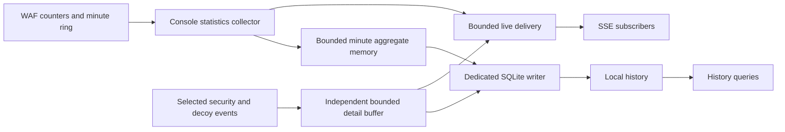

# Monitoring console storage and retention

Date: 2026-11-16

Status: The [bottom-up Phase 1 library](monitoring-console-phase1.md) implements
version-one records, SQLite persistence, atomic checkpoints, and a bounded
in-memory writer queue. Phase 2 adds source minute measurement, bounded event
reception, collection, and coalescing. The UTC, reason-separated statistics,
aggregation, and 30-day retention policy in sections 4 and 5 is implemented in
[Phase 3](monitoring-console-phase3.md), including bounded query/maintenance
workers and version-three migration. It
supersedes the earlier 30-day minute / 365-day hour proposal. The queues
themselves are not durable. Other candidate values remain proposals unless
explicitly adopted here or in the Phase 1 or Phase 2 contract.

See the [console design](monitoring-console.md) and
[screen requirements](monitoring-console-requirements.md). These requirements
preserve Kunato's bounded-resource and forwarding-independence invariants.
The [revised Phase 2 proposal](monitoring-console-phase2.md) specifies counters
and bounded WAF minute measurements as the statistical source. That proposal
is implemented in the library and development runner, without a web console.
See the [cadence evaluation](monitoring-console-cadence.md) for the subsequent
one-second live collection/publication recommendation and its measurement limits.

## 1. Ownership and persistence

| Component | Owns | Persistence |
| --- | --- | --- |
| WAF process | Atomic request/protection counters, current runtime gauges, and a fixed-size minute ring | In memory only; counters and minute ring reset on WAF restart |
| Optional console process | Collection positions, observed samples, time buckets, recorded events, and correlation summaries | Embedded SQLite; collection works in the development runner, deployment remains future work |
| Browser | Displayed subset, filters, chart data, and bounded live/replay state | Transient; reload must be able to query server-retained history |
| systemd journal | Existing emitted WAF logs | Governed by the host's journal policy, separately from console retention |

The proposed deployed console storage directory is `/var/lib/kunato/console/`;
deployment and ownership setup are not implemented. The Phase 1 library accepts
an explicit private directory; Phase 3 initializes schema version 3 and migrates
application-owned versions 1 and 2. The console owns its database;
the WAF does not open it or write SQL for individual requests. Existing WAF
configuration, managed rules, and certificate caches retain their own behavior.

| Event | Intended result |
| --- | --- |
| Browser closes or reloads | Collection continues; saved history remains |
| Console restarts | Committed history and collection checkpoints remain; resume and mark gaps where recovery is unavailable |
| WAF restarts | Saved console history remains; identify a new counter generation rather than subtract it from the previous one |
| Host restarts | Stored history remains subject to the chosen SQLite/filesystem durability policy; pending observations may be lost |
| Current prototype reloads | All fictional browser-session data resets; this is not the intended persistent backend behavior |

Persisting console history does not persist WAF ban state or decoy signing keys.
Historical token identifiers do not restore recognition after token expiry or a
WAF restart.

## 2. Collection and asynchronous writes

All waits for SQLite transactions belong to the console side. The WAF must not
wait for storage acknowledgements, a database worker, or a full storage queue.
Slow storage must not stall rule evaluation, protection, or forwarding.

The revised statistics path is periodic bounded snapshots of cumulative
counters and source-minute aggregates, without a normal-access log stream.
Selected journal events serve investigation and live context; their delivery
or suppression does not change statistical totals. The existing loopback
`/metrics` endpoint retains its original contract; `/console/snapshot` supplies
the version 2 generation/revision envelope, retained minutes, and selected
bounded events. Ordinary access rows are never required for these statistics.
Any additional notification path from the WAF must also use bounded work and
non-waiting admission when its consumer is full.

### 2.1 Proposed initial write policy

| Item | Proposed initial value or behavior |
| --- | --- |
| Ordinary HTTP request | Update WAF counters and bounded minute measurements; no normal-access log or per-request database row |
| Source minute retention | 10 fixed slots including the current minute; actual retained range is explicit |
| Metrics collection / live publication | Every 1 second; shared collection of minute revisions and cumulative snapshots, coalesced aggregate publication |
| Historical metrics view refresh | About every 5 seconds while visible; independent of continuous background collection |
| Metric bucket persistence | Coalesce repeated revisions and submit approximately every 10 seconds; upsert minute totals rather than add snapshots |
| Detailed-event buffering | Independently buffer selected detection, service, and decoy evidence; never reconstruct already measured traffic totals from it |
| Event batch trigger | About 1 second elapsed or about 200 pending events, whichever occurs first, subject to write budgets |
| Batch persistence | Multiple event rows and aggregate updates in one transaction |
| Normal console shutdown | Attempt a bounded final flush; do not make WAF shutdown depend on it |

Only selected investigation events use detail rows. A retained event can remain
a separate database row even though many rows share a commit. This reduces
transaction overhead without requiring one representative
row for every batch. High-volume repeated observations may additionally be
grouped with counts and first/last times; that is a separate, disclosed policy.

The collection interval, aggregate grain, commit interval, and browser update
cadence are different concepts. Persisting a minute bucket every ten seconds
does not imply collecting only once per minute. The prototype's two-second
generator is not the final production sampling contract.

SQLite documents the benefit of grouping operations in a transaction in its
[transaction-batching guidance](https://www.sqlite.org/faq.html#q19).

### 2.2 Buffer bounds and pressure

- Bound pending events by both item count and encoded bytes. Bound individual
  records, batch size, retry work, and time spent in the writer.
- Bound writes per unit time as well as batch size; a count trigger must not
  permit an unbounded commit storm.
- Prioritize compact decoy credential-use evidence and other important
  observations under pressure. Priority does not guarantee lossless delivery.
- Aggregate repetitive events or omit lower-priority detail when necessary.
  Preserve independently measured request totals where supported.
- Record known omitted/coalesced counts and affected intervals. If a crash or
  source limitation makes the lost count unknowable, mark it unknown.
- Expose pending work, persistence lag, last saved time, storage errors, and
  known loss in console health. Do not equate latest live delivery with latest
  durable persistence.
- Phase 1 adopts initial queue, record, transaction, and write-rate limits in
  its implementation contract. Production tuning and priority/coalescing
  policies remain future work; the current worker stops admission on failure
  after bounded handling of transient database contention.

### 2.3 Loss and durability contract

The design accepts some observation loss to preserve forwarding and bounded
resources. An abrupt stop can lose buffered events, pending aggregates, and
uncollected counter increments. A nominal one-second event flush interval is
not a promise that every failure loses at most one second.

SQLite transaction atomicity, application-crash recovery, power-loss durability,
and in-memory-buffer loss are separate properties. Phase 1 selects DELETE
rollback journaling and EXTRA synchronization; do not claim that
every returned commit necessarily survives every host power failure. Preserve
database consistency while reducing commit frequency.

Live delivery may precede a storage commit, so an operator might have seen an
event that does not survive a collector crash. A saved journal cursor can
support recovery of journal-retained events, but source retention, existing
log suppression, and inspection limits constrain recovery. Unsampled history
cannot be reconstructed with exact timing from a later cumulative counter.

## 3. Source identity and collection correctness

- Persist source generation and sample positions alongside metric progress.
  A restarted source can exceed its old counter value before the next poll;
  detecting only decreases is insufficient.
- Persist stable event/source identities or cursors sufficient to avoid
  reimporting and counting the same recorded event again.
- Commit relevant detail, aggregate changes, and processing progress together
  where they must be replayed atomically.
- Recover console state from committed checkpoints. Repeated collection or
  aggregation must not double-count prior work.
- Keep global counter-derived totals separate from recorded-event summaries.
  Replaying logs must not add those requests to a total already derived from
  counters.
- Store, aggregate, expire, query, and initially display time in UTC. Display
  formatting must never change bucket identities or retention cutoffs.
- Track observed coverage, gaps, source changes, and known omission counts
  with the same history horizon as their associated aggregates.
- Late observations may update retained buckets when provenance supports
  deduplication. Do not recreate expired detail tiers or invent precise
  placement for unsampled counter increments. Exact replay horizons and
  late-arrival handling remain part of the collection protocol design.

## 4. Aggregation rules

Phase 2 builds bounded minute measurements directly in the WAF
without event-detail retention. The console coalesces absolute source-minute
revisions and persists them. Cumulative snapshot differences alone cannot
place requests precisely across a minute boundary or a long collection gap.
Build the selected 5-, 10-, 20-, and 60-minute aggregates from ended intervals
regularly. Accept bounded correction of retained rollups when valid late
observations arrive. Every rollup preserves the source coverage and provenance
needed to distinguish missing data from measured zero.

An ended interval can still have incomplete observation. A successfully saved
rollup means its available input and coverage metadata were processed; it does
not mean the collector observed every request. Missing data must not prevent
expiry forever or be silently converted to zero.

| Data | Aggregation rule |
| --- | --- |
| Request, rejection, log-detection, and decoy-use counts | Sum non-overlapping interval deltas with their documented scope |
| Rejection rate | Sum matching numerator/denominator counts, then divide; do not average percentages |
| Average request rate | Derive from counts and the documented observation duration; expose missing coverage |
| Active connections | Retain time-weighted average inputs and observed maxima; do not sum gauges |
| Peak rate | Retain the maximum observed rate and its sampling interval; do not call a sampled peak a true instantaneous maximum |
| Latency average | Retain sum/count and recompute; do not equally average unequal-population buckets |
| Median, p95, p99 | Merge compatible histograms or another explicitly chosen distribution representation, then calculate; do not average quantiles |
| Unique IPs or credential IDs | Count from retained evidence or use a labeled, bounded approximation; distinct counts from separate buckets cannot simply be added |
| Source/path rankings | Bound retained dimensions and disclose whether results are complete recorded counts or approximations |
| Missing/suppressed observations | Retain coverage and known-loss metadata alongside the value |

### 4.1 Rejection reasons and independent totals

Persist rejection statistics as separate logical rows for each fixed terminal
reason in the same SQLite database. Each logical aggregate is identified by
instance, scope, reason, grain, and UTC interval start. Keep source generation,
input revisions, and processing checkpoints as provenance for idempotent
replacement. Phase 3 records pending materialization durably and commits
coarser replacement together with child deletion.
Do not create a database per reason or a row per rejected request.

The current `RejectionReason` model supplies 22 stable reason identifiers:

- `rule`, `response_rule`, `rate_limit`, `ban`, `overload`.
- `client_identity`, `host`, `admin_access`, `body`, `decode`.
- `form`, `upload`, `graphql`, `saml`, `php_request`, `php_response`.
- `hardening`, `jwt`, `decoy`, `behavior`, `protocol`, `response_inspection`.

These are terminal mechanisms, not attack classes or arbitrary YAML rule names.
For example, SQL injection and XSS can both terminate as `rule`; a separate
attack-class/category/rule breakdown requires its own bounded instrumentation.
The initial scope is global because Phase 2 does not export site dimensions.
Do not infer a site from selected event detail.
Version the reason definitions with the aggregate contract. A renamed, added,
or unsupported reason must not reinterpret old rows or turn unknown history
into measured zero.

One rejected request contributes once to one primary terminal reason, including
a response-phase replacement. Preserve request/response phase semantics from
the reason model. LOG matches, upstream application 403 responses, maintenance
pages, and ordinary decoy lure responses do not create rejection-reason counts.
Existing overlapping diagnostic counters are not additional primary reasons.

Keep overall request and rejection totals independently. For a complete, stable
interval, the sum of the 22 reason counts must equal its overall rejection
count. A provisional/non-atomic snapshot can differ transiently; missing
attribution can also make a minute incomplete. Preserve that state, suppress
unsupported ratios, and never force equality by changing measured values.

Each reason uses the same interval coverage. A supported zero count remains
zero; unavailable old-schema fields or missing intervals remain unknown.
Selecting a reason filters the numerator. Its rejection rate uses all measured
requests in the matching scope; its share of rejections uses the matching
overall rejection count. Label these two percentages separately. Never add
the request denominator once for every reason.

This dimension applies to rejection counts and their statistics. Connection
gauges and response-status/latency distributions remain overall measurements;
the current source cannot reconstruct reason-specific latency from counters
or selected events.

### 4.2 Extrema, averages, and merge inputs

For overall and reason-specific count series, retain total count, valid
observation duration, and supported minimum/maximum **one-minute counts**.
Use complete UTC source minutes as the common extrema population at every
storage grain. Preserve the number of eligible base minutes, completeness,
and the inputs needed for a population-consistent mean. Partial or missing
minutes are not zero-valued extrema samples. Keep known partial totals with
their incomplete flag; do not manufacture a full-interval mean from them.

An average rate is count divided by a compatible observed duration. Derive
one-minute-average RPS extrema by dividing the retained minute-count extrema
by 60. A one-minute peak is not a one-second or instantaneous peak. Graphs
comparing different storage grains use compatible rates or clearly labeled
interval totals, so larger buckets do not appear to be increased traffic.

Merge sums by addition and extrema by min/max over the same base population;
recompute averages from their numerators and denominators. Never average
already computed averages. A cached mean may be stored, but its merge inputs
remain authoritative. Compute overall extrema from overall base-minute
totals; summing reason-specific maxima or minima is incorrect because they
can occur in different minutes. When generations share a UTC minute, combine
their deduplicated count contributions before calculating cross-generation
minute extrema. Unknown overlap or downtime preserves incomplete coverage.

Connection averages retain connection-time integrals and observed duration.
Retain compatible latency count/sum and histogram bins for approximate
quantiles. The current source has an observed connection maximum, but no
connection minimum or exact per-request latency extrema; additional source
instrumentation is required before those extrema can be claimed. Histogram
bin edges are not exact latency minima/maxima. Do not duplicate these overall
distributions across all reason rows.

If required histogram or distinct-count evidence is unavailable, show the
measurement as unavailable for that period. Do not fabricate historical p95
or unique-source totals after the supporting data expires.

Prefer bounded category/rule/mechanism dimensions for long-term statistics.
Do not retain an unlimited IP/path/token-ID time series. The schema and any
approximation algorithm remain open; adding a dependency requires justification.

## 5. Adopted statistics retention policy

Age is elapsed time from the current UTC instant, not a number of local calendar
dates. The first column describes the requested historical resolution; section
5.1 defines the bounded transition behavior for aligned intervals.

| Age | Stored statistics grain |
| --- | --- |
| Less than 1 hour | 1 minute |
| 1 hour to less than 3 hours 30 minutes | 5 minutes |
| 3 hours 30 minutes to less than 6 hours | 10 minutes |
| 6 hours to less than 12 hours | 20 minutes |
| 12 hours to less than 30 days | 1 hour |
| 30 days or older | Expired |

Apply this profile to overall statistics and each supported primary rejection
reason. Keep hourly resolution after the first day to preserve the time of
past attack activity. Daily charts aggregate the retained hours at UTC midnight
boundaries; no additional daily-only retention tier is needed.

These requirements are implemented by the Phase 3 library and development
collector; no user-facing console command is added. The prototype
continues to show fictional retention and period controls. The previous
365-day statistics and 90-day compact-summary proposals are superseded.

### 5.1 UTC boundaries and the oldest interval

Every interval is half-open `[start, end)` and aligned to a fixed UTC boundary:
minutes, multiples of 5/10/20 minutes within the hour, and full hours. Query
ranges use inclusive start and exclusive end. Do not recenter stored intervals
on every query or every moving age threshold.

Coarsen a parent only after its entire interval is old enough for the new grain.
For example, promote five one-minute children after the five-minute parent's
end is at least one hour old. Preserve finer input across a threshold until
that parent is eligible; this can retain a bounded extra interval of finer
detail. The query planner selects disjoint inputs and never counts both a
parent and its children. Preserve incomplete parents rather than waiting
forever for unavailable children.

The logical expiry cutoff is `now_utc - 30 * 24 hours`. Do not serve aggregates
whose start precedes that cutoff, and expire them as whole rows. This deliberately
discards the oldest straddling hour rather than retaining observations older
than 30 days or pretending its count can be prorated. The available oldest
boundary can consequently be less than one hour newer than the cutoff; return
that boundary explicitly. Never invent partial-hour totals after finer input
has expired. True retention expiry does not require another retained rollup.

Bounded physical cleanup follows the maintenance schedule and can lag logical
expiry; report cleanup lag, especially after downtime. This policy does not
promise secure erasure or immediate removal from backups or SQLite free pages.
Reimport or revision time must not extend retention, and replay must not
recreate expired rows. A display time change must not shift any boundary.
Persist a nondecreasing expiry watermark and use it with the current cutoff
for reads and cleanup. A backward clock adjustment must not revive logically
expired history. Expose clock discontinuities and test them independently
from the source minute-ring clock policy.

For a continuous single-scope series, the profile has approximately 831
intervals: 60 + 30 + 15 + 18 + 708, excluding transition edges. Twenty-two
reason series plus one overall series would therefore have approximately
19,113 aggregate rows. This is an arithmetic estimate, not a database size or
hard memory bound: pending inputs, checkpoints, generations, indexes, optional
dimensions, and event detail require separate budgets.

### 5.2 Independent event and decoy retention

Detailed event retention remains independent of statistics. Phase 3 defaults
selected-event retention to seven days, configurable within the 30-day cap,
with existing count/byte budgets; it does not extend statistical resolution.
If compact decoy summaries
are added, their retention is at most 30 days with independent count/byte
limits. Compact-summary implementation and enablement remain future work;
selected-detail expiry is implemented. Neither tier restores expired request
detail or modifies token validity.

The compact record may retain:

- Hashed credential ID, source generation/site, and lure/template when known.
- Issuance time and first/last observed credential use.
- Credential-use, passive-occurrence, and blocked-use counts kept distinct.
- A bounded set or summary of observed issuance/reuse source addresses.
- Relevant incomplete-correlation and logging-suppression indicators.

Bound both record count and total bytes, including per-record source history.
Do not keep full request payloads, raw credentials, or unbounded per-token
event histories in this tier. A repeated use is not a new distinct credential,
and different source IPs are not proof of the same person.

Compact history supports later investigation; it does not modify the WAF's
token lifetime or process-local verification key. Counts and correlation can
still be incomplete when the source did not record the relevant observation.

## 6. Safe expiry workflow

1. Run console maintenance approximately every five minutes, subject to its
   work budget. On startup, catch up incrementally rather than in a large
   blocking purge.
2. Select eligible precision transitions and expired rows with UTC cutoffs.
   Read APIs enforce logical expiry even before physical cleanup catches up.
3. For a precision transition, commit replacement overall/reason aggregates,
   coverage, and processing progress before deleting required input. Bounded
   chunks must not mark a whole interval complete until all required rows are
   committed. Same-interval corrections replace prior revisions.
4. Delete eligible input in bounded transactions, initially around 1,000 rows
   per batch. Yield between batches so ingestion and live/query work can run.
   At true retention expiry, delete without requiring a new rollup; prevent
   subsequent replay from recreating the expired history.
5. Expire recorded detail and optional compact correlation independently with
   their own time/count/byte bounds. Retain gap metadata for retained statistics.
6. Resume safely after interruption. Never delete required input because an
   aggregation job was merely started or because its uncommitted result was
   sent to a browser.

The writer may serialize these jobs, but its task scheduling must prioritize
current collection and use bounded transactions. The WAF does not wait for
aggregation, deletion, checkpointing, or compaction.

## 7. Capacity pressure

The initial proposed console-storage budget is **1 GiB**, to be confirmed by
measurement. Count the database, indexes, WAL, and temporary working files in
the budget. Reserve headroom before reaching a hard boundary; cleanup itself
can require writes and working space.

When approaching the effective budget:

1. Remove expired data first.
2. Shorten oldest ordinary event detail ahead of its nominal retention period.
3. Remove eligible finer statistics after their selected coarser aggregates
   and processing progress have committed.
4. Prefer retaining bounded decoy-correlation summaries and coarse history
   over ordinary detail, subject to their own limits.
5. If space still cannot be recovered safely, restrict new persistence and
   disclose loss/lag. Preserve database consistency and WAF operation.

Do not advertise the nominal retention periods as guaranteed during capacity
pressure. Prevent unlimited accumulation of important-event summaries or WAL
as a way around the storage budget. Precise thresholds, reserve sizing, and
hard-limit enforcement remain to be designed and tested.

The budget is for console-owned storage. It does not implicitly bound or
delete the system journal, exports, backups, or existing WAF state files.

## 8. SQLite space reclamation

Logical deletion normally makes database pages reusable without immediately
shrinking the database file. Treat reusable space, physical size, and free
filesystem space as distinct measurements. See
[SQLite's VACUUM documentation](https://www.sqlite.org/lang_vacuum.html).

- Prefer reuse of freed pages during ordinary operation.
- If WAL mode is selected, budget and checkpoint its growth independently of
  the main database. Bound read transactions and handle busy/slow readers.
- Select a bounded incremental reclamation strategy where appropriate for
  the chosen database configuration.
- Do not run a full database-rebuilding VACUUM as part of every periodic expiry
  cycle. Any exceptional full rebuild needs explicit space/time planning.
- Do not rely on deleting rows from an already full disk to provide immediate
  physical space for further writes.

Relevant SQLite behavior is documented in
[WAL operation and checkpoints](https://www.sqlite.org/wal.html) and
[synchronization policies](https://www.sqlite.org/pragma.html#pragma_synchronous).
Phase 1/2 currently use DELETE rollback journaling and EXTRA synchronization;
WAL would require a separate reviewed lifecycle change.

## 9. Operational behavior and validation

Show retained periods, selected grain, collection freshness, last persistence,
queue/storage health, known loss, and incompleteness in the console. After
detail expires, use an explicit expired/unavailable message rather than an empty
count implying no observations. Keep a past coverage gap visible after rollup.

Before release, validate:

- Counter and collector restarts, generation changes, and partial batches.
- Replayed/late events, atomic progress, and repeatable rollups without double
  counting.
- Requests with overlapping rule/LOG/response outcomes and distinct decoy
  contexts.
- Correct ratios, weighted gauges, peaks, histograms, and unique-count limits.
- Reason-separated replay, all 22 stable identifiers, supported zero versus
  unknown, and the primary-reason sum invariant on complete stable intervals.
- Overall extrema versus reason extrema with peaks in different minutes, and
  a source restart within one base minute before rollup.
- UTC alignment and transitions at 1 hour, 3 hours 30 minutes, 6 hours,
  12 hours, and the 30-day cutoff, including the oldest straddling hour.
- Nondecreasing expiry across clock rollback, source replay, and collector restart.
- Mixed-grain queries without overlap, eligible-zero extrema, partial-minute
  exclusion from extrema, and preservation of incomplete coverage after expiry.
- Crash between aggregation and deletion, and interrupted expiry recovery.
- Shortened retention, capacity pressure, full storage, stalled writer,
  bounded retries, and final-flush timeouts.
- WAL/reclamation behavior, long readers, working-space bounds, and sustained
  input beyond the persistence budget.
- Preservation of WAF forwarding and protective behavior throughout these
  console failures.

The UTC/reason/precision/30-day policy, schema migration, correction boundaries,
and bounded query/maintenance workers are implemented in Phase 3. A supported
online backup procedure, optional compact correlation, web delivery, and
deployment-specific resource tuning remain later work. Wider buckets use a
separate version-three history model rather than reinterpreting source minutes.
