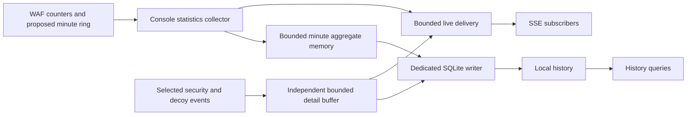

# Monitoring console storage and retention

Date: 2026-11-15

Status: The [bottom-up Phase 1 library](monitoring-console-phase1.md) implements
version-one records, SQLite persistence, atomic checkpoints, and a bounded
in-memory writer queue. Phase 2 adds source minute measurement, bounded event
reception, collection, and coalescing. Rollups and retention are still proposed.
The queues themselves are not durable. Values in this document remain proposals
unless explicitly adopted in the Phase 1 or Phase 2 contract.

See the [console design](monitoring-console.md) and
[screen requirements](monitoring-console-requirements.md). These requirements
preserve Kunato's bounded-resource and forwarding-independence invariants.
The [revised Phase 2 proposal](monitoring-console-phase2.md) specifies counters
and bounded WAF minute measurements as the statistical source. That proposal
is implemented in the library and development runner, without a web console.
See the [cadence evaluation](monitoring-console-cadence.md) for the subsequent
one-second live collection/publication recommendation and its measurement limits.

## 1. Ownership and persistence

| Component | Owns | Persistence |
| --- | --- | --- |
| WAF process | Atomic request/protection counters and current runtime gauges; proposed fixed-size minute ring | In memory only; counters and minute ring reset on WAF restart |
| Optional console process | Collection positions, observed samples, time buckets, recorded events, and correlation summaries | Proposed embedded SQLite under a local console data directory |
| Browser | Displayed subset, filters, chart data, and bounded live/replay state | Transient; reload must be able to query server-retained history |
| systemd journal | Existing emitted WAF logs | Governed by the host's journal policy, separately from console retention |

The proposed deployed console storage directory is `/var/lib/kunato/console/`;
deployment and ownership setup are not implemented. The Phase 1 library accepts
an explicit private directory and initializes schema version 1. The console owns its database;
the WAF does not open it or write SQL for individual requests. Existing WAF
configuration, managed rules, and certificate caches retain their own behavior.

| Event | Intended result |
| --- | --- |
| Browser closes or reloads | Collection continues; saved history remains |
| Console restarts | Committed history and collection checkpoints remain; resume and mark gaps where recovery is unavailable |
| WAF restarts | Saved console history remains; identify a new counter generation rather than subtract it from the previous one |
| Host restarts | Stored history remains subject to the chosen SQLite/filesystem durability policy; pending observations may be lost |
| Current prototype reloads | All fictional browser-session data resets; this is not the intended persistent backend behavior |

Persisting console history does not persist WAF ban state or decoy signing keys.
Historical token identifiers do not restore recognition after token expiry or a
WAF restart.

## 2. Collection and asynchronous writes

All waits for SQLite transactions belong to the console side. The WAF must not
wait for storage acknowledgements, a database worker, or a full storage queue.
Slow storage must not stall rule evaluation, protection, or forwarding.

The revised statistics path is periodic bounded snapshots of cumulative
counters and source-minute aggregates, without a normal-access log stream.
Selected journal events serve investigation and live context; their delivery
or suppression does not change statistical totals. The existing loopback
`/metrics` endpoint retains its original contract; `/console/snapshot` supplies
the version 2 generation/revision envelope, retained minutes, and selected
bounded events. Ordinary access rows are never required for these statistics.
Any additional notification path from the WAF must also use bounded work and
non-waiting admission when its consumer is full.

### 2.1 Proposed initial write policy

| Item | Proposed initial value or behavior |
| --- | --- |
| Ordinary HTTP request | Update WAF counters and proposed bounded minute measurements; no normal-access log or per-request database row |
| Source minute retention | Proposed 10 fixed slots including the current minute; actual retained range is explicit |
| Metrics collection / live publication | Every 1 second; shared collection of minute revisions and cumulative snapshots, coalesced aggregate publication |
| Historical metrics view refresh | About every 5 seconds while visible; independent of continuous background collection |
| Metric bucket persistence | Coalesce repeated revisions and submit approximately every 10 seconds; upsert minute totals rather than add snapshots |
| Detailed-event buffering | Independently buffer selected detection, service, and decoy evidence; never reconstruct already measured traffic totals from it |
| Event batch trigger | About 1 second elapsed or about 200 pending events, whichever occurs first, subject to write budgets |
| Batch persistence | Multiple event rows and aggregate updates in one transaction |
| Normal console shutdown | Attempt a bounded final flush; do not make WAF shutdown depend on it |

Only selected investigation events use detail rows. A retained event can remain
a separate database row even though many rows share a commit. This reduces
transaction overhead without requiring one representative
row for every batch. High-volume repeated observations may additionally be
grouped with counts and first/last times; that is a separate, disclosed policy.

The collection interval, aggregate grain, commit interval, and browser update
cadence are different concepts. Persisting a minute bucket every ten seconds
does not imply collecting only once per minute. The prototype's two-second
generator is not the final production sampling contract.

SQLite documents the benefit of grouping operations in a transaction in its
[transaction-batching guidance](https://www.sqlite.org/faq.html#q19).

### 2.2 Buffer bounds and pressure

- Bound pending events by both item count and encoded bytes. Bound individual
  records, batch size, retry work, and time spent in the writer.
- Bound writes per unit time as well as batch size; a count trigger must not
  permit an unbounded commit storm.
- Prioritize compact decoy credential-use evidence and other important
  observations under pressure. Priority does not guarantee lossless delivery.
- Aggregate repetitive events or omit lower-priority detail when necessary.
  Preserve independently measured request totals where supported.
- Record known omitted/coalesced counts and affected intervals. If a crash or
  source limitation makes the lost count unknowable, mark it unknown.
- Expose pending work, persistence lag, last saved time, storage errors, and
  known loss in console health. Do not equate latest live delivery with latest
  durable persistence.
- Phase 1 adopts initial queue, record, transaction, and write-rate limits in
  its implementation contract. Production tuning and priority/coalescing
  policies remain future work; the current worker stops admission on failure.

### 2.3 Loss and durability contract

The design accepts some observation loss to preserve forwarding and bounded
resources. An abrupt stop can lose buffered events, pending aggregates, and
uncollected counter increments. A nominal one-second event flush interval is
not a promise that every failure loses at most one second.

SQLite transaction atomicity, application-crash recovery, power-loss durability,
and in-memory-buffer loss are separate properties. Phase 1 selects DELETE
rollback journaling and EXTRA synchronization; do not claim that
every returned commit necessarily survives every host power failure. Preserve
database consistency while reducing commit frequency.

Live delivery may precede a storage commit, so an operator might have seen an
event that does not survive a collector crash. A saved journal cursor can
support recovery of journal-retained events, but source retention, existing
log suppression, and inspection limits constrain recovery. Unsampled history
cannot be reconstructed with exact timing from a later cumulative counter.

## 3. Source identity and collection correctness

- Persist source generation and sample positions alongside metric progress.
  A restarted source can exceed its old counter value before the next poll;
  detecting only decreases is insufficient.
- Persist stable event/source identities or cursors sufficient to avoid
  reimporting and counting the same recorded event again.
- Commit relevant detail, aggregate changes, and processing progress together
  where they must be replayed atomically.
- Recover console state from committed checkpoints. Repeated collection or
  aggregation must not double-count prior work.
- Keep global counter-derived totals separate from recorded-event summaries.
  Replaying logs must not add those requests to a total already derived from
  counters.
- Store time buckets in UTC and align their boundaries consistently. Convert
  to the selected display time zone when querying/rendering.
- Track observed coverage, gaps, source changes, and known omission counts
  with the same history horizon as their associated aggregates.
- Late observations may update retained buckets when provenance supports
  deduplication. Do not recreate expired detail tiers or invent precise
  placement for unsampled counter increments. Exact replay horizons and
  late-arrival handling remain part of the collection protocol design.

## 4. Aggregation rules

The revised proposal builds bounded minute measurements directly in the WAF
without event-detail retention. The console coalesces absolute source-minute
revisions and persists them. Cumulative snapshot differences alone cannot
place requests precisely across a minute boundary or a long collection gap.
Build hour aggregates from ended minute intervals regularly, rather than waiting
until minute data is about to expire. Accept bounded correction of retained
rollups when valid late observations arrive.

An ended interval can still have incomplete observation. A successfully saved
rollup means its available input and coverage metadata were processed; it does
not mean the collector observed every request. Missing data must not prevent
expiry forever or be silently converted to zero.

| Data | Aggregation rule |
| --- | --- |
| Request, rejection, log-detection, and decoy-use counts | Sum non-overlapping interval deltas with their documented scope |
| Rejection rate | Sum matching numerator/denominator counts, then divide; do not average percentages |
| Average request rate | Derive from counts and the documented observation duration; expose missing coverage |
| Active connections | Retain time-weighted average inputs and observed maxima; do not sum gauges |
| Peak rate | Retain the maximum observed rate and its sampling interval; do not call a sampled peak a true instantaneous maximum |
| Latency average | Retain sum/count and recompute; do not equally average unequal-population buckets |
| Median, p95, p99 | Merge compatible histograms or another explicitly chosen distribution representation, then calculate; do not average quantiles |
| Unique IPs or credential IDs | Count from retained evidence or use a labeled, bounded approximation; distinct counts from separate buckets cannot simply be added |
| Source/path rankings | Bound retained dimensions and disclose whether results are complete recorded counts or approximations |
| Missing/suppressed observations | Retain coverage and known-loss metadata alongside the value |

If required histogram or distinct-count evidence is unavailable, show the
measurement as unavailable for that period. Do not fabricate historical p95
or unique-source totals after the supporting data expires.

Prefer bounded category/rule/mechanism dimensions for long-term statistics.
Do not retain an unlimited IP/path/token-ID time series. The schema and any
approximation algorithm remain open; adding a dependency requires justification.

## 5. Proposed retention tiers

| Tier | Proposed retention | Expiry prerequisite and result |
| --- | --- | --- |
| Detailed recorded events | 7 days | Persist their supported event summaries first; delete detail while coarse counts remain |
| One-minute metrics and supported summaries | 30 days | Confirm committed hourly rollups, including coverage, before deleting minute input |
| One-hour metrics and supported summaries | 365 days | Delete fully expired intervals from oldest first |
| Compact decoy-reuse correlation summaries | 90 days, additional proposal | Delete the summary on expiry; retained hourly credential-use counts remain |

These are design candidates, not current binary defaults. The prototype's
retention labels are fictional. In particular, the 90-day decoy-summary tier is
an additional proposal motivated by the requirement to investigate follow-up
use of issued information.

Retention is based on event/bucket time, not extended indefinitely whenever a
row is reimported or its aggregate is updated. Only fully expired buckets are
deleted; protect the current in-progress intervals.

Minute and hour tiers overlap for recent time. A query selects one appropriate
grain for each interval and must not add both copies of the same traffic.
Long-range graphs disclose their coarser grain. IP/path details and arbitrary
historical event drill-down expire independently of the coarse counts.

### 5.1 Compact decoy-correlation proposal

The compact record may retain:

- Hashed credential ID, source generation/site, and lure/template when known.
- Issuance time and first/last observed credential use.
- Credential-use, passive-occurrence, and blocked-use counts kept distinct.
- A bounded set or summary of observed issuance/reuse source addresses.
- Relevant incomplete-correlation and logging-suppression indicators.

Bound both record count and total bytes, including per-record source history.
Do not keep full request payloads, raw credentials, or unbounded per-token
event histories in this tier. A repeated use is not a new distinct credential,
and different source IPs are not proof of the same person.

Compact history supports later investigation; it does not modify the WAF's
token lifetime or process-local verification key. Counts and correlation can
still be incomplete when the source did not record the relevant observation.

## 6. Safe expiry workflow

1. Run console maintenance approximately every five minutes, subject to its
   work budget. On startup, catch up incrementally rather than in a large
   blocking purge.
2. Select fully expired intervals using consistent UTC cutoffs.
3. Confirm that the required retained rollup and processing progress have been
   committed. Preserve their completeness/gap metadata.
4. Delete eligible input in bounded transactions, initially around 1,000 rows
   per batch. Yield between batches so ingestion and live/query work can run.
5. Expire compact correlation and hourly data independently according to their
   policies. Apply the same count/time bounds to these jobs.
6. Resume safely after interruption. Never delete required input because an
   aggregation job was merely started or because its uncommitted result was
   sent to a browser.

The writer may serialize these jobs, but its task scheduling must prioritize
current collection and use bounded transactions. The WAF does not wait for
aggregation, deletion, checkpointing, or compaction.

## 7. Capacity pressure

The initial proposed console-storage budget is **1 GiB**, to be confirmed by
measurement. Count the database, indexes, WAL, and temporary working files in
the budget. Reserve headroom before reaching a hard boundary; cleanup itself
can require writes and working space.

When approaching the effective budget:

1. Remove expired data first.
2. Shorten oldest ordinary event detail ahead of its nominal retention period.
3. Remove older minute detail after committed hourly aggregation.
4. Prefer retaining bounded decoy-correlation summaries and coarse history
   over ordinary detail, subject to their own limits.
5. If space still cannot be recovered safely, restrict new persistence and
   disclose loss/lag. Preserve database consistency and WAF operation.

Do not advertise the nominal retention periods as guaranteed during capacity
pressure. Prevent unlimited accumulation of important-event summaries or WAL
as a way around the storage budget. Precise thresholds, reserve sizing, and
hard-limit enforcement remain to be designed and tested.

The budget is for console-owned storage. It does not implicitly bound or
delete the system journal, exports, backups, or existing WAF state files.

## 8. SQLite space reclamation

Logical deletion normally makes database pages reusable without immediately
shrinking the database file. Treat reusable space, physical size, and free
filesystem space as distinct measurements. See
[SQLite's VACUUM documentation](https://www.sqlite.org/lang_vacuum.html).

- Prefer reuse of freed pages during ordinary operation.
- If WAL mode is selected, budget and checkpoint its growth independently of
  the main database. Bound read transactions and handle busy/slow readers.
- Select a bounded incremental reclamation strategy where appropriate for
  the chosen database configuration.
- Do not run a full database-rebuilding VACUUM as part of every periodic expiry
  cycle. Any exceptional full rebuild needs explicit space/time planning.
- Do not rely on deleting rows from an already full disk to provide immediate
  physical space for further writes.

Relevant SQLite behavior is documented in
[WAL operation and checkpoints](https://www.sqlite.org/wal.html) and
[synchronization policies](https://www.sqlite.org/pragma.html#pragma_synchronous).
The exact journal and synchronization settings are not yet chosen.

## 9. Operational behavior and validation

Show retained periods, selected grain, collection freshness, last persistence,
queue/storage health, known loss, and incompleteness in the console. After
detail expires, use an explicit expired/unavailable message rather than an empty
count implying no observations. Keep a past coverage gap visible after rollup.

Before release, validate:

- Counter and collector restarts, generation changes, and partial batches.
- Replayed/late events, atomic progress, and repeatable rollups without double
  counting.
- Requests with overlapping rule/LOG/response outcomes and distinct decoy
  contexts.
- Correct ratios, weighted gauges, peaks, histograms, and unique-count limits.
- Crash between aggregation and deletion, and interrupted expiry recovery.
- Shortened retention, capacity pressure, full storage, stalled writer,
  bounded retries, and final-flush timeouts.
- WAL/reclamation behavior, long readers, working-space bounds, and sustained
  input beyond the persistence budget.
- Preservation of WAF forwarding and protective behavior throughout these
  console failures.

Final schema, migration/backup policy, replay bounds, resource limits, and the
proposed numerical defaults must be resolved before backend implementation.
