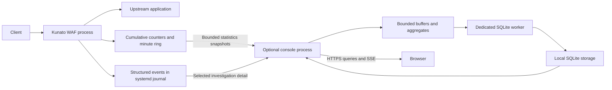

# Monitoring console design

Date: 2026-11-16

Status: The browser-only prototype is implemented and committed in `d9ba903`
(`Add interactive monitoring console prototype`). The subsequently approved
bottom-up Phase 1 implements the observation contracts, SQLite store, and
bounded persistence worker as a library. See the
[Phase 1 implementation contract](monitoring-console-phase1.md).
[Phase 2](monitoring-console-phase2.md) adds in-memory WAF measurements, a
loopback snapshot API, selected bounded evidence, and a separate development
collector connected to persistence. [Phase 3](monitoring-console-phase3.md)
implements UTC aggregates, separate primary-reason rows, mixed-grain reads,
and 30-day expiry. [Phase 4](monitoring-console-phase4.md) adds bounded site/rule
measurements, upstream status and reason latency, rankings/unique estimates,
operational state, and compact decoy evidence. Web delivery, authentication, HTTPS, SSE, and packaging
remain future work. The prototype still uses fictional data.

Related documents:

- [Screen and interaction requirements](monitoring-console-requirements.md)
- [Collection, persistence, aggregation, and retention](monitoring-console-storage.md)
- [Bottom-up Phase 1 scope and verification](monitoring-console-phase1.md)
- [Phase 2 counter-based statistics implementation](monitoring-console-phase2.md)
- [Phase 3 UTC aggregates and retention](monitoring-console-phase3.md)
- [Phase 4 additional source measurements](monitoring-console-phase4.md)
- [Update-cadence evaluation and measurements](monitoring-console-cadence.md)
- [Prototype source and launch instructions](../ui/console-prototype/README.md)
- [Existing observability architecture](DESIGN.md#9-observability)
- [Existing admin and metrics reference](development.md#admin-and-metrics)
- [Existing log viewer](development.md#log-viewer)
- [Decoy protocol and evidence limits](decoy-design.md)

## 1. Purpose and decision status

The console helps a personal-server operator understand traffic and protective
actions over time, follow current activity, and investigate returned decoy
credentials. The primary questions are whether protection is operating,
whether normal service is affected, and whether attention is needed.

The following distinctions apply throughout these documents:

| Status | Meaning |
| --- | --- |
| Existing WAF | Available in the current Rust implementation independently of the console |
| Implemented prototype | Available only with fictional browser-local data |
| Agreed direction | Product or design direction established in the discussion; implementation status is recorded separately |
| Proposed initial value | A candidate value or policy to validate before backend implementation; not a supported configuration default |
| Open | A detail that still needs a concrete implementation decision |

| Area | Direction | Status |
| --- | --- | --- |
| Navigation | One console with a left sidebar and two views: Metrics and Real-time monitor | Agreed; prototyped |
| Runtime boundary | An optional console process separate from the WAF process | Agreed direction |
| Distribution | Initially one repository and one executable with a separate console subcommand | Agreed direction; exact packaging remains open |
| Live transport | SSE from the console to the browser; ordinary HTTP APIs for queries and operations | Agreed direction; simulated in the prototype |
| Access | Loopback by default; explicit listener and source-IP/CIDR policy for remote access | Agreed direction; backend absent |
| Remote transport | HTTPS and user authentication alongside the source allowlist | Design requirement; mechanisms remain open |
| Certificates | Use the WAF's public-443 ACME acquisition path to supply a certificate usable by the private console listener | Agreed direction; material delivery and reload remain open |
| History | Persist console history locally with embedded SQLite | Store, collector, and bounded mixed-grain reader implemented; no web integration |
| Statistics | UTC intervals, independent overall totals, and separate fixed primary-rejection-reason series | Phase 3 reason rows and aggregates implemented |
| Retention | 1/5/10/20/60-minute precision tiers, hourly history through 30 days, then expiry | Phase 3 logical expiry and bounded cleanup implemented |
| Writes | Bounded buffering and batched writes, independent of request forwarding | Library/development collector implemented; user-facing runtime absent |
| Decoys | Treat credential-use attempts as a first-class signal in both views | Agreed; prototyped |
| Live emphasis | Brief arrival effects plus persistent event-age backgrounds | Agreed; prototyped |
| Reading position | Preserve the same visible events during updates, including horizontal position | Agreed; prototyped |

## 2. Architecture and responsibility boundaries

Keep request inspection, protective decisions, and forwarding in the WAF. Place
collection, history storage, aggregation, queries, and web delivery in the
console process. Both views share that console process and its stored data.
Phase 2 keeps bounded source-time minute measurements
beside the WAF counters; console aggregation coalesces these absolute buckets
and Phase 3 builds coarser history. Request totals do not depend on log records.



The arrows describe the intended information flow, not implemented console
endpoints. The journal and loopback metrics already exist. Console-side
counter-based collection is implemented in the library/development runner;
web delivery remains absent.

### 2.1 Why a separate process

| Alternative | Tradeoff | Decision |
| --- | --- | --- |
| Put web delivery, queries, and history storage in the WAF process | Simple process count, but shares runtime, storage work, and failure handling with forwarding | Do not use for the planned historical console |
| Require a separately configured monitoring product | Isolates work but increases installation and maintenance | Do not require for personal deployment |
| Offer an optional console process within the Kunato distribution | Adds a service only when enabled and separates request processing from analytics | Preferred initial architecture |

A separate executable or repository is not required initially. It can be
considered later if dependency size or release requirements justify it.
External Prometheus/Grafana-style integrations can remain optional extensions;
they are not prerequisites for using this console.

### 2.2 Fault isolation requirements

- Request handling must not wait for SQLite transactions, console queries,
  browser delivery, or console maintenance jobs.
- The console must not make WAF operation depend on its own availability.
- SQLite work runs in a dedicated console worker, outside console request and
  streaming handlers. An async function alone does not establish this boundary.
- Buffers, replay history, subscribers, queries, and work queues are bounded.
  If new WAF-to-console notifications become necessary, their enqueue path
  must not wait for the storage consumer.
- Console failure, slow storage, full storage, or a slow browser may reduce
  observation completeness. They must not change protective verdicts or stop
  forwarding.
- Separate processes still share host CPU, memory, and storage I/O. Apply
  console resource limits and write/query budgets; do not claim zero host-level
  interference from process separation alone.
- Keep the UI read-only in the initial release. Do not add rule editing,
  maintenance toggles, source bans, or administrative access changes to this UI.

## 3. Personal-use deployment experience

The WAF remains useful with one binary and one YAML configuration and without
the console, a database server, or cloud services. Enabling the console should
be an optional, simple installation action; install/update handling should be
coordinated with Kunato rather than delegated to a separate monitoring stack.

Illustrative future commands, **not implemented commands**:

```sh
kunato --config /etc/kunato/kunato.yaml
kunato console --config /etc/kunato/kunato.yaml
```

The intended console is an independent service, not a browser session that
owns collection. Closing a browser or switching views must not stop collection
or storage. Restarting the console must not require restarting the WAF.

Embed static web assets in the eventual executable so operators do not need
Node.js, Nginx, a frontend build, or a database CLI at runtime. Embedded SQLite
adds a library dependency rather than a separate database daemon. Phase 1 uses
`rusqlite` with bundled SQLite; the dependency and build-script review are
recorded in the [Phase 1 contract](monitoring-console-phase1.md#dependency-review).

The installation/configuration experience must apply the adopted 30-day
statistics policy, provide capacity values, and automate expiry. Exact installer
flags, service units, credential generation, and upgrade/migration behavior
remain open.

## 4. Access policy

### 4.1 Listener and permitted clients are separate settings

- Default to a loopback listener.
- Allow explicitly configured remote operation with individual source IPs or
  CIDRs. IPv4 and IPv6 support must be explicit and tested.
- `listen` selects a local server address; `allowed_clients` selects permitted
  client sources. Adding a remote client to the list does not make a loopback
  listener reachable remotely.
- Deny sources outside the effective allowlist across the page, assets,
  history APIs, and live stream. Reconnects follow the same policy.
- Use the actual transport peer for direct-console source checks. Do not trust
  arbitrary `X-Forwarded-For`. A future proxy deployment would need a separate,
  explicit trusted-proxy policy.
- A console source allowlist is separate from the WAF's protective allowlist
  and its `allowed_hosts` policy.

Illustrative future connection-policy fragment, **invalid in current releases**:

```yaml
console:
  enabled: true
  listen: 0.0.0.0:9091
  allowed_clients:
    - 127.0.0.1/32
    - 192.168.1.20/32
    - 203.0.113.10/32
```

This example covers IPv4 and illustrates connection policy only. It is not a
complete secure remote configuration: authentication and TLS fields have not
been designed or implemented. Do not copy it into `rules.example.yaml`, managed
rules, or a deployed configuration before a compatible binary is released.

### 4.2 Authentication and administrative separation

Remote access requires user authentication and encrypted transport in addition
to IP filtering. Shared public IPs do not identify a single user. Initial
credential generation should minimize setup work; the exact login, secret
storage, session, and recovery mechanisms remain open.

The existing loopback admin listener also exposes mutating maintenance and
administrative access endpoints. Keep that listener loopback-only. The console
must expose fixed read-only functionality rather than an arbitrary proxy to
admin endpoints.

A read-only UI and an unprivileged process do not by themselves prevent local
access to that existing listener. OS/service identity, local administrative
authorization, and certificate access boundaries require a concrete design
before remote console deployment. Do not advertise process separation as
complete privilege isolation.

Treat event fields as untrusted text. Do not execute or render attack payloads
as HTML. Keep request bodies, credentials, authorization values, and query
strings out of the normal UI and stored console event schema.

## 5. HTTPS on a private console port

Certificate acquisition and HTTPS service ports are separate concerns. A
certificate covering a DNS name can be used for that name on a console port
such as 9091; that port need not be publicly reachable by the issuing CA.

### 5.1 Preferred path when the WAF has public port 443

1. The WAF obtains and renews a certificate containing the console's chosen
   DNS name through its public-443 ACME TLS-ALPN-01 path.
2. Supply the required certificate chain and private-key material to the
   separate console process through a controlled local mechanism.
3. Serve the console on its configured private/restricted listener.
4. Reload valid renewed material without restarting the WAF. Exact delivery,
   reload timing, and failure handling remain implementation decisions.

For example, a covered name could be visited as
`https://console.example.com:9091`. The browser must reach that listener through
LAN, VPN, or explicitly permitted routing/firewall rules. An application IP
allowlist does not open a closed network path. Internal DNS may resolve the
covered name to a private address; direct IP access must not rely on a
certificate issued only for that DNS name.

The existing ACME implementation requires public reachability on TCP 443 and
does not implement HTTP-01 or DNS-01. Console-side certificate sharing and
renewal reload are new work, not existing capabilities.

The ACME cache contains sensitive certificate and account-key material. Design
certificate delivery without exposing the account key or weakening the
existing cache permissions. Do not have both processes independently renew
the same cache. Console certificate failure must remain independent of request
forwarding; do not silently downgrade remote console traffic to plaintext.

### 5.2 Other network arrangements

- Loopback operation can be reached through SSH forwarding. A local review
  example is `ssh -N -L 127.0.0.1:9091:127.0.0.1:9091 user@server`.
- If public validation ports are unavailable, DNS-01 can validate an owned DNS
  name without exposing the web listener. This needs a future DNS-01 feature
  or externally supplied certificates; it is not supported by Kunato today.
- A private CA is another possible deployment choice with client trust setup.
  The initial built-in experience for this case has not been selected.

References: [Let's Encrypt challenges](https://letsencrypt.org/docs/challenge-types/),
[TLS service identity](https://www.rfc-editor.org/rfc/rfc9525.html).

## 6. Data sources and current gaps

| Source or capability | Current state | Console consequence |
| --- | --- | --- |
| WAF counters and gauges | Existing `GET /metrics` plus version 3 loopback `/console/snapshot` | Cumulative statistics, bounded source minutes, sampled gauges, and selected evidence |
| Structured security events | Journal output with normalized `kunato log` rendering | Suitable initial event source; permissions and journal retention apply |
| Rate-limit and ban event details | Aggregated/suppressed logs while counters still count rejections | Log rows cannot substitute for total request counts |
| Decoy evidence | Credential/occurrence counters and hashed-ID issuance/reuse logs | Supports basic counts and bounded correlation; complete trails are not guaranteed |
| Counter-based historical collection | Implemented in development runner | Separate process; one-second collection and ten-second statistics coalescing |
| SSE and browser delivery | Absent | Future backend work |
| SQLite store and persistence worker | Phase 4 schema migration, reason aggregates, bounded query/maintenance workers | Connected to the collector; prototype remains fictional |
| Deduplicated overall rejection count | Implemented in scoped request measurements | Separate total and fixed primary reasons; upstream refusals remain separate |
| Host/class/category/rule measurements | Implemented with quotas and omission metadata | Bounded match/request breakdowns; incomplete populations must be labeled |
| Status distributions and header-decision latency | Client/upstream statuses, reason latency, and exact observed extrema implemented | Header decisions; full-body duration remains unavailable |
| Restart identity and observation completeness | Process generation, source revisions, missed attribution, and gap metadata implemented | Bounded recovery; no promise of lossless history |

Current logs do not record ALLOW rule matches, request query strings, headers,
or bodies. Classification is category-based. Do not imply that the console can
reconstruct missing request metadata or prove false positives, AI use, or
successful exploitation.

## 7. Prototype and implementation phases

### UI prototype: implemented review surface

The buildless source lives in `ui/console-prototype/`. It contains the two views,
fictional charts and events, period/site controls, CSV export, filtering,
details, decoy correlation examples, display pause, simulated collection loss,
arrival effects, event-age colors, and scroll preservation.

```sh
python3 -m http.server 8765 --bind 127.0.0.1 --directory ui/console-prototype
```

Review `http://127.0.0.1:8765/#metrics` and
`http://127.0.0.1:8765/#live`. This HTTP server is only a local static preview;
it does not implement the future console's TLS, authentication, or source
allowlist. All values are fictional, including health, coverage, and retention.

The prototype generates activity every two seconds and bounds its browser
state to 500 events and 900 traffic samples. Reloading resets that session.
It makes no WAF/API/SSE connection and has no durable database. Some metrics
and health values are static demonstrations.

### Bottom-up Phase 1: persistence foundations

The user approved implementing the storage layers before making the console
usable. [Phase 1](monitoring-console-phase1.md) contains bounded data contracts,
schema version 1, atomic writes and checkpoints, idempotent replay, bounded
queries, nonblocking admission, batched background persistence, health, and
bounded shutdown. Minute buckets are supplied by callers and tests; this phase
does not calculate them from WAF counters.

### Later phases: collection, processing, and delivery

The [implemented Phase 2 contract](monitoring-console-phase2.md) makes WAF
in-memory measurements the source of statistical totals, retains bounded
source-minute aggregates, and separates selected event evidence from those
totals. The development runner exercises collection/persistence independently
of the fictional browser prototype.

1. Finalize web query/delivery contracts and access/certificate boundaries
   around the implemented collection and history libraries.
2. Build the optional console runtime and collectors around the storage library.
3. Expose history queries over HTTP and add SSE, including resume/loss semantics.
4. Add the missing WAF measurements without introducing storage waits on the
   request path.
5. Integrate optional installation, independent service management, and
   migrations, then verify the requirements and failure cases.

No changes to rule evaluation, protective verdicts, managed rule format, or
decoy enforcement are implied by this plan. The documentation is not a release
announcement or a production-readiness claim.

## 8. Decisions still required

- Exact console subcommands, optional enablement workflow, and service units.
- Authentication, session lifecycle, initial credentials, and recovery.
- Certificate names, material delivery, service permissions, and reload policy.
- Event cursor/replay handling and bounded pause/resume behavior.
- Future upgrades beyond schema version four and a supported online backup workflow.
- Production tuning of storage/queue/query/maintenance limits for the adopted
  UTC, reason-separated precision tiers and 30-day statistics horizon.
- Production tuning of detailed-event and implemented compact-correlation budgets.
