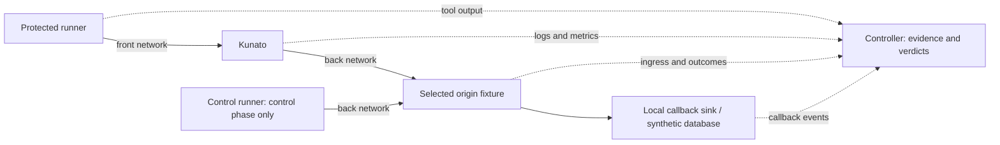

# Local adversarial testing lab

Status: design selected on 2026-10-24. The recording origin, curated goTestWAF,
DVWA/sqlmap, the CVE-2021-41773/Nuclei fixture, ffuf path discovery and
enumeration behavior, an authenticated ZAP spider/passive baseline, 25
deterministic mutation variants, and a pinned OWASP CRS 4.3.0 comparison are
available, together with 12 raw protocol/WebSocket cases, benign
JSON/upload/i18n/large-body/streamed-response/GraphQL/auth workflows, slow-HTTP,
availability-boundary, slow-connect, ban-recovery, and WebSocket lifecycle probes,
a pinned k6 v2.3.0 mixed availability load, and a restart-under-load probe; Rust
proxy tests cover HTTP/2 Rapid Reset,
CONTINUATION, an oversized HPACK header block, a malformed raw HTTP/3 request
stream, hot reload under load, and rules update plus reload under load. See
[lab usage](../lab/README.md) and the
[testing model](security-lab-testing-model.md). ZAP active scanning is deferred:
ZAP 2.17.0 exits at activeScan start even in an endpoint-scoped plan (code 2, empty
report), and the pinned image and Docker Hub `latest` share the same digest. This document describes the
complete target design and the implemented evidence, not achieved coverage for
arbitrary applications.

## Decision

Use a disposable local Linux VM with Docker Engine and Compose for vulnerable
applications and attack tools. Start with **goTestWAF, Nuclei, and sqlmap**, plus
Kunato's existing black-box runner. Add ZAP, ffuf, deterministic mutation, the
optional OWASP CRS comparison, and protocol/availability sandbox suites after
per-case evidence collection works. The implemented ZAP plan covers form login,
spidering, and passive discovery; the active-scan plan must be revisited when
the authenticated fixture no longer aborts ZAP 2.17, and the passing
active-injection controls remain sqlmap/Nuclei/goTestWAF.

These are development dependencies: Kunato still deploys as one binary and one
configuration file. The core tools run locally without a paid service. Selection
is based on documented capabilities, not a claim about attacker market share.

For concrete attacker-use evidence, [US-CERT's SQL injection testing guide](https://www.cisa.gov/sites/default/files/publications/Practical-SQLi-Identification.pdf)
documents sqlmap use in successful real-world compromises. This is historical
evidence; current capabilities are checked against maintainer documentation.

Broad scans discover candidates. Minimized, reviewed attack regressions paired
with nearby legitimate requests decide whether a change can ship.

## Existing foundation

| Component | Reuse and extension |
| --- | --- |
| `lab/` | Isolated recording/DVWA/CVE fixtures, pinned attack tools and k6, direct controls, fail-closed verdicts, and retained evidence for the implemented milestones. |
| `scripts/blackbox-test.sh` | Already builds binaries, removes `trusted-sources`, starts Kunato/upstream, replays both corpora, and retains logs. Add case-level evidence around this foundation. |
| `blackbox/src/main.rs`, `h2c.rs`, `hpack.rs` | Dependency-free HTTP/1.1 and h2c replay with selected HPACK/header probes. Keep simple replay cases here. |
| `examples/upstream.rs` | Useful forwarded-request inspector. Introduce a separate bounded recording fixture for lab observations. |
| `scripts/blackbox-report.py` | Status summaries and aggregate upstream access-count checks. Extend the verdict model before applying it to real applications. |
| `tests/proxy.rs` | Existing protocol, HTTP/3, WebSocket, response, limits, identity, and behavior tests are the home for deterministic engine regressions. |
| Coverage documents and daily CVE workflow | Reuse intake, tracking, and the existing deterministic black-box gate. |

The current report treats non-2xx attack responses as blocked and cross-checks
aggregate upstream access counts. This works with the controlled example origin;
it cannot establish exploit prevention against arbitrary applications. Origin
errors, response-phase blocks, unrelated bans, and incomplete observation need
separate verdicts.

Ordinary CI currently runs for pushes and Dependabot pull requests and does not
run the black-box script. General PR gating is an implementation task. The
daily CVE workflow already runs the script.

## Tool selection

| Tool | Decision and purpose | Evidence and limits |
| --- | --- | --- |
| [goTestWAF](https://github.com/wallarm/gotestwaf) | Initial: sweep payloads, placements, encodings, and benign samples | Finds signature misses and false blocks against a recording origin. Forwarding does not prove exploitation; review whether an encoding has meaning to the application. |
| [Nuclei](https://docs.projectdiscovery.io/opensource/nuclei/running) | Initial: selected HTTP CVE templates with matching vulnerable fixtures | Confirm the direct exploit first. Empty output against a generic mock cannot establish protection. |
| [sqlmap](https://sqlmap.org/) | Initial: SQL injection and selected tamper variants against DVWA | Compare actual injection outcomes. Separate cache/session directories; validate authentication and timing stability. |
| [ZAP Automation Framework](https://www.zaproxy.org/docs/automate/automation-framework/) | Second: authenticated workflows, OpenAPI/GraphQL import, active scanning | Use explicit automation plans. Baseline scanning analyzes traffic passively; an active-scan plan is needed to exercise injection defenses. |
| [ffuf](https://github.com/ffuf/ffuf) | Second: bounded path/parameter discovery and enumeration behavior | Distinguish origin 404s from blocks, and retain planned/sent accounting rather than only filtered discoveries. |
| Existing corpus plus bounded mutations | Second: encoding, case, delimiter, and placement variants | Use deterministic seeds and bounded expansion. Confirm that a variant still represents an attack or label it only a signature probe. |
| Raw clients and existing Rust protocol helpers | Third: framing, request smuggling, H2/H3 translation, and connection isolation | Observe actual bytes and origin boundaries; ordinary clients can repair malformed requests. |
| [k6](https://grafana.com/docs/k6/latest/using-k6/thresholds/) | Implemented: normal baseline and mixed attack/normal availability | Assert successful normal workflows, latency, and recovery. Throughput alone is not a DoS verdict. |
| [slowhttptest](https://github.com/shekyan/slowhttptest) | Optional reference: slow HTTP/1.x headers/body/read scenarios | The lab's bounded raw-socket probe (`lab/probe.py slow`) covers the required slow run; slowhttptest is not part of pinned execution. The classic binary does not cover H2/H3 attacks. |

Configure goTestWAF to save JSON/HTML locally with `--noEmailReport`. Use the
normal Go client initially and `--addDebugHeader` for correlation where valid.
Calibrate its pass/block statuses for the fixture; origin evidence settles
disagreements. Keep resets unresolved until intentional rejection and process
health are verified. Never copy an instruction to allowlist the attacking source
in a way that bypasses the protection being measured.

Pin Nuclei's engine and templates independently. Use reviewed template IDs,
machine-readable findings, loaded-template accounting, errors, and request
counts. Findings JSONL alone does not prove which cases ran. Disable update
checks/downloads, cloud uploads, and public Interactsh during execution. Initially
exclude code, JavaScript, headless, network, and unrelated protocol templates.
Review raw HTTP templates separately. Verify upstream signatures; record hashes
and provenance for local adaptations rather than treating modified files as
upstream-signed templates.

Begin sqlmap with one known injectable parameter and deterministic boolean/UNION
cases. Add curated tamper variants and timing tests after measuring stability.
A synthetic database canary is enough to prove impact; no interactive shell or
database takeover is required for the acceptance test.

| Alternative | Decision |
| --- | --- |
| [Burp Repeater](https://portswigger.net/burp/documentation/desktop/tools/repeater) | Optional manual request inspection and minimization. ZAP supplies the initial automated application-scanning workflow without a commercial scanner dependency. |
| [OWASP CRS and go-ftw](https://coreruleset.org/docs/index.print) | Second-stage payload source and optional reference WAF. Adapt HTTP inputs and expectations: tests can depend on CRS rule IDs, audit logs, and server configuration. |
| [h2spec](https://github.com/summerwind/h2spec) | Optional HTTP/2 conformance baseline for RFC 7540/7541. Reconcile current protocol expectations and intentional limits; this is not an exploit or HTTP/3 suite. |
| [h2load](https://nghttp2.org/documentation/h2load.1.html) | Optional H2 throughput measurement, separate from targeted reset/CONTINUATION attacks. |
| `slowhttptest-ng` | Upstream describes H2 and QUIC attacks in a beta rewrite. Evaluate pinned source and verdicts separately before using it as a release gate. |
| Metasploit/public exploit repositories | Use individual reviewed modules when a selected CVE cannot be reproduced with Nuclei or raw replay. Defer the framework as a default dependency. |
| Nikto, Nmap, Hydra, Kali Linux | Defer the bundle: overlapping scanners, port discovery, and password guessing contribute less to the initial WAF regression loop than payload and protocol evidence. |

## Local environment



Use two traffic networks plus a data-only network, each with `internal: true`.
The protected runner joins only `front`, the fixtures and direct controls join
`back`, and Kunato joins both. DVWA joins `back` and `data`; the database joins
only `data`. Create a short-lived runner on `back` for direct positive controls
and destroy it before the protected phase. Fixture/database ports are never
published. Only optional manual Kunato ports bind to VM loopback; include UDP
for HTTP/3. Collect admin metrics from loopback inside Kunato's network
namespace.

Compose's internal network is external network isolation, not a VM boundary or
proof of host-service isolation. Preflight checks IPv4/IPv6 routes, DNS, redirects,
host/gateway services, and outbound callback attempts. The VM firewall denies
access outside declared lab services. Test workloads cannot access the controller
or Docker socket. Do not use host networking or put a normalizing reverse proxy
in front of raw protocol tests.

Separate preparation from execution. Download approved binaries/images/templates
and record digests during preparation. Execute offline from these frozen inputs
with automatic rule/template refresh disabled. Blind SSRF/XXE tests use a local
HTTP/DNS sink and reviewed template substitutions. Unadapted public-OAST templates
are skipped with a reason, not passed.

Start planning with 4 vCPUs and 8 GiB RAM and run one vulnerable application at a
time. This is a proposed budget, not a measured requirement. Set per-service CPU,
memory, process, connection, disk/log, and wall-clock limits and calibrate them
using observed runner and target resource use.

## Fixtures and comparison controls

| Fixture | Purpose and proof |
| --- | --- |
| Bounded recording origin | Signature sweeps. Record receipt before reading the full body, identity, method/target/headers, bounded body evidence, and a unique origin marker. Include API/form endpoints rather than only `/`. |
| [DVWA](https://github.com/digininja/DVWA) and its database | Initial sqlmap fixture. Fix revision, security level, authentication, database seed, and synthetic canary query result. |
| [OWASP Juice Shop](https://devguide.owasp.org/en/07-training-education/01-vulnerable-apps/01-juice-shop/) | Second-stage JavaScript/API/browser workflows and selected injection challenges. Use business-logic cases to document WAF boundaries. |
| Selected [Vulhub](https://github.com/vulhub/vulhub) environment or vendor reproduction | One pinned fixture per selected CVE. Check the affected version and reproduction against the vendor advisory; merely starting the environment proves nothing. |
| Lab Apache 2.4.49 CVE-2021-41773 fixture | A pinned, lab-only canary image built from the pinned `httpd:2.4.49` base and a reviewed Dockerfile. The direct Nuclei control must extract the canary; the protected attempt must not. It is not a general-purpose vulnerable application. |
| Controlled response/protocol fixtures | Response leaks, malicious upstream headers, incomplete bodies, ambiguous framing, and sentinel requests; reuse integration helpers where practical. |

Reset database/files/uploads, sessions, callback events, and Kunato state between
control/protected attempts and state-mutating cases. Do not compare concurrent
sandbox suites that modify the same fixture. Keep application authority, settings,
authenticated role, and protocol prerequisites equivalent; use runner-local
DNS/connection routing changes rather than a different application virtual host.
Use local test certificates and record actual ALPN/HTTP version. Silent protocol
fallback does not count as an H2/H3 test.

## Sandbox suite profiles

| Profile | Configuration and claim |
| --- | --- |
| Signature discovery | Remove the entire `trusted-sources` category: Docker private addresses match it too. Disable automatic protection; isolate or explicitly disable YAML rule-level throttles in an archived lab profile when they interfere. Keep other guards unless the case explicitly varies them. |
| Scanner identification | Preserve default tool fingerprints and attribute blocks to their actual rules. This measures scanner recognition separately. |
| Payload efficacy | Use a fixed ordinary User-Agent and verify that templates did not override it. Every relevant attack runs here even if default fingerprints already trigger a block. |
| Protection/behavior | Enable intended rate/connection/ban settings and remove matching `protection.allowlist` entries. Check thresholds, windows, recovery, and normal traffic from a separate source. The ffuf behavior phase uses an explicit enumeration `BLOCK` profile and a long-lived normal client whose address cannot reuse the banned runner. |
| Workflow/discovery | Authenticate through the form and spider/passively scan the application with ZAP; run bounded ffuf path discovery with the same wordlist directly and through the WAF. Require receipts, status/length parity, LOG/block events, and a separate normal source. ZAP active scanning is attempted but not part of a passing plan: ZAP 2.17.0 exits at activeScan start even with a scoped context and `failOnError: false`. |
| Mutation/reference | Run reviewed seed/transform variants (case, comments, whitespace, body formats, parameter pollution, alternative tags, dot padding, shell metacharacters, headers) with direct controls, no origin receipts on blocks, and benign near-misses. Optionally compare the same corpus through a pinned OWASP CRS proxy; report agreement as an observation, not a gate. |
| Full configuration | Run intended rules and policies with explicit lab addresses/keys and no trusted test sources; assert complete legitimate workflows and actual rejection reasons. |

`--disable-protection` does not disable YAML rule-level limits. A later ban or
rate-limit response cannot establish SQLi/XSS detection. Archive the full effective
configuration and its diff from the example.

Use distinct runner addresses for attackers and normal clients. Different
`X-Forwarded-For` values from one untrusted runner do not simulate independent
clients. Test trusted proxy identity in a dedicated scenario, including forged
headers from untrusted peers. Keep a separate shared-NAT scenario.

Behavior defaults include LOG-only signals. Assert logs/metrics for those defaults;
use an explicit opt-in BLOCK profile for enforcement tests.

## Verdicts and reporting

Declare each claim before running: `request-rejection`, `exploit-prevention`,
`response-containment`, `availability`, or `observation`. Keep their results
separate instead of presenting one overall security percentage.

| Observation | Verdict |
| --- | --- |
| Attack reaches a recording origin in a request-rejection case | `gap`, even if the origin returns an error |
| Expected Kunato rejection, no forbidden origin receipt, healthy normal probe | `prevented` for the declared request-rejection claim |
| Direct exploit succeeds and the protected exploit also succeeds | `gap` for exploit prevention |
| Direct exploit succeeds; protected attempt shows a verified preventive mechanism and no exploit outcome | `prevented` for that bounded scenario, with its mechanism recorded |
| Origin executes the attack but a response rule hides the result | `contained` for disclosure only; exploit prevention remains `gap` |
| Direct exploit fails, setup/authentication breaks, or observations disagree | `inconclusive`, never defense success |
| Reset/timeout without intentional rejection, process health, and origin evidence | `inconclusive` or availability failure |
| Legitimate workflow fails, returns wrong data, or is rejected | `false-block` or functional regression, even with HTTP 200 |
| Selected case does not execute or lacks a supported fixture | `skipped` with a reason, not passed |

For stateful tools, prove the direct exploit, reset, and run the same bounded
sandbox suite through Kunato. Discovery sequences can diverge after a block; preserve
the directly successful exchange and minimize it into an exact replay for causal
comparison. Repeat controls afterward to detect fixture drift.

Correlate `(run_id, case_id, attempt_id)` with a lab header, goTestWAF's debug
header, or a safe canary when valid. Rules must never depend on these IDs. If an
extra header changes a malformed attack, serialize cases and correlate transport
connections/streams instead. Retain sent bytes separately from origin-parsed
requests. Application logs can miss parser-rejected bytes and incomplete bodies;
raw cases need bounded origin-side capture or equivalent instrumentation. Failed
log collection makes a case inconclusive.

Retain under `target/security-lab/<run_id>/`:

- Kunato commit/binary hash, effective rule/config hashes, tool/image versions,
  template IDs/revisions, fixture versions, architecture, and mutation seed;
- planned, loaded, attempted, completed, skipped, and errored case counts;
- commands/settings, original/minimized requests, raw reports, origin ingress and
  outcome events, callbacks, relevant Kunato logs, and metric deltas;
- reset/preflight results, bounded captures, resource samples, normal-client
  assertions, and verdicts linked to their evidence.

Show misses over completed valid block cases and false blocks over completed
valid benign cases. Report skips/errors/inconclusive cases alongside both
denominators, broken down by family, placement, encoding, fixture, and protocol.
Missing or inconclusive mandatory regressions fail the gate. Broad discovery
sandbox suites can have open gaps; preserve and triage them rather than redefining
the expected result to improve a score.

## Measure, fix, and retain the regression

1. Select an existing gap, reproducible tool finding, or CVE candidate. Prioritize
   reachable, high-impact cases with an observable outcome; use deployed stacks,
   KEV, and EPSS to order CVEs. Define the claim and configuration prerequisites.
2. Freeze tool/template/fixture/rule revisions, seed, and request/time budgets.
   Verify routing, health, identity, and direct controls. A recording origin needs
   receipt controls; an exploit fixture needs an actual exploit outcome.
3. Reset and run the protected ordinary-UA sandbox suite, then the separate default
   fingerprint sandbox suite if useful. Maintain a normal-client probe for availability.
4. Triage: missing/overbroad signature, normalization/decoding error, protocol or
   resource bug, opt-in policy, fixture/tool defect, application-only issue, or
   inconclusive evidence. A base64 variant that the application never decodes is
   not automatically an exploitable bypass.
5. Minimize a confirmed failure and add its failing regression plus a nearby
   benign guard before fixing it. Use existing corpora for expressible requests;
   use integration tests or versioned lab cases for raw/stateful/response cases.
6. Fix the appropriate layer: stable request feature in a reusable rule;
   parser/decoding/resource behavior in the engine; endpoint-specific policy in
   scoped local configuration. Authorization/business-logic flaws need application
   fixes; blocking normal object IDs does not solve them.
7. Re-run the small case, benign guards, full corpus, relevant integration tests,
   and original bounded tool sandbox suite. A single hard-coded sample is insufficient.
8. Update `docs/attack-coverage.md` when coverage/evidence changes and
   `docs/cve-coverage.md` for reviewed CVEs. Keep conditional mitigations Partial
   and application patch requirements visible. Scanner scores cannot promote an
   entire attack class to Covered.
9. For rule changes, run `scripts/update-dist-rules.sh`, configuration validation,
   and `scripts/check-rules-compat.sh`. New schema fields/targets/phases require a
   compatible binary release before managed rules can use them.
10. Run required checks in order: `cargo fmt`,
    `cargo clippy --all-targets -- -D warnings`, `cargo deny check`, and
    `cargo test`, plus blackbox formatting/lint when it changes. This design
    does not authorize automatic commits, pushes, or releases.

CVE additions to `blackbox/requests/` still require CVSS base score >= 7.0 and an
HTTP-reproducible attack. General attack-class regressions and benign guards are
separate from CVE eligibility. Track lower-scoring CVEs as watch/out-of-scope;
do not bypass the policy by relabeling a CVE-specific example.

Benign guards should include names with apostrophes, international text, benign
encoded values, valid JSON/GraphQL, multipart uploads, and legitimate 302/401/404
responses. Test SQL/tutorial text in explicitly configured content routes while
ensuring the exemption cannot bypass checks on public parameter endpoints.

## Protocol and availability sandbox suites

Cover HTTP/1.1 CL/TE conflicts and connection reuse, H2 HPACK/CONTINUATION and
reset behavior, H2/H3-to-origin translation, H3 malformed heads/bodies, and
WebSocket handshake/tunnel lifecycle. Check sentinel request boundaries and
effects on another connection. A WebSocket handshake check does not imply
inspection of subsequent tunnel messages.

Extend existing Rust raw/H3 integration fixtures first; justify any new external
protocol client. Smuggling requires evidence that the actual proxy-origin pair
interpreted an unintended request, rather than only an unusual status or timeout.

Measure a normal-only baseline, then mix bounded attack traffic with a distinct
normal source. Collect normal semantic success, p95/p99 latency, Kunato CPU/RSS,
connections/file descriptors, target health, ban/recovery timing, and generator
saturation. Separate intended attack 403/429 responses from normal-client errors.

The implemented defaults are a 50 requests/second, 60-second k6 mixed
availability run with 8 separately capped slow connections, concurrent normal
probes, and immediate recovery checks. The k6 thresholds are p95 < 200 ms,
p99 < 500 ms, failed requests < 1%, and checks > 99%; the judge also requires
200 from the normal and recovery probes, no Kunato restart, and RSS under the
256 MiB ceiling. These are fixed-runner starting budgets, not capacity claims.

Set deadlines and hard resource ceilings before execution. Abort and retain
diagnostics for OOM, restarts, sustained normal-source failure, or lost observation.
Verify recovery within the configured ban/timeout window plus a stated margin and
healthy independent-source traffic during that window. Establish performance
thresholds from repeated fixed-runner baselines; shared-CI numbers remain trends
until variance is understood. Local multi-source tests do not demonstrate
resistance to Internet link saturation or a distributed botnet.

## Implementation sequence

The implemented paths are below; additional tool/fixture plans are added as
their controls and outcome evidence become available:

```text
lab/
  compose.yaml          # Networks and one-at-a-time fixture/tool services
  artifacts.lock.json   # Tool/image/template/fixture revisions and hashes
  cases/                # Controls, scenario metadata, and expected outcomes
  fixtures/             # DVWA setup and the lab-only CVE fixture
  templates/            # Reviewed Nuclei template adaptations
  plans/                # Generated scanner, workflow, and mutation settings
scripts/security-lab.sh  # prepare, verify, run, report, and down operations
target/security-lab/    # Generated evidence and temporary state
```

Use Compose and small orchestration scripts; reuse integration helpers and
existing reporting. Check `Cargo.toml` before justifying any new crate. Keep
downloaded third-party corpora outside Git and preserve provenance/licenses when
importing reviewed samples into repository regressions.

Milestones 1-4 are implemented with one ZAP limitation: recording origin,
goTestWAF, DVWA/sqlmap, the CVE-2021-41773 canary, ffuf
discovery/enumeration, the authenticated ZAP spider/passive baseline, 25
deterministic mutation variants, the optional OWASP CRS comparison, 12
protocol/WebSocket cases, benign workflows, the slow-HTTP, availability,
slow-connect, ban-recovery, WebSocket lifecycle, and restart-under-load probes,
and the k6 mixed load pass. Rust
proxy tests cover HTTP/2 Rapid Reset, CONTINUATION, oversized HPACK, malformed
raw HTTP/3 streams, hot reload under load, and rules update plus reload under
load. ZAP active scanning remains deferred because ZAP 2.17.0 exits at activeScan start even in an endpoint-scoped plan; no newer stable image is published.

| Milestone | Deliverable and acceptance evidence |
| --- | --- |
| 1. Evidence foundation | Networks, version lock, reset/preflight, recording origin, case report. Valid requests are observed, known blocks are absent, private-source ALLOW is removed, and broken controls/collection fail the run. |
| 2. Initial attack loop | goTestWAF, DVWA/sqlmap, one selected high-severity HTTP CVE fixture/Nuclei template. Direct controls succeed; ordinary-UA results have evidence; confirmed failures become attack/benign regression pairs, or a bounded no-gap result is recorded. |
| 3. Workflows and variants | ZAP, ffuf, deterministic mutations, optional CRS comparison. Authenticated/API/upload journeys pass; retained variants have meaningful interpretation and seeds. Implemented: ffuf discovery/enumeration, the authenticated ZAP spider/passive baseline, and 25 mutation variants whose 15 attacks are blocked and 10 benign cases pass; the CRS 4.3.0 comparison agrees on all 25. ZAP active scanning is deferred: an endpoint-scoped plan still exits at activeScan start with ZAP 2.17.0. |
| 4. Protocol/availability | Implemented: 12 raw HTTP/1.1/WebSocket cases with per-framing direct controls (4 passed, 8 prevented), benign JSON/upload/i18n/large-body/streamed-response/GraphQL/auth/slow-stream workflows (8 passed), a bounded 8-connection/2-second slow run (2 passed), availability probes for slow body, slow read, the per-source and global connection caps, and upstream-response timeout (9 passed), a slow-connect suite (3 passed), ban recovery (5 passed), the WebSocket control/fragmentation/close lifecycle (6 passed), a restart-under-load suite (4 passed), and a 50 rps/60-second k6 mixed run (6 passed: 3001 requests, p95 47.9 ms, p99 48.2 ms, 100% success, normal/recovery 200, RSS 21.8 MiB, no restart, metrics matched). Rust proxy tests cover HTTP/2 Rapid Reset, CONTINUATION, oversized HPACK, malformed raw HTTP/3 streams, hot reload under load, and rules update plus reload under load. Protocol and origin-boundary evidence, independent normal source, measured resources, and recovery are required. |
| 5. Continuous regression | Fast PR gates, scheduled discovery, release smoke tests. Mandatory cases cannot silently skip and reports reproduce locally. |

| Cadence | Workload and gate |
| --- | --- |
| Relevant PRs | Required repository checks, full existing attack/benign corpus, then the stable lab replay, mutations, protocol, slow, availability, connect, ban, websocket, load, restart, goTestWAF, sqlmap, Nuclei, ffuf, and ZAP baseline sandbox suites, plus the optional CRS comparison, run locally before push. CI runs the lab observation tests and shellcheck wrappers, not the bounded sandbox suites. Zero new misses/false blocks and no missing/inconclusive mandatory cases. Enable ordinary PRs as well as Dependabot. |
| Daily/on demand | Existing CVE intake plus selected template/fixture smoke tests with pinned inputs. Promote confirmed findings into reviewed regressions; do not demand 100% of an unreviewed public scanner catalog. |
| Weekly/on demand | Larger ZAP/ffuf/mutation sandbox suites and protocol/load sweeps, with a triaged backlog of gaps, unsupported inputs, and application-only cases. |
| Before release | Stable regressions, representative fixture controls, protocol/availability on a fixed runner, rule compatibility, and archived evidence. |

Update images/templates as separate reviewed input changes. Account for added,
removed, and skipped cases and re-establish controls before comparing scores.
An optional ModSecurity/CRS lane is a reference, not Kunato's specification.

The daily CVE workflow has a file-change allowlist and can commit passing changes
directly. Keep exploratory lab work in a separate review/workflow path initially.
Integration requires explicit changes to its file allowlist, documentation gates,
and publication behavior; this design does not silently broaden its authority.

## Primary references

Linked maintainer documentation and READMEs were reviewed on 2026-10-24.
Additional references supporting the design:

- [Docker Compose internal networks](https://docs.docker.com/reference/compose-file/networks/#internal)
- [Nuclei template signing](https://docs.projectdiscovery.io/templates/reference/template-signing)
- [Nuclei unsafe/raw HTTP](https://docs.projectdiscovery.io/templates/protocols/http/unsafe-http)
- [ZAP Docker scan types](https://www.zaproxy.org/docs/docker/)
- [OWASP authorization testing](https://wstg.owasp.org/v4.2/4-Web_Application_Security_Testing/05-Authorization_Testing/02-Testing_for_Bypassing_Authorization_Schema/)
- [OWASP business-logic testing](https://wstg.owasp.org/v4.2/4-Web_Application_Security_Testing/10-Business_Logic_Testing/00-Introduction_to_Business_Logic/)
